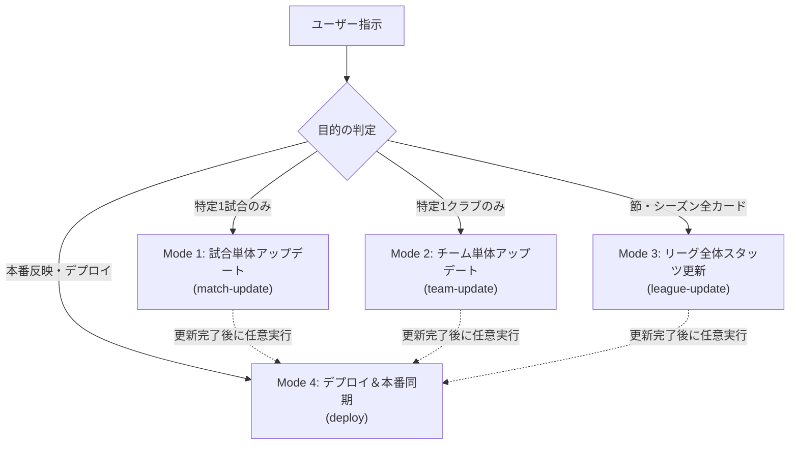

# Jリーグ観戦ガイドRAG サイト運用統合スキル (`site-operations`)

本スキルは、Jリーグ戦術分析・観戦ガイドRAGシステムにおいて、
データの最新化から戦術分析レポートの生成、フルテスト検証、Gitプッシュ、
Streamlit Community Cloud（スマホ実機・Web）への反映までを一貫して安全に行うための標準運用プロトコルです。

関心事と実行コストを最適化するため、**4つの独立運用モード**に分かれています。

---

## 1. 共通安全制約・運用ルール (Safety Constraints)

エージェントはいかなる場合も以下の厳格なルールを遵守しなければなりません。

1. **勝手にコミット・プッシュしない**:
   - コミットおよびプッシュは、必ず事前にユーザーへ報告し、明示的な許可・指示（「コミットして」「プッシュして」等）を得てから実行する。
2. **コミット前のフルテスト必須 (100% Pass Guardrail)**:
   - コミット前に必ず `python -m unittest discover tests`（365件以上）を実行し、1件のエラーも許容しない。
3. **かっこの閉じ漏れ防止・コード品質**:
   - メソッドや関数のネストを深くせず、細かくモジュールに切り出す。
   - 末尾カンマを徹底し、構文チェック（`python -m py_compile <file>`）を必ず通過させる。
4. **Git Rebase とバイナリコンフリクト解決**:
   - リモート（GitHub Actionsの定期更新等）と分岐した場合は、`git pull --rebase origin main` を使用する。
   - `data/football.db` 等のバイナリファイルでコンフリクトが発生した場合は、最新データを保持している側（`git checkout --theirs <file>`）を採用して `git rebase --continue` する。
5. **事実と推測の厳格分離**:
   - レビューや分析レポートでは、常に【事実】（客観スタッツ）と【推測】（戦術的仮説）を明確に分離して出力する。

---

## 2. 4つの運用モード概要 (Operational Modes)



---

## 3. Mode 1: 試合単体アップデート (`match-update`)

### ■ ユースケース
- 「第13節の岡山vs東京のスタッツを最新化して」
- 「昨日の〇〇戦のデータとレビューを作って」

### ■ 実行プロトコル
1. **DB試合・選手・イベントデータの投入**:
   - `data/football.db` に実名選手（スタメン11名＋ベンチ選手：背番号、ポジション、出場分数、得点、アシスト、CBP、走行距離、スプリント）とマッチイベントを登録。
   - 文字化けやNoneを徹底排除する。
   ```bash
   # 例: スクリプトによる投入
   python scripts/import_mwXX_data.py
   # または即時インジェスト
   python scripts/ingest_matchday_immediate.py --match-id <MATCH_ID>
   ```

2. **戦術構造化JSONの生成**:
   - `pipeline/match_tactical_enricher.py` を通じて、`data/structured/{match_id}_tactical.json` を生成。
   - `match_context`（過密日程・中◯日、移動距離、累積警告、負傷者、契約条項）が正常に含まれていることを確認。

3. **Layer 2指標に基づく仮説導出レビューの生成**:
   - `pipeline/review_curation_service.py` を呼び出し、Layer 2客観スタッツ（スプリント数・走行距離の差異、CBPトップ選手のハブ機能、xGと枠内シュート比率）から試合の因果関係と戦術的仮説（Hypothesis 1〜3）を自動導出。
   - `exports/{match_id}_review_curated.md` に保存。

4. **4大外部リンクの生成確認**:
   - `pipeline/external_links.py` により、YouTube公式ハイライト、ホーム公式レビュー、アウェイ公式レビュー、Yahoo!速報、Football LABスタッツのリンクが正常に解決されることを確認。

---

## 4. Mode 2: チーム単体アップデート (`team-update`)

### ■ ユースケース
- 「FC東京の所属選手とスタッツ一覧を更新して」
- 「岡山の怪我人と警告累積状況を反映して」

### ■ 実行プロトコル
1. **クラブ選手名鑑・個人スタッツの更新**:
   ```bash
   python scripts/export_team_players_sheet.py --team <TEAM_ID>
   ```
   - `exports/players/{TEAM_ID}_players.xlsx` およびログCSVを最新化。

2. **前提コンテキスト（負傷者・出場停止・契約条項）の更新**:
   - `config/injury_tracker.json`（負傷者リスト）
   - `config/loan_restrictions.json`（育成型・期限付き移籍の対戦不可条項）
   - `pipeline/match_context_service.py` で次節の警告リーチや連戦疲労度を再計算。

3. **チーム戦術プロファイルの更新**:
   - `knowledge/team_tactical_profiles.json` の基本フォーメーション、プレッシング方針、ビルドアップスタイルを調整。

---

## 5. Mode 3: リーグ全体スタッツ更新 (`league-update`)

### ■ ユースケース
- 「第13節の全10試合をすべて取り込んでカルテを再構築して」
- 「全チームの構造化JSONを最新スタッツで一括更新して」

### ■ 実行プロトコル
1. **全10試合のDB一括取り込み**:
   - `data/football.db` の `matches` テーブルに全10カードのスコア・入場者数・天候・スタジアムを反映。

2. **全構造化戦術JSONの一括再構築**:
   ```bash
   python scripts/rebuild_all_tactical_structures.py
   ```
   - 2026シーズン全節の試合に対して、`data/structured/{match_id}_tactical.json` を最新の戦術ロジックと `match_context` 付きで一括再生成。

3. **全節戦術カルテ・シーズン統合分析の更新**:
   - `exports/J1_2026_全節戦術カルテ.md`
   - `scripts/batch_update_all_teams_tactics.py` による全クラブのシーズン戦術カルテ同期。

---

## 6. Mode 4: デプロイ＆本番同期 (`site-deploy`)

### ■ ユースケース
- 「テストしてコミットして」
- 「GitHubにプッシュして本番（Streamlit Cloud）に反映して」

### ■ 実行プロトコル（安全ゲートウェイ）
1. **コード構文・かっこの閉じ漏れチェック**:
   ```bash
   python -m py_compile app.py pipeline/*.py agent/*.py
   ```
2. **単体テスト・関連テストの検証**:
   ```bash
   python -m unittest tests/test_external_links.py tests/test_spec_conformance.py tests/test_review_curation_service.py tests/test_dashboard_helpers.py
   ```
3. **プロジェクト全体のフルテスト実行 (必須)**:
   ```bash
   python -m unittest discover tests
   ```
   - **判定**: `Ran 365+ tests ... OK` を確認する。1件でもFAILがある場合はデプロイを即座に中断して修正する。
4. **Git リモート差分の確認と Rebase 統合**:
   ```bash
   git status
   git log -n 3 origin/main
   git pull --rebase origin main
   ```
   - DBやバイナリのコンフリクト発生時は、最新化済みのローカルデータ（`git checkout --theirs data/football.db`）を採用して `git add` し `git rebase --continue` を実行。
5. **コミット & プッシュ**:
   - 分かりやすく明確なコミットメッセージ（Conventional Commits形式: `feat:`, `fix:`, `data:`）でコミット。
   ```bash
   git push origin main
   ```
6. **Streamlit Community Cloud 稼働確認**:
   - URL: `https://footballrag-qseuzwydrcsehqql3kuyl8.streamlit.app/`
   - デプロイのトリガー確認と、ユーザーへの確認ポイント（スマホ実機での表示、新設リンク、最新節データ）の案内。

---

## 7. モード連携ショートカット

ユーザーが複数のアクションを一度に求めた場合は、以下の順序で連動させます。

- **「試合更新してデプロイまでやって」**:
  `Mode 1` (試合更新 & 仮説レビュー) ➔ `Mode 4` (フルテスト ➔ コミット ➔ プッシュ)
- **「チーム情報更新して反映して」**:
  `Mode 2` (チーム名鑑・コンテキスト更新) ➔ `Mode 4` (フルテスト ➔ コミット ➔ プッシュ)
- **「節全体のデータ更新して反映して」**:
  `Mode 3` (リーグ全試合・カルテ一括更新) ➔ `Mode 4` (フルテスト ➔ コミット ➔ プッシュ)
