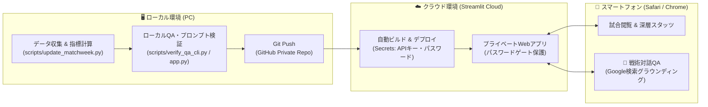

# Jリーグ戦術分析・観戦ガイドRAG クラウド運用＆モバイル連携ガイド
*(Cloud Deployment, Mobile QA & Operation Guide)*

---

## 1. 運用アーキテクチャ概要

本システムは「**ローカル（PC）でのデータ収集・分析更新・検証**」と「**クラウド（Streamlit Cloud）経由でのスマホ閲覧・対話QA**」を完全分離・同期するハイブリッド運用を採用しています。



---

## 2. 初回セットアップ：クラウドデプロイ手順（所要時間：約3分）

### Step 1: GitHub Privateリポジトリにプッシュ
1. 本プロジェクトをGitHubのプライベートリポジトリとして作成・プッシュします。
   ```bash
   git add .
   git commit -m "feat: Add tactical QA engine and mobile chat interface"
   git push origin main
   ```
   > [!NOTE]
   > リポジトリを **Private（非公開）** にしておくことで、収集したデータやコードが外部に公開されません。

### Step 2: Streamlit Community Cloud と連携
1. [Streamlit Community Cloud](https://share.streamlit.io/) にアクセスし、GitHubアカウントでサインイン。
2. **「New app」** をクリック。
3. 以下を指定：
   - **Repository**: あなたのGitHubリポジトリ（Privateリポジトリを選択可能）
   - **Branch**: `main`
   - **Main file path**: `app.py`
4. **「Deploy!」** をクリック。

---

## 3. Secrets設定（APIキー ＆ パスワード保護）

Streamlit Cloudのアプリ管理画面（右下の `Settings` ➔ `Secrets`）を開き、以下を貼り付けて保存します。

```toml
# Gemini APIキー（Google AI Studioで取得）
GEMINI_API_KEY = "AIzaSy..."

# スマホからのプライベートアクセス用パスワード（自由に決めてください）
APP_PASSWORD = "your-private-password-2026"
```

> [!IMPORTANT]
> - `APP_PASSWORD` を設定することで、URLを知っている第三者のアクセスを遮断し、自分専用のプライベートアプリとして運用できます。
> - ローカル環境（自分のPC）では `APP_PASSWORD` を `.env` に書かなければパスワード入力をスキップできます。

---

## 4. スマートフォンでの閲覧 ＆ QA利用方法

1. **URLの保存**:
   - Streamlit Cloudで発行されたURL（例: `https://your-app-name.streamlit.app`）をスマホのSafariまたはChromeで開きます。
2. **パスワード認証**:
   - 初回アクセス時、設定した `APP_PASSWORD` を入力してログインします（ブラウザを閉じても一定期間セッションが保持されます）。
3. **ホーム画面に追加（推奨）**:
   - Safariの共有ボタン（またはChromeメニュー）から **「ホーム画面に追加」** を選択すると、通常のネイティブアプリと同じ感覚でアイコンからワンタップ起動できます。
4. **対話QAの活用**:
   - 先頭タブ **「💬 戦術対話QA (Google検索)」** を開きます。
   - クイック質問ボタン（「🛡️ 守備課題と交代策」「🏥 過密日程と怪我影響」「🔭 次節への観戦レンズ」）をタップするか、自由入力で質問。
   - **「🌐 Google検索で最新情報を補完する」** にチェックを入れると、Geminiが最新のJ公式ニュース・怪我人リリース・監督コメントを自律検索して回答します。

---

## 5. 日々の運用ワークフロー（ローカル更新 ➔ クラウド反映）

試合終了後や週末のデータ更新は、ローカルPC上で以下のコマンドを実行するだけの**ワンアクション**です。

```bash
# 1. 試合データの収集・指標計算（例：第◯節の更新）
python scripts/update_matchweek.py --mw 13

# 2. ローカルでの動作・プロンプト検証（CLIまたはローカルapp.py）
python scripts/verify_qa_cli.py -m 20260228_tokyo_kashima -q "交代カードの効果は？"

# 3. クラウドへの自動反映（Git Pushするだけ）
git add data/
git commit -m "Update matchweek 13 data"
git push origin main
```

👉 **`git push` を行うと、Streamlit Cloud側が自動的に検知して再起動・最新データにリロードされます。**

---

## 6. コスト管理と注意点

1. **サーバー代**:
   - Streamlit Community Cloud: **0円（完全無料）**。
2. **LLM API代 (Gemini 2.5 Flash / 3.8 Flash)**:
   - 通常のQA：1回あたり約 **0.05円〜0.1円**。
   - Google検索連携：必要な質問時のみ画面上の「🌐 Google検索」チェックボックスをONにすることで、無駄な検索コストをほぼ0円〜月数十円に抑えられます。

