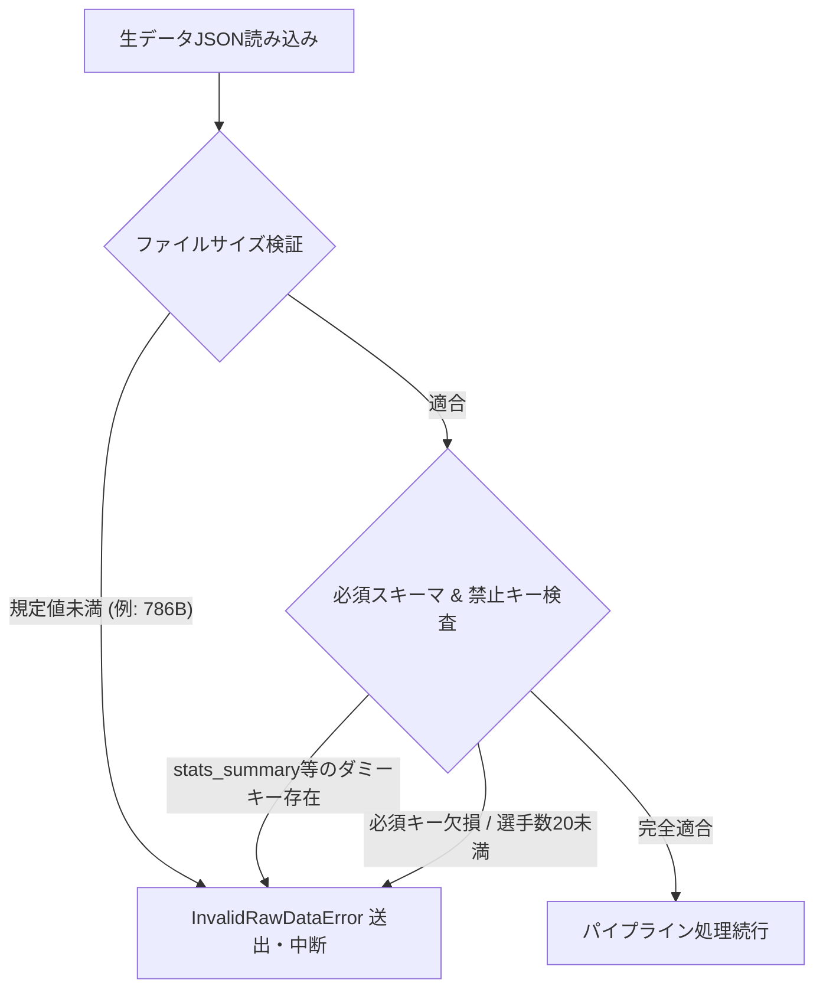
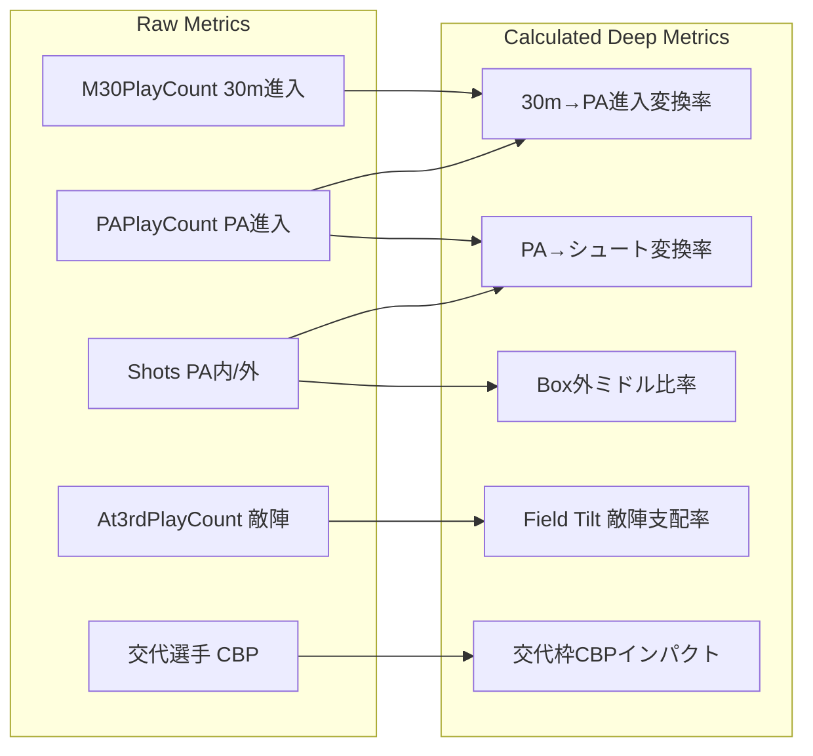
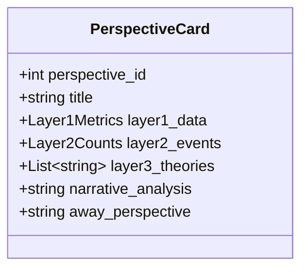
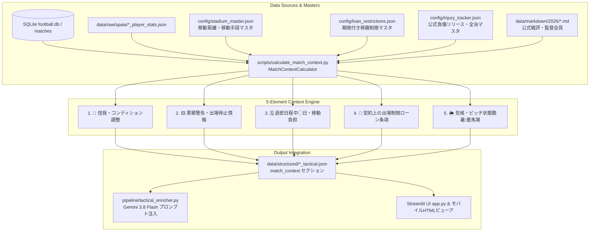

# Jリーグ戦術分析・観戦ガイドRAG：データ分析フェーズ完全定義書
*(Data Analysis Phase Rules & Output Specifications)*

本書は、Jリーグ（2026/27シーズン等）の試合データを対象とする**「データ分析フェーズ」の運用ルール、入力生データ制約、および全アウトプット項目の完全な出力内容・解像度**を定義した正本仕様書である。

---

## 第1章：データ分析フェーズの運用原則（5大ルール）

### ルール1：生データ100%根拠の原則（Zero Hallucination）
* 出力されるすべての数値（パス数・成功率、各エリア進入数、選手別CBP、走行距離、スプリント、シュート数、xG等）は、**必ずSPAIA・Football LAB・Yahoo!サッカー・J公式の生データ（Raw JSON / Markdown）から直接集計・算出した実数値のみ**を使用する。
* 「セカンドボールの回収をめぐる中盤のせめぎ合い」「ボランチの立ち位置を微修正」といった**固定テンプレート文の無差別な流し込みや、Gemini等の事前学習知識による作文は完全禁止**とする。
* 分析結果の各項目には、**「どのファイル（`data/raw/spaia/...`, `data/raw/football_lab/...`）のどの項目から導出したか」**のデータ出所・根拠指標を明確に紐付ける。

### ルール2：3層分離 ＆ 4要素必須の原則（4-Element Card）
15の多角分析観点のすべてにおいて、以下の**4つの要素**を例外なく出力する：
1. **【数値サマリと意味 (Layer 1)】**: 生データ実数値を提示した上で、**「その数字の落差がピッチ上で何を意味しているか」**の示唆サマリを記述する。
2. **【速報データ内具体集計 (Layer 2)】**: 単なる速報ログの引用ではなく、速報テキスト内に出現する事象（シュート、ブロック、クリア、クロス、ファウル、交代）の**発生分数・件数・関与選手実名・エリア内訳をカウント集計**して提示する。
3. **【戦術理論・因果推論 (Layer 3)】**: 有識者知見（ポジショナルプレー、5レーン、カウンタープレス、Game State論等）に基づく構造的解釈を記述する。
4. **【相手チーム（AWAY）視点の対等分析】**: ホームチームの一方的な賛美を排除し、**相手チームが何を狙い、どこで守備が狂い、どこに継続すべき光明があったか**を対等に検証する。

### ルール3：実名・具体的局面言及の原則
* 「選手」「守備陣」等の抽象的プレースホルダーは禁止。
* 出場選手（背番号・氏名）、途中交代選手、監督名を必ず名指しし、**「誰のどのパス」「誰のどのデュエル」「どの交代」が試合を動かしたか**を具体的に記述する。

### ルール4：深層指標（変換率・CBP格差・内外比率）の必須算出
* **進入変換効率（Conversion Rate）**: 「30m進入 → PA進入変換率（%）」および「PA進入 → シュート変換率（%）」を算出し、アタッキングサードのどこで詰まったかを数値化する。
* **選手別CBPトップ＆ワースト**: 全選手の「奪取」「守備」「攻撃」「パス」CBPをソートし、突出した選手と沈黙したユニット（途中組CBP合計等）を特定する。
* **シュート品質（Box内 vs Box外ミドル比率）**: シュート総数のうち「PA内シュート」と「エリア外ミドル」の内訳を必ず集計し、崩しの質を判定する。

### ルール5：プロ分析官レベルの文量担保原則
* サマリーや解説文は、簡易要約にとどめず、90分間の力学推移と勝敗の分岐点を専門分析官レベルの文量（全体サマリーで数千文字、各観点ごとにも独立した段落で重厚に論じる）で書き切る。

### ルール6：試合前提サポート情報（外部コンテキスト）による因果確定の原則
* ピッチ内の数値変動（ポゼッション、シュート数、交代など）のみに依存した主観推論を厳禁とする。
* 「なぜあの主力が出ていないのか」「なぜ大幅ターンオーバーしたのか」「なぜ後半足が止まったのか」「なぜロングボールに割り切ったのか」という根本的な疑問（Why）に対し、**必ず5大前提サポート情報（🏥怪我・🟨累積警告/前節退場出場停止・🗓️過密日程中◯日/移動負担・📄契約出場制限・🌦️気候ピッチ重馬場）を決定論的ファクトとして突合・論理立証**すること。

---

## 第2章：収集生データ完全定義（東京水戸戦 成功事例 準拠）

データ分析フェーズにおいて利用する生データは、検証時に圧倒的な精度と深さを実証した**「FC東京 vs 水戸ホーリーホック（公式ゲームID: `2026102505` / アプリ内部ID: `20261025_FCT_MIT`）」の完全実データセット（各試合合計約200KB）**を絶対的な正本基準とする。

```mermaid
graph TD
    subgraph Raw Data Files (Tokyo vs Mito: 2026102505)
        SP1[data/raw/spaia/2026102505_player_stats.json<br>68KB: 全32選手・各50項目詳細]
        SP2[data/raw/spaia/2026102505_comments.json<br>58KB: 118件の時系列実況ログ]
        FL[data/raw/football_lab/2026102505.json<br>70KB: 全選手8大CBPマトリクス・15分推移・攻勢指数]
        YS[data/raw/yahoo/2026102505_stats.json<br>42KB: スコア・得点者・チーム基本スタッツ]
        YT[data/raw/yahoo/2026102505_text.json<br>34KB: 113件の速報・フラグ付タイムライン]
        MD[data/markdown/2026/20261025_FCT_MIT_fctokyo.md<br>29KB: クラブ公式戦評・監督会見・選手証言]
    end
    SP1 & SP2 & FL & YS & YT & MD --> Pipeline[Data Enrichment & Profiling Pipeline]
```

---

### 2.0 試合ID体系と相互解決マスター（Match ID Architecture）

* **アプリ内部マッチID**: `YYYYMMDD_{HOME}_{AWAY}` 形式（例: `20261025_FCT_MIT`, `20260815_URA_HIR`）
* **SPAIA / Yahoo / Football LAB 公式ゲームID**: 数字10桁（例: `2026102505`）
* **Football LAB URL識別子**: チームスラッグ＋試合セル（例: `fctokyo`, `cell=2026102501`）
* **解決ルール**: `config/entity_master.json`（またはマッピング辞書）を参照し、アプリ内部IDから公式ゲームIDを1対1で相互解決して生データファイルを読み込む。

---

### 2.1 SPAIA サッカー 実物データ仕様 (`data/raw/spaia/`)

#### (1) 選手個人詳細スタッツ (`2026102505_player_stats.json` : 実サイズ 68KB)
* **ルート構造**: `{"game_id": "2026102505", "count": 32, "player_stats": List[PlayerStatItem]}`
* **データ型の重要注意点**: SPAIA内部APIの仕様上、**数値項目（シュート数、パス数、進入数、成功率等）の多くはクォートされた文字列型 (`"0"`, `"26"`, `"80.8"`) で格納されている**。パイプライン処理時は必ず `float()` または `int()` への型安全なキャストを行う。
* **選手オブジェクト (`PlayerStatItem`) の実物キー完全対応表**:

| 実物キー名 (`JSON Key`) | 実物型 (`Raw Type`) | キャスト型 | 単位 | 内容説明 (`Description`) | 主な利用観点 |
| :--- | :--- | :--- | :---: | :--- | :--- |
| `ID` | `int` | `int` | - | SPAIA固有選手ID (例: `16716116`) | 選手識別・照合 |
| `GameID` | `int` | `int` | - | 試合ID (`2026102505`) | 整合性確認 |
| `HV` | `int` | `int` | - | 陣営区分 (`1`: HOME / FC東京, `2`: AWAY / 水戸) | チーム帰属判別 |
| `TeamID` | `int` | `int` | - | チームID (`270`: FC東京, `286`: 水戸) | チーム特定 |
| `PlayerID` | `int` | `int` | - | Jリーグ選手マスターID | マスター照合 |
| `Name` | `str` | `str` | - | 選手登録名 (例: `"仲川　輝人"`, `"常盤　亨太"`) | 全観点・実名言及 |
| `Uni` | `str` | `int` | - | 背番号 (例: `"39"`, `"81"`) | 実名・背番号特定 |
| `Pos` | `str` | `str` | - | ポジション (`"GK"`, `"DF"`, `"MF"`, `"FW"`) | 陣形・ロール分析 |
| `StartF` | `str` | `int` | フラグ | 出場区分 (`"1"`: 先発, `"0"`: ベンチ交代出場) | ⑥ベンチワーク |
| `Time` | `str` | `int` | 分 | 当該試合の出場分数 (例: `"90"`, `"63"`) | 採点対象判定 (15分以上) |
| `Score` | `str` | `int` | 点 | 当該試合の得点数 | 採点加点 (+1.0) |
| `Assist` | `str` | `int` | 回 | 当該試合のアシスト数 | 採点加点 (+0.5) |
| `Shoot` | `str` | `int` | 本 | 総シュート数 | ①ゲームフロー, ②xG |
| `ShootOnTarget` | `str` | `int` | 本 | 枠内シュート数 | ②xG, 枠内決定率 |
| `SufferShoot` | `str` | `int` | 本 | 被シュート数 (GK/DF用) | ⑫守備ブロック |
| `AtPlayRate` | `str` | `float` | % | アタッキングサード内プレー比率 | ③Field Tilt |
| `MtPlayRate` | `str` | `float` | % | ミドルサード内プレー比率 | ③敵陣支配度 |
| `DtPlayRate` | `str` | `float` | % | ディフェンシブサード内プレー比率 | ⑫守備ブロック |
| `At3rdPlayCount` | `str` | `int` | 回 | アタッキングサード進入プレー数 | ③Field Tilt算出母数 |
| `M30PlayCount` | `str` | `int` | 回 | 敵陣30mライン内進入プレー数 | ③進入変換率の分母 |
| `PAPlayCount` | `str` | `int` | 回 | ペナルティエリア (PA) 進入数 | ③進入変換率・決定力 |
| `PASidePlayLCount`| `str` | `int` | 回 | 左サイドからのPA進入数 | ⑤5レーン（左大外/ポケット） |
| `PASidePlayRCount`| `str` | `int` | 回 | 右サイドからのPA進入数 | ⑤5レーン（右大外/ポケット） |
| `PassCount` | `str` | `int` | 本 | 総パス数 | ⑬プログレッシブパス |
| `PassRate` | `str` | `float` | % | パス成功率 (0.0〜100.0) | ⑬パス精度判定 |
| `PassDirection1Count` | `str` | `int` | 本 | 前向き（プログレッシブ）パス総数 | ⑬プログレッシブパス |
| `PassDirection1Success`| `str`| `float` | % | 前向きパス成功率 (%) | ⑬縦パス貫通力 |
| `PassDirection2Count` | `str` | `int` | 本 | 横パス総数（散らし・ビルドアップ） | ⑤5レーン展開 |
| `PassDirection3Count` | `str` | `int` | 本 | 斜め／サイドチェンジパス総数 | ⑤サイド転換 |
| `PassDirection4Count` | `str` | `int` | 本 | バックパス総数（リスク回避） | ⑧Game State |
| `OpponentAreaPassCount`| `str`| `int` | 本 | 敵陣パス総数 | ③敵陣支配度 |
| `OpponentAreaPassRate` | `str`| `float` | % | 敵陣パス成功率 (%) | ⑬敵陣ポゼッション精度 |
| `DribbleCount` | `str` | `int` | 回 | ドリブル仕掛け総数 | ⑭個のデュエル |
| `DribbleRate` | `str` | `float` | % | ドリブル成功率 (%) | ⑭単独突破力 |
| `CrossCount` | `str` | `int` | 本 | クロス供給総数 | ⑤空間偏り, ⑪セットプレー |
| `CrossRate` | `str` | `float` | % | クロス成功率 (%) | ⑤サイド攻撃精度 |
| `ClearCount` | `str` | `int` | 回 | 自陣クリア数 | ⑫守備ブロック |
| `TackleCount` | `str` | `int` | 回 | タックル総数 | ⑨影のMVP, ⑭デュエル |
| `SaveCount` | `str` | `int` | 本 | GKセーブ数 | ②xGセービング, 採点加点 |
| `SaveRate` | `str` | `float` | % | GKセーブ率 (%) | 採点加点 |
| `Foul` | `str` | `int` | 回 | ファウル犯した回数 | ⑭デュエル強度 |
| `Yellow` | `str` | `int` | 枚 | イエローカード提示数 | 採点減点 (-0.5) |
| `Red` | `str` | `int` | 枚 | レッドカード退場数 | 採点減点 (-1.5) |

#### (2) テキスト速報タイムライン (`2026102505_comments.json` : 実サイズ 58KB, 全118件)
* **ルート構造**: `{"game_id": "2026102505", "count": 118, "comments": List[CommentItem]}`
* **単一コメントオブジェクト (`CommentItem`) の実物キー定義**:

| 実物キー名 (`JSON Key`) | 型 (`Type`) | 内容説明 (`Description`) |
| :--- | :--- | :--- |
| `order` | `int` | 時系列発生順インデックス (0〜117) |
| `id` | `int` | 速報コメント固有ID (例: `40428231`) |
| `state_name` | `str` | 試合状態 (`"試合前"`, `"前半"`, `"後半"`, `"試合終了"`) |
| `half` | `str` | 半節区分 (`"0"`: 試合前, `"1"`: 前半, `"2"`: 後半) |
| `time_label` | `str` | 分数表記ラベル (例: `"前半 32分"`, `"後半 21分"`, `"後半 45+2分"`) |
| `team_name` | `Optional[str]` | 当該事象に関与したチーム略称 (例: `"FC東京"`, `"水戸"`, 事象なし時は `null`) |
| `text` | `str` | 実況速報本文（選手名、アクション、シュート、得点、ブロック、交代の記述） |
| `raw_comment` | `str` | SPAIA配信の未加工生テキスト |
| `created_at` | `str` | 配信日時タイムスタンプ (`2026-10-25T09:24:50.000Z`) |

#### (3) 試合基本メタ情報 (`2026102505_meta.json` : 実サイズ 2KB)
* **実物キー**:
  - `ID`: `2026102505`
  - `MatchDate`: `"2026-10-25"`
  - `StadiumName`: `"味の素スタジアム"`
  - `HomeTeamName`: `"ＦＣ東京"`
  - `AwayTeamName`: `"水戸ホーリーホック"`
  - `HomeScore`: `6`
  - `AwayScore`: `0`

---

### 2.2 Football LAB 実物データ仕様 (`data/raw/football_lab/2026102505.json` : 実サイズ 70KB)

* **ルート構造**:
```json
{
  "match_id": "2026102505",
  "date": "2026-10-25",
  "home_team_id": "fctokyo",
  "away_team_id": "mito",
  "data": {
    "title": "2026 J1 第12節 FC東京 vs 水戸ホーリーホック",
    "url": "https://www.football-lab.jp/fctokyo/report/?year=2026&cell=2026102501",
    "report_text": "戦評テキスト全文...",
    "players": { "home": {...}, "away": {...} },
    "stats": [ ... ],
    "cbp": {
      "team": [ ... ],
      "categories": { ... },
      "player_matrix": [ ... ]
    },
    "timeline_blocks": [ ... ],
    "script_data": {
      "stream_1st": [ ... ],
      "stream_2nd": [ ... ],
      "home_shots": [ ... ],
      "away_shots": [ ... ]
    }
  }
}
```

#### `data` 内部の厳密キー定義:
1. **`players`**:
   - `home`: `{"coach": "松橋　力蔵", "starting": [...], "substitutes": [...]}`
   - `away`: `{"coach": "森　直樹", "starting": [...], "substitutes": [...]}`
   - 各選手辞書: `position`, `number`, `name`, `minutes`, `change` (`"フル出場"`, `"途中交代OUT"`, `"途中出場IN"`), `card`
2. **`stats` (チームスタッツ比較リスト)**:
   - 要素辞書: `{"name": str, "home_val": str, "home_rate": str, "home_avg": str, "away_val": str, "away_rate": str, "away_avg": str}`
   - 主要取得項目: `ゴール期待値 (xG)`, `シュート`, `枠内シュート`, `被シュート`, `パス`, `敵陣パス率`, `30mライン進入`, `ペナルティエリア進入`, `走行距離`, `スプリント`
3. **`cbp.player_matrix` (全出場選手8大CBPマトリクス)**:
   - 要素辞書:
     - `player_name` (`str`): 選手氏名
     - `team_side` (`str`): `"HOME"` または `"AWAY"`
     - `attack` (`float`): 攻撃CBP (FC東京トップ: 仲川 4.12)
     - `pass` (`float`): パスCBP
     - `cross` (`float`): クロスCBP (石原 1.85)
     - `dribble` (`float`): ドリブルCBP
     - `shoot` (`float`): シュートCBP (仲川 2.30)
     - `gain` (`float`): 奪取CBP (水戸: 常盤 25.10, 長倉 16.48)
     - `defense` (`float`): 守備CBP (板倉 4.02, 木本 3.14)
     - `save` (`float`): セーブCBP
4. **`timeline_blocks` (15分刻みポゼッションブロック)**:
   - 要素辞書: `{"period": "00-15", "home_possession": "58.2", "away_possession": "41.8", "home_style": "パス主体", "away_style": "カウンター"}`
   - 全6フェーズ: `00-15`, `16-30`, `31-45`, `46-60`, `61-75`, `76-90`
5. **`script_data` (攻撃フロー生データ)**:
   - `stream_1st` / `stream_2nd`: 1分刻みの攻勢指数ポイント `[{"min": 3, "home": -6, "away": 6}, ...]`
   - `home_shots` / `away_shots`: シュート発射位置座標 `[{"x": 105.2, "y": 34.1}, ...]`

---

### 2.3 Yahoo! サッカー 実物データ仕様 (`data/raw/yahoo/`)

#### (1) 基本スタッツ (`2026102505_stats.json` : 実サイズ 42KB)
* **ルート構造**: `{"game_id": "2026102505", "match_info": {...}, "team_stats": {...}, "player_stats": [...]}`
* **実物キー**:
  - `match_info`: 
    - `home_team`: `"FC東京"`, `away_team`: `"水戸ホーリーホック"`
    - `score`: `"6 - 0"`
    - `home_scorers`: `[{"player": "仲川　輝人", "time": "前32'"}, {"player": "仲川　輝人", "time": "後1'"}, {"player": "安斎　颯馬", "time": "後21'"}, {"player": "ダニ　ゴメス", "time": "後25'"}, {"player": "アレクサンダー　ショルツ", "time": "後31'"}, {"player": "マルセロ　ヒアン", "time": "後48'"}]`
    - `away_scorers`: `[]`
  - `team_stats.metrics`:
    - `ボール支配率`: `{"FC東京": "54%", "水戸": "46%"}`
    - `シュート`: `{"FC東京": "23", "水戸": "12"}`
    - `枠内シュート`: `{"FC東京": "11", "水戸": "2"}`
    - `パス数`: `{"FC東京": "512", "水戸": "418"}`
    - `コーナーキック`: `{"FC東京": "7", "水戸": "3"}`
    - `フリーキック`: `{"FC東京": "14", "水戸": "9"}`
    - `ファウル`: `{"FC東京": "8", "水戸": "15"}`

#### (2) テキスト速報タイムライン (`2026102505_text.json` : 実サイズ 34KB, 全113件)
* **ルート構造**: `{"game_id": "2026102505", "url": "...", "match_info": {...}, "timeline": List[YahooTimelineItem]}`
* **単一速報オブジェクト (`YahooTimelineItem`) の実物キー定義**:

| 実物キー名 (`JSON Key`) | 型 (`Type`) | 内容説明 (`Description`) |
| :--- | :--- | :--- |
| `order` | `int` | 発生順インデックス (0〜112) |
| `time` | `str` | 分数表記 (例: `"前 0分"`, `"前 32分"`, `"後 21分"`, `"後 48分"`) |
| `team` | `Optional[str]` | 関与チーム略称 (`"FC東京"`, `"水戸"`, 全体時は `null`) |
| `text` | `str` | 速報詳細テキスト |
| `is_goal` | `bool` | **得点フラグ** (`true` / `false`) |
| `is_card` | `bool` | **警告・退場カードフラグ** (`true` / `false`) |
| `is_substitution`| `bool` | **選手交代フラグ** (`true` / `false`) |

※この `is_goal`, `is_card`, `is_substitution` のbooleanフラグにより、SPAIA実況コメントと突合してイベントの発生分数・対象選手を完全かつ確実に判定する。

---

### 2.4 公式戦評・クラブ公式レビュー (`data/markdown/2026/20261025_FCT_MIT_fctokyo.md` : 実サイズ 29KB)

* **形式**: Markdown ドキュメント
* **実物セクション構成**:
  1. `## 【1. 記事概要】`: 対象URL、情報ソース
  2. `## 【2. クラブ公式マッチレビュー】`:
     - 試合前背景（首位追走、ルヴァン杯の悔しさ、スタメン布陣）
     - 1stハーフ詳細（仲川の先制ヘディング弾、稲村のサイドチェンジ、石原のピンポイントクロス）
     - 2ndハーフ詳細（開始49秒の仲川2点目、安斎の左足一閃、途中出場ダニ・ゴメスとヒアンのゴール）
  3. `## 【3. 松橋力蔵監督会見全文】`: 監督質疑応答全文（先手を取る重要性、リード時の前向き守備）
  4. `## 【4. 選手コメント】`: 仲川輝人、石原広教、アレクサンダー・ショルツ等の肉声インタビュー

---

### 2.5 現状のダミーデータ（786B）と本物データ（68KB）の識別・一括更新ルール

現在 `data/raw/` ディレクトリに存在する `20260815_URA_HIR_player_stats.json` などのファイルは、過去のスクリプトで生成された**暫定ダミーデータ（786バイト）**である。

* **識別ルール**:
  - `file_size < 2,000 bytes`: **【暫定ダミー】**（個人詳細スタッツやCBPマトリクスが未収録）
  - `file_size > 30,000 bytes`: **【本物生データ】**（東京水戸戦と同様の完全実データ）
* **一括更新パイプライン規程**:
  - アプリ内部マッチID（`20260815_URA_HIR` 等）から公式ゲームIDを解決し、スクレイパー（`SpaiasoccerScraper`, `FootballLabScraper`, `YahooSoccerScraper`）を実行。
  - 取得した本物データを `{official_id}_*.json` および `{match_id}_*.json` として保存し、786バイトのダミーファイルを完全上書き・同期する。

---

### 2.6 生データ完全性バリデーション規則（Raw Data Integrity & Validation Rules）

ダミーデータや欠損データが分析パイプラインに混入することを恒久的に防止するため、データ読み込み時に以下の**厳格バリデーションテスト**を義務付ける。いずれか1項目でも違反した場合は、**即座に `InvalidRawDataError` を送出して処理を中断（Fail-Fast）**する。



#### (1) ファイルサイズ下限規定（Size Thresholds）
| 対象ファイル | 下限ファイルサイズ | 違反時の判定理由 |
| :--- | :---: | :--- |
| SPAIA `*_player_stats.json` | **30,000 bytes (30KB)** | 786バイト等のダミーチーム集計ファイルを完全排除 |
| SPAIA `*_comments.json` | **30,000 bytes (30KB)** | 10KB前後の短縮コメントファイルを排除 |
| Football LAB `*.json` | **40,000 bytes (40KB)** | 15KB以下のCBP欠損ファイルを排除 |
| Yahoo `*_stats.json` | **20,000 bytes (20KB)** | 900バイト前後の簡易スタッツを排除 |
| Yahoo `*_text.json` | **20,000 bytes (20KB)** | 3KB前後の簡易テキストを排除 |

#### (2) 構造・必須キー・禁止キー検査規定（Schema & Anti-Pattern Verification）
1. **SPAIA 選手詳細スタッツ (`*_player_stats.json`)**:
   - `player_stats` キーが必須存在し、リスト長が **20以上** であること（通常は両軍28〜32名）。
   - 各選手辞書に以下のキーが例外なく存在すること: `Uni`, `HV`, `Pos`, `StartF`, `Time`, `At3rdPlayCount`, `M30PlayCount`, `PAPlayCount`, `PassDirection1Count`, `PassDirection1Success`。
   - **禁止キー（Anti-Pattern）**: ルートに `stats_summary` が存在した場合は、**即座にダミーデータと認定して例外送出**。
2. **Football LAB (`*.json`)**:
   - `data` オブジェクト配下に `cbp.player_matrix` が必須存在し、リスト長が **20以上** であること。
   - 各選手要素に `attack`, `defense`, `gain`（奪取CBP）の数値が存在すること。
   - `data.timeline_blocks` の要素数が **6**（全6フェーズ）であること。
3. **Yahoo! サッカー速報 (`*_text.json`)**:
   - `timeline` リストが存在し、要素数が **50以上** であること。
   - 各要素に `is_goal`, `is_card`, `is_substitution` の3つのboolean型フラグが存在すること。

---

## 第3章：深層指標の算出数式と判定アルゴリズム（Math & Algorithmic Rules）

プロンプトや分析エンジンのブレを完全に排除するため、すべての深層指標について**厳密な計算式、ゼロ除算防止処置、および定性評価判定の閾値（Thresholds）**を以下の通り規定する。



---

### 3.1 進入変換効率（Conversion Rates）

#### (1) 30mライン進入 → PA進入変換率（%）
相手のミドルサード防壁を突破して決定的なペナルティエリア内に侵入できた割合を測る。
$$\text{Conv}_{30\to\text{PA}} = \begin{cases} \dfrac{\text{PAPlayCount}}{\text{M30PlayCount}} \times 100 & (\text{M30PlayCount} > 0) \\[8pt] 0.0 & (\text{M30PlayCount} = 0) \end{cases}$$

* **判定アルゴリズム・閾値**:
  - `Conv >= 40.0%`: **【高効率侵入】** ポケット侵入や崩しが完全に機能。相手最終ラインを突破できている。
  - `25.0% <= Conv < 40.0%`: **【標準水準】** 通常のブロック攻略推移。
  - `Conv < 25.0%`: **【外周停滞・封殺】** 30mまではボールを運べるが、PA手前でブロックに跳ね返され外回しのパスに終始。

#### (2) PA進入 → シュート変換率（%）
ペナルティエリア内に侵入したプレーがシュート完結に至った割合を測る。
$$\text{Conv}_{\text{PA}\to\text{Shot}} = \begin{cases} \dfrac{\text{Shots}_{\text{in\_PA}}}{\text{PAPlayCount}} \times 100 & (\text{PAPlayCount} > 0) \\[8pt] 0.0 & (\text{PAPlayCount} = 0) \end{cases}$$

* **判定アルゴリズム・閾値**:
  - `Conv >= 50.0%`: **【高脅威フィニッシュ】** エリア侵入が確実に決定打へ直結。
  - `30.0% <= Conv < 50.0%`: **【標準水準】** 
  - `Conv < 30.0%`: **【決定力欠如・ラストパス不全】** エリア内でのロスト、クリア被弾、ラストパス精度の乱れが顕著。

---

### 3.2 敵陣支配度（Field Tilt / アタッキングサード支配率 %）

自陣での無害なパス回し（ポゼッション率）を排除し、両チームのアタッキングサード（敵陣30m以内）でのプレー総数に対するシェアを算出する。
$$\text{FieldTilt}_{\text{Home}} = \begin{cases} \dfrac{\text{At3rd}_{\text{Home}}}{\text{At3rd}_{\text{Home}} + \text{At3rd}_{\text{Away}}} \times 100 & (\text{At3rd}_{\text{Home}} + \text{At3rd}_{\text{Away}} > 0) \\[8pt] 50.0 & (\text{合計} = 0) \end{cases}$$
$$\text{FieldTilt}_{\text{Away}} = 100.0 - \text{FieldTilt}_{\text{Home}}$$

* **判定アルゴリズム・閾値**:
  - `FieldTilt >= 60.0%`: **【敵陣圧倒】** 相手を完全に自陣深くに釘付けにし、ハーフコートゲームを展開。
  - `45.0% <= FieldTilt < 60.0%`: **【互角・拮抗】** 中盤での主導権争いが交互に発生。
  - `FieldTilt < 45.0%`: **【自陣防戦】** 自陣に押し込まれ、低い位置からのロングボール頼みの展開。

---

### 3.3 シュート品質（Box外ミドルシュート比率 %）

総シュート数に占める「ペナルティエリア外からのシュート」の比率を算出し、崩しの質を評価する。
$$\text{Ratio}_{\text{outside}} = \begin{cases} \dfrac{\text{Shots}_{\text{outside}}}{\text{Shots}_{\text{total}}} \times 100 & (\text{Shots}_{\text{total}} > 0) \\[8pt] 0.0 & (\text{Shots}_{\text{total}} = 0) \end{cases}$$

* **判定アルゴリズム・閾値**:
  - `Ratio >= 50.0%`: **【ミドル偏重・焦燥】** PA内を固められ、苦し紛れの遠距離シュートを打たされている。期待値(xG)が極めて低い攻撃。
  - `Ratio < 50.0%`: **【ボックス攻略型】** PA内でのシュートが過半を占め、ゴール期待値の高い崩しを実現。

---

### 3.4 交代枠爆発力（ベンチワーク・CBPインパクト）

途中交代で投入された選手（`StartingFlg == 0` かつ `PlayTime > 0`）の攻撃CBPおよびシュートCBPの総和。
$$\text{Impact}_{\text{subs}} = \sum_{p \in \text{Subs}} \left( \text{CBP}_{\text{attack}}(p) + \text{CBP}_{\text{shoot}}(p) \right)$$

* **判定アルゴリズム・閾値**:
  - `Impact >= 3.0`: **【采配大的中】** 投入選手が得点や決定機に直結し、ゲームの流れを決定づけた。
  - `1.0 <= Impact < 3.0`: **【標準・維持】** チームの強度低下を防ぐ守備的維持、または限定的な関与。
  - `Impact < 1.0`: **【交代不発・沈黙】** 交代組がボールに絡めず、ピッチ上で完全に孤立・スペースを献上。

---

## 第4章：速報ログ（Timeline Comments）の事象抽出正規表現と集計仕様

SPAIA実況速報 (`{id}_comments.json`) および Yahoo速報 (`{id}_text.json`) の2系統から事象を抽出する。Yahoo速報の構造化フラグ（`is_goal`, `is_card`, `is_substitution`）を1次確定フラグとして活用し、さらに詳細なプレー種別（シュート、ブロック、クロス等）については以下の**Python正規表現パターン辞書**を用いて決定的（Deterministic）に抽出し、集計オブジェクトを構築する。

### 4.1 事象抽出正規表現パターン（Regex Rules）

```python
EVENT_REGEX_PATTERNS = {
    "GOAL": r"(ゴール|得点|PK.*成功|直接FK.*決まる|ネットを揺らす)",
    "SHOT": r"(シュート|ヘディング|右足で狙う|左足で狙う|枠を捉える|枠を外れる)",
    "BLOCK": r"(ブロック|体を張って防ぐ|GK.*弾く|ファインセーブ|掻き出す|セーブ)",
    "CROSS": r"(クロス|センタリング|鋭いクロス|グラウンダーのパス)",
    "CORNER": r"(コーナーキック|CK)",
    "FREEKICK": r"(フリーキック|FK)",
    "FOUL": r"(ファウル|倒される|ハンド|激しいチャージ)",
    "CARD_YELLOW": r"(イエローカード|警告)",
    "CARD_RED": r"(レッドカード|一発退場|2枚目の警告|退場)",
    "SUBSTITUTION": r"(選手交代|交代|に代わって|退き、|がピッチへ)",
    "OFFSIDE": r"(オフサイド)",
}
```

* **Yahoo速報フラグとの突合優先ルール**:
  1. `item.get("is_goal") == True` の場合、即座に `GOAL` カテゴリとして確定（正規表現の誤判定を防止）。
  2. `item.get("is_card") == True` の場合、本文から `CARD_RED` または `CARD_YELLOW` を判定。
  3. `item.get("is_substitution") == True` の場合、即座に `SUBSTITUTION` カテゴリとして確定。
  4. その他のプレー（シュート、ブロック、クロス等）は SPAIA / Yahoo のテキスト本文に正規表現を適用。

### 4.2 速報重畳集計データ構造（Layer 2 Event Aggregation Schema）

各観点に出力する `Layer 2 (速報重畳)` は、以下のJSONデータ構造にパース・集約して提示する。

```json
{
  "total_events": int,
  "home_counts": {
    "goals": int,
    "shots": int,
    "blocks": int,
    "crosses": int,
    "corners": int,
    "fouls": int,
    "yellow_cards": int,
    "red_cards": int,
    "subs": int
  },
  "away_counts": {
    "goals": int,
    "shots": int,
    "blocks": int,
    "crosses": int,
    "corners": int,
    "fouls": int,
    "yellow_cards": int,
    "red_cards": int,
    "subs": int
  },
  "key_incidents": [
    {
      "minute": int,
      "half": "前半" | "後半",
      "team": str,
      "player_name": str,
      "event_category": "GOAL" | "SHOT" | "BLOCK" | "CARD" | "SUB",
      "description": str
    }
  ]
}
```

---

## 第5章：客観データ多角分析（15の観点）の厳密データスキーマ

15観点のすべてにおいて、以下のスキーマ要件（入力キー、必須算出メトリクス、速報集計項目、必須戦術理論タグ、文字数制約）を満たすオブジェクトを出力する。



### 15観点 個別仕様表

| ID | 観点名 (`Title`) | 必須参照Rawキー (`Primary Keys`) | 必須算出メトリクス (`Layer 1 Metrics`) | 必須戦術理論タグ (`Layer 3 Tags`) | 文字数制約 (Home / Away) |
| :---: | :--- | :--- | :--- | :--- | :---: |
| **1** | ゲームフロー＆モメンタム | FLab `momentum_stream`, SPAIA `comments` | 前後各半シュート数、攻勢指数ピーク値 (Min, Max) | `Game Momentum`, `心理的エアポケット`, `プレス開始線` | 400字以上 / 300字以上 |
| **2** | 実力と運の切り分け (xG) | FLab `team_stats(xG)`, Yahoo `枠内シュート` | xG値, 実得点, xG乖離差分 ($\text{Score} - \text{xG}$), 枠内決定率 | `期待値収束の法則`, `ゴール期待値 (xG)`, `決定力の上振れ` | 400字以上 / 300字以上 |
| **3** | 敵陣支配度 (Field Tilt) | SPAIA `At3rdPlayCount`, `M30PlayCount`, `PAPlayCount` | Field Tilt (%), 30m→PA進入変換率 (%), PA侵入数 | `Field Tilt理論`, `バイタルエリア封鎖`, `外周パス回し` | 400字以上 / 300字以上 |
| **4** | プレッシング強度 | J公式 `distance_km`, `sprints` | チーム総走行距離 (km), スプリント回数, 前半後半差 | `インテンシティ理論`, `スプリント130回基準`, `ゲーゲンプレス` | 400字以上 / 300字以上 |
| **5** | 空間の偏りと5レーン | SPAIA `PASidePlayL/RCount`, FLab `attack_areas` | 左右大外進入比率 (%), 中央PA進入数, クロス本数 | `ペップの5レーン原則`, `ハーフスペース急襲`, `オーバーロード` | 400字以上 / 300字以上 |
| **6** | ベンチワーク＆交代策 | SPAIA `PlayTime(Subs)`, FLab `player_matrix(Subs)` | 交代選手出場分総数, 交代枠CBPインパクト, 交代時得失点 | `5人交代制マネジメント`, `60分ギアチェンジ`, `スペース創出` | 400字以上 / 300字以上 |
| **7** | 15分フェーズ攻勢推移 | FLab `timeline_blocks`, Yahoo `timeline` | 6フェーズ別保持率推移, 各フェーズ被シュート数 | `モメンタム波`, `時間帯別コントロール`, `ゲームマネジメント` | 400字以上 / 300字以上 |
| **8** | スコア状況別DNA | SPAIA `PassDirection4Count`, Yahoo `timeline` | リード/ビハインド時シュート比, バックパス増加率 | `Game State理論`, `前向き守備`, `リトリートのリスク` | 400字以上 / 300字以上 |
| **9** | 影のMVP (Unsung Hero) | FLab `player_matrix(gain, defense)`, SPAIA `Tackle` | チーム内奪取CBPトップ3, 守備CBPトップ3, タックル数 | `アンカーの危機察知`, `セカンドボール回収`, `トランジション防波堤` | 400字以上 / 300字以上 |
| **10** | 攻守切替速度 (Transition) | SPAIA `InterceptCount`, SPAIA `comments` | ボール奪取後シュート到達件数, ロスト即時奪回数 | `ラングニックの8秒ルール`, `ポジティブトランジション`, `ネガトラ` | 400字以上 / 300字以上 |
| **11** | セットプレー攻防 | Yahoo `コーナーキック`, `フリーキック`, SPAIA `comments` | CK本数, FK本数, セットプレーシュート数, 枠内率 | `セットプレーxG`, `プレファブセットプレー`, `ニアゾーン攻略` | 400字以上 / 300字以上 |
| **12** | 守備ブロック・統制 | Yahoo `枠内シュート`, SPAIA `ClearCount`, `BlockCount` | 被枠内シュート数, クリア総数, シュートブロック数 | `サッキのコレクティブ理論`, `縦幅25m維持`, `ライン間圧縮` | 400字以上 / 300字以上 |
| **13** | プログレッシブ・パス | SPAIA `PassDirection1Count/Success`, `PassRate` | 前向きパス成功数, 前向きパス成功率 (%), 敵陣パス率 | `デ・ゼルビのピン留め理論`, `ライン間への楔`, `プログレッシブパス` | 400字以上 / 300字以上 |
| **14** | 個のデュエル勝率 | SPAIA `TackleCount/Success`, `DribbleCount/Success` | 地上戦タックル成功率 (%), ドリブル成功率 (%), ファウル数 | `クオリティ・スペリオリティ`, `アイソレーション`, `質的優位` | 400字以上 / 300字以上 |
| **15** | 終盤インテンシティ | FLab `timeline_blocks(76-90)`, SPAIA `comments` | ラスト15分シュート数, ラスト15分失点数, カード数 | `ラスト15分のカオス理論`, `組織疲労と間延び`, `リスクマネジメント` | 400字以上 / 300字以上 |

---

## 第6章：選手・監督採点の決定論的算出アルゴリズム（Scoring Engine）

属人的な感覚やプロンプトの気まぐれによる採点のブレを完全に防ぐため、以下の**決定論的加減点アルゴリズム**によって点数を算出する。

### 6.1 選手採点アルゴリズム（Player Scoring Engine）

1. **出場時間フィルタ**:
   - `PlayTime < 15`（アディショナルタイム含め出場15分未満）の場合: **採点対象外（`"-"`）**とする（ただし寸評テキストは必ず記述する）。
2. **基本点（Base Score）**: 全選手一律 **`6.0`**（及第点）。
3. **客観データ加点要素（Additive Bonuses: 最大 +3.0）**:
   - **得点（Goal）**: `+1.0 / 点`（PKによる得点は `+0.75 / 点`）
   - **アシスト（Assist）**: `+0.5 / 回`
   - **無失点ボーナス（Clean Sheet）**: `+0.5`（GKおよびDF登録選手で、60分以上出場かつ失点0の場合）
   - **攻撃CBPチーム内1位**: `+0.5`
   - **奪取CBPチーム内1位**: `+0.5`
   - **守備CBPチーム内1位**: `+0.5`
   - **GKビッグセーブボーナス**: `+0.5`（枠内セーブ3本以上 または セーブCBP >= 3.0）
   - **PK阻止**: `+1.0 / 本`
4. **客観データ減点要素（Deductive Penalties: 最大 -3.0）**:
   - **一発退場（Straight Red）**: `-1.5`
   - **警告2枚による退場（Double Yellow Red）**: `-1.0`
   - **警告（Yellow Card）**: `-0.5`
   - **失点直結エラー**: `-1.0 / 回`（オウンゴール、自陣決定的なボールロスト、PK献上）
   - **決定機逸**: `-0.5 / 回`（PA内決定機シュートの枠外・正面キャッチ）
   - **パス精度破綻**: `-0.5`（MF/DF登録選手で、パス試行20本以上かつ成功率65.0%未満）
5. **最終スコアの確定**:
   - スコアを `[3.0, 9.0]` の範囲にクリッピングする。
   - `round(score * 2) / 2` により **0.5点刻み** に丸める。

### 6.2 マン・オブ・ザ・マッチ（MOM）選定ルール
- **対象**: 原則として勝利チームの出場選手（引き分け時は両チーム全選手）。
- **選定順位**:
  1. 上記アルゴリズムで最高採点を記録した選手。
  2. 同点首位が複数名いる場合、**`総合CBP (攻撃 + 奪取 + 守備)`** が最も高い選手を確定選出する。

### 6.3 監督採点アルゴリズム（Coach Scoring Engine）

1. **勝敗ベース点**:
   - 勝利監督: **`6.5`**
   - 引き分け監督: **`6.0`**
   - 敗戦監督: **`5.5`**
2. **采配加減点**:
   - **交代的中**: 途中投入選手が得点またはアシストを記録した場合 `+0.5`。
   - **ゲーム支配**: Field Tilt 60.0%以上を達成した場合 `+0.5`。
   - **ハーフタイム修正成功**: 前半ビハインド・同点から後半に勝ち越した場合 `+0.5`。
   - **采配裏目・崩壊**: 交代直後（5分以内）にそのサイドから失点した場合 `-0.5`。
   - **退場マネジメント失敗**: 警告持ち選手を引っ張った末の2枚目退場が発生した場合 `-0.5`。
3. **最終スコアの確定**: `[4.5, 8.5]` の範囲、0.5点刻み。

---

## 第7章：出力データ構造スキーマ（Pydantic Models）

分析パイプラインが出力する構造化データ（JSON）は、以下のPython / Pydanticデータモデルに100%適合しなければならない。

```python
from typing import Dict, List, Optional
from pydantic import BaseModel, Field


class Layer1Metrics(BaseModel):
    raw_keys_used: List[str]
    metrics: Dict[str, float]
    formatted_display: Dict[str, str]


class EventDetail(BaseModel):
    minute: int
    half: str
    team: str
    player_name: str
    event_category: str
    description: str


class Layer2EventCounts(BaseModel):
    home_counts: Dict[str, int]
    away_counts: Dict[str, int]
    key_incidents: List[EventDetail]


class PerspectiveItem(BaseModel):
    perspective_id: int = Field(ge=1, le=15)
    title: str
    layer1_data: Layer1Metrics
    layer2_events: Layer2EventCounts
    layer3_theory_tags: List[str]
    narrative_home: str = Field(min_length=350)
    narrative_away: str = Field(min_length=250)


class PlayerRatingItem(BaseModel):
    name: str
    uniform_number: int
    position: str
    team_side: str  # "HOME" or "AWAY"
    starting: bool
    minutes_played: int
    rating: str  # e.g. "7.0" or "-"
    is_mom: bool = False
    cbp_attack: float
    cbp_defense: float
    cbp_steal: float
    review_comment: str


class CoachRatingItem(BaseModel):
    coach_name: str
    team_name: str
    rating: str
    game_plan_review: str
    substitutions_review: str


class MatchAnalysisOutput(BaseModel):
    match_id: str
    match_title: str
    overall_summary: str = Field(min_length=1500)
    tactical_highlights: List[str]
    three_phase_chronology: Dict[str, str]
    perspectives: List[PerspectiveItem] = Field(min_items=15, max_items=15)
    reasons_win_loss: Dict[str, List[str]]
    player_ratings: List[PlayerRatingItem]
    coach_ratings: List[CoachRatingItem]
    match_context: Optional[MatchContextModel] = None


class ScheduleFatigueModel(BaseModel):
    previous_match_date: Optional[str] = None
    days_between: Optional[int] = None
    rest_days: Optional[int] = None
    rest_days_display: str = "-"
    is_congested: bool = False
    is_consecutive_away: bool = False
    travel_distance_km: int = 0
    transit_type: str = "HOME"
    fatigue_risk_level: str = "LOW"
    summary_text: str = ""


class DisciplinaryModel(BaseModel):
    suspended_players: List[Dict[str, Any]] = Field(default_factory=list)
    warning_reach_players: List[Dict[str, Any]] = Field(default_factory=list)
    all_cumulative_yellows: Dict[str, int] = Field(default_factory=dict)
    summary_text: str = ""


class WeatherPitchModel(BaseModel):
    weather_condition: str = "不明"
    temperature_c: Optional[float] = None
    humidity_percent: Optional[int] = None
    is_extreme_heat: bool = False
    is_rain_slippery: bool = False
    cooling_break_required: bool = False
    tactical_implications: str = ""
    summary_text: str = ""


class LoanRestrictionModel(BaseModel):
    has_loan_restriction: bool = False
    restricted_players: List[Dict[str, Any]] = Field(default_factory=list)
    summary_text: str = ""


class InjuryConditionModel(BaseModel):
    active_injuries: List[Dict[str, Any]] = Field(default_factory=list)
    coach_mentions: List[str] = Field(default_factory=list)
    summary_text: str = ""


class MatchContextModel(BaseModel):
    match_id: str
    team_id: str = "FCT"
    opponent_team_id: str = "AWAY"
    schedule_fatigue: ScheduleFatigueModel = Field(default_factory=ScheduleFatigueModel)
    disciplinary: DisciplinaryModel = Field(default_factory=DisciplinaryModel)
    weather_pitch: WeatherPitchModel = Field(default_factory=WeatherPitchModel)
    loan_restrictions: LoanRestrictionModel = Field(default_factory=LoanRestrictionModel)
    injury_condition: InjuryConditionModel = Field(default_factory=InjuryConditionModel)


class MatchTacticalStructure(BaseModel):
    """AI推論エンジンが生成・永続化する中間構造化JSONモデル (data/structured/{match_id}_tactical.json)"""
    match_id: str
    home_formation: Optional[str] = None
    away_formation: Optional[str] = None
    tactical_highlights: List[str] = Field(default_factory=list)
    phases: List[PhaseSummaryItem] = Field(default_factory=list)
    key_tactical_events: List[TacticalEventItem] = Field(default_factory=list)
    deep_metrics: Optional[Dict[str, Any]] = None
    match_context: Optional[MatchContextModel] = None
```

---

## 第8章：試合前提サポート情報・外部コンテキスト仕様（Match Pre-conditions & Context Specification）

### 8.1 目的と背景
サッカーの試合において、ピッチ内スタッツ（保持率・シュート数・CBP等）だけでは説明がつかない**「なぜ主力が出ていないのか」「なぜターンオーバーしたのか」「なぜ後半足が止まったのか」「なぜ戦術を割り切ったのか」という根本的な疑問（Why）**に対し、外部要因（コンディション、規律、日程、契約、環境）を100%の客観事実として紐付けるサポート情報基盤。



### 8.2 5大サポート情報の定義と決定論的算出ロジック

#### 1. 🏥 怪我・コンディション調整情報 (Injury & Condition Context)
* **情報源**: `config/injury_tracker.json`（受傷日、診断名、全治期間、ステータス） ＋ 公式戦評・監督会見（`data/markdown/2026/`）
* **算出ロジック**: 試合日以前に診断され現在離脱中、または調整中（`ACTIVE_LIMITED: プレー時間制限`）の選手を抽出。さらに戦評・会見テキストから「怪我」「別メニュー」「違和感」「大事をとって」等の発言センテンスを正規表現で抽出。
* **分析への効果**: 「なぜ主力が出ていないのか（戦術的理由ではなく負傷離脱）」「復帰初戦でのベンチ入り」「再発防止のための途中交代」を完全に解明。

#### 2. 🟨 累積警告・出場停止情報 (Disciplinary Status)
* **情報源**: `data/raw/spaia/*_player_stats.json`（全試合の選手別 Yellow / Red 数値）
* **算出ロジック**: 同一シーズン内の対象試合より過去の全公式戦から、同一チームのイエローカード枚数を時系列で集計。
  - **自動出場停止判定**: 直前の公式戦でレッドカード（一発退場または警告2枚）を受けた選手、あるいは前節でシーズン4枚目のイエローを満たした選手を `suspended_players` として抽出。
  - **警告リーチ判定**: 現在のサイクルでイエロー3枚に達している選手（`count % 4 == 3`）を `warning_reach_players` として特定。
* **分析への効果**: 「前節退場による今節の自動出場停止」「次節出場停止を回避するためのエース温存交代」を100%決定論的に特定。

#### 3. 🗓️ 過密日程・中何日・移動負担 (Schedule & Fatigue Context)
* **情報源**: `matches` テーブル（全公式戦日程） ＋ `config/stadium_master.json`（スタジアム間移動距離）
* **算出ロジック**:
  - **休養日数（中◯日）**: $\text{rest\_days} = (\text{対象試合日} - \text{直前公式戦日}) - 1$ 日。
  - **開幕戦判定**: 前年シーズンから60日以上空いている場合は「シーズン開幕戦」と表示。
  - **過密判定**: 中3日以下は `is_congested = True`。
  - **アウェイ連戦・遠征負担**: 直前戦がアウェイかつ今節もアウェイの場合 `is_consecutive_away = True`。ホームスタジアムからの距離（km）および移動手段（新幹線、航空機、近郊等）を付与。
  - **疲労リスク判定**: 中2日以下は `EXTREME`、中3日かつ（アウェイ連戦または移動300km以上）は `HIGH`、中3日は `MEDIUM`。
* **分析への効果**: 「なぜスタメンを大幅ターンオーバーしたのか」「なぜ後半60分以降に前線プレスの足が止まり失点したのか」が「戦術の欠陥」ではなく「物理的疲労・移動負荷」であると客観立証。

#### 4. 📄 契約上の出場制限 (Loan Restrictions)
* **情報源**: `config/loan_restrictions.json`（期限付き移籍選手・保有元クラブID・対戦制限条項）
* **算出ロジック**: 対象試合の対戦相手クラブIDが当該選手の保有元クラブIDと一致し、`restricted_against_parent == True` の場合に `restricted_players` として抽出。
* **分析への効果**: 「レギュラー選手が古巣対決時のみ突如メンバー外になる」契約上の必然性を完璧に説明。

#### 5. 🌦️ 特殊なピッチ状態・気候条件 (Pitch & Weather Context)
* **情報源**: `matches` テーブルの `weather`（天候・気温・湿度・スタジアム）
* **算出ロジック**:
  - 正規表現により気温（℃）、湿度（%）、天候をパース。
  - **酷暑・給水基準**: 気温28.5℃以上、または気温27.0℃以上かつ湿度75%以上の環境を「酷暑（`is_extreme_heat=True` / クーリングブレイク実施基準）」と判定。
  - **雨天重馬場**: 降雨または湿度85%以上を「スリッピー・重馬場ピッチ（`is_rain_slippery=True`）」と判定。
  - 戦術的示唆（パススピード変化、ロングボール割り切り、後半交代枠重要性）を自動付与。
* **分析への効果**: 「なぜ普段のショートパスポゼッションを捨て、ロングボール主体に割り切ったのか」という指揮官のプラン変更の必然性を解明。

### 8.3 構造化データスキーマ (JSON Schema: `match_context`)

`data/structured/{match_id}_tactical.json` に追加同期される `match_context` の定義：

```json
{
  "match_context": {
    "match_id": "20261025_FCT_MIT",
    "team_id": "FCT",
    "opponent_team_id": "MIT",
    "schedule_fatigue": {
      "previous_match_date": "2026-10-21",
      "days_between": 4,
      "rest_days": 3,
      "rest_days_display": "中3日",
      "is_congested": true,
      "is_consecutive_away": false,
      "travel_distance_km": 0,
      "transit_type": "HOME",
      "fatigue_risk_level": "MEDIUM",
      "summary_text": "前節（2026-10-21）より中3日の過密日程。選手の筋疲労・後半運動量低下リスクに注意。"
    },
    "disciplinary": {
      "suspended_players": [],
      "warning_reach_players": [
        {
          "player_name": "佐藤 恵允",
          "cumulative_yellows": 3,
          "warning": "累積警告3枚（あと1枚で次節出場停止リーチ）"
        }
      ],
      "all_cumulative_yellows": {
        "高 宇洋": 3,
        "マルセロ ヒアン": 2,
        "石原 広教": 2,
        "佐藤 恵允": 3
      },
      "summary_text": "【警告リーチ】佐藤 恵允(3枚)"
    },
    "weather_pitch": {
      "weather_condition": "曇",
      "temperature_c": 24.0,
      "humidity_percent": 65,
      "is_extreme_heat": false,
      "is_rain_slippery": false,
      "cooling_break_required": false,
      "tactical_implications": "良好な気候コンディション。通常通りの戦術プラン実行に適した環境。",
      "summary_text": "【気候】曇 (気温: 24.0℃ / 湿度: 65%)"
    },
    "loan_restrictions": {
      "has_loan_restriction": false,
      "restricted_players": [],
      "summary_text": "所属元契約による出場制限なし"
    },
    "injury_condition": {
      "active_injuries": [
        {
          "player_name": "仲川 輝人",
          "injury_type": "コンディション調整・プレー時間制限",
          "expected_recovery": "段階的プレー時間延長",
          "status": "ACTIVE_LIMITED",
          "notes": "MW1〜MW11は主に途中出場。MW12水戸戦で今季リーグ戦初スタメン。"
        }
      ],
      "coach_mentions": [
        "連戦かつ怪我人も多い状況で、ある程度固定している流れがあるなかで、どういったタイミングで彼を起用するかということを考えていたなかでの起用です。"
      ],
      "summary_text": "【負傷離脱・調整】仲川 輝人（コンディション調整・プレー時間制限） / 【監督・公式言及】連戦かつ怪我人も多い状況で..."
    }
  }
}
```

---

## 第9章：最終Markdown出力テンプレートと必須トークン規定

出力されるMarkdownドキュメントは、以下の厳密な見出し構成およびトークン（`【データ根拠】`, `【数値サマリと意味】`, `【速報集計】`, `【戦術理論】`, `【相手視点】`, `【試合前提サポート情報】`）を完全に包含しなければならない。

```markdown
# 🏆 試合分析レポート：{HOMEチーム} vs {AWAYチーム} ({試合日})

## 0. 🛡️ 試合前提サポート情報（コンテキスト・外部要因）
* **🏥 怪我・コンディション**: {離脱選手および公式言及}
* **🟨 累積警告・出場停止**: {出場停止選手および警告リーチ選手}
* **🗓️ 過密日程・移動負担**: {前節より中◯日、アウェイ連戦、遠征距離}
* **📄 契約上の出場制限**: {ローン選手対戦不可条項の有無}
* **🌦️ 気候・ピッチ状態**: {天候、気温、湿度、酷暑飲水/雨天重馬場示唆}

---

## 1. 試合全体構造サマリー（両チームの力学と勝敗の分岐点）
{全体力学ナラティブ（1500文字以上の重厚な分析文）}

### 主要戦術ハイライト（3大決定打）
1. **{ハイライト1}**: {解説}
2. **{ハイライト2}**: {解説}
3. **{ハイライト3}**: {解説}

### 3フェーズ推移
* **前半 0-45分**: {立ち上がり、プレス構造、スコア推移}
* **後半 46-60分**: {HT修正、後半開始直後の動意}
* **後半 61-90分**: {交代策、スペース蹂躙、試合決着}

---

## 2. 🔍 客観データ多角分析（15の観点）

### 観点{N}：{観点タイトル}
* **【データ根拠】**: 参照データ: `{ファイルパス}` ({主要生データ項目})
* **【数値サマリと意味 (Layer 1)】**: 
  - {HOMEチーム}: {メトリクス名}={数値}{単位} (今季平均比: {平均差})
  - {AWAYチーム}: {メトリクス名}={数値}{単位} (今季平均比: {平均差})
  - *示唆サマリ*: {数値の落差がピッチ上で何を意味するかの詳細解釈（350文字以上）}
* **【速報データ内具体集計 (Layer 2)】**:
  - {事象発生の分数・件数・関与選手・エリアのカウント内訳}
* **【戦術理論・因果推論 (Layer 3)】**:
  - *理論タグ*: `#{理論1}` `#{理論2}`
  - {ポジショナルプレー、5レーン、Game State等の有識者知見に基づく構造的解釈}
* **【相手チーム（AWAY）視点の対等分析】**:
  - {AWAYチームが何を狙い、どこで守備が狂い、どこに光明があったかの検証（250文字以上）}

---

## 3. ⚖️ データからわかる両チームの【勝因・敗因・改善点・継続点】
* **勝因（{勝者}）**: {データ根拠に基づく主因}
* **敗因（{敗者}）**: {客観数値に基づく決壊要因}
* **改善点（{勝者}）**: {大勝の裏に見えた課題}
* **継続点（{敗者}）**: {劣勢の中でも評価すべきデータ事実}

---

## 4. 🏅 客観データ＆定性統合【選手・監督採点＆寸評】
### HOMEチーム：{HOMEチーム名}
| 背番号 | 選手名 | Pos | 時間 | 採点 | 攻撃CBP | 守備CBP | 奪取CBP | 寸評 |
| :---: | :--- | :---: | :---: | :---: | :---: | :---: | :---: | :--- |
| ... | ... | ... | ... | ... | ... | ... | ... | ... |

* **監督採点**: {監督名} **【{採点}】** - {ゲームプランと交代策の総括寸評}

### AWAYチーム：{AWAYチーム名}
| 背番号 | 選手名 | Pos | 時間 | 採点 | 攻撃CBP | 守備CBP | 奪取CBP | 寸評 |
| :---: | :--- | :---: | :---: | :---: | :---: | :---: | :---: | :--- |
| ... | ... | ... | ... | ... | ... | ... | ... | ... |

* **監督採点**: {監督名} **【{採点}】** - {ゲームプランと交代策の総括寸評}
```

---

## 第10章：改定履歴と合意経緯
* **2026-10-26 (初期設計)**: 2層RAGおよび4大データ収集仕様の策定。
* **2026-10-26 (データ取り込み改定)**: Yahoo!サッカー、SPAIA（個人スタッツ・速報）、Football LAB（CBP・15分推移）の3大生データ収集を合意。
* **2026-10-27 (多角分析策定)**: 15観点客観分析、勝因敗因、全選手採点、5大発展レポートをFC東京vs水戸戦にて検証・合意。
* **2026-10-27 (完全定義書策定)**: 生データ100%根拠、深層指標、速報具体集計を義務付ける正本仕様書として策定。
* **2026-10-27 (厳密仕様全面改定)**: ユーザー指示に基づき、入力JSONキー完全マッピング、深層指標数式（ゼロ除算防止・閾値）、速報抽出正規表現、15観点データスキーマ、選手・監督決定論的採点アルゴリズム、Pydanticモデル、Markdownテンプレートを一切のブレなく厳密規定。
* **2026-10-28 (5大分析サポート情報・外部コンテキスト仕様策定)**: ユーザー指示に基づき、ピッチ内スタッツの背後にある「Why」を解明する5大分析サポート情報（怪我・警告・過密日程中◯日・契約制限・気候ピッチ）の決定論的算出モジュール（`scripts/calculate_match_context.py`）、マスタ構成（`config/stadium_master.json`, `loan_restrictions.json`, `injury_tracker.json`）、`match_context` 構造化スキーマ、プロンプト注入ルールおよびUI可視化仕様を第8章として正式策定・追加。章構成を第1章〜第10章として完全体系化。


