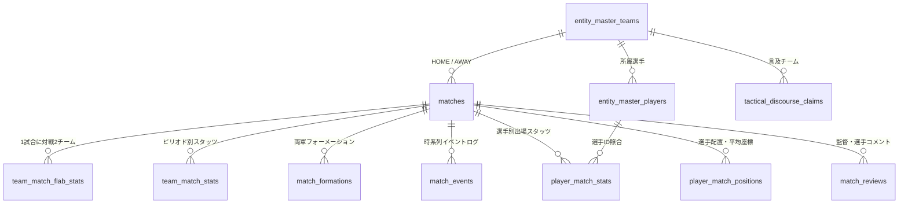

# J1戦術分析・観戦ガイドRAG システム仕様書
## データベース・スキーマ完全仕様書 (Database Schema Specification)

---

### 1. 概要・データアーキテクチャ

本仕様書は、本プラットフォームの中核データストアである SQLite データベース（`data/football.db`）の全テーブル構造、データ型、制約、およびテーブル間リレーションを網羅的に定義するものです。
客観事実（Layer 1）から戦術ヒューリスティクス（Layer 2）、言説データ（Layer 3/5）に至るまでの多層データを厳密に正規化・構造化して保持しています。

---

### 2. 全11テーブル 完全定義

#### 2.1 `matches`（試合マスターテーブル）
2026シーズンの全対戦カードの基本情報・スコア・会場・気象ログ。

| カラム名 | データ型 | NULL | PK | 説明・備考 |
| :--- | :--- | :---: | :---: | :--- |
| `match_id` | TEXT | NO | PK | 試合固有ID（例: `20260808_FCT_ZEL`） |
| `season` | INTEGER | NO |  | シーズン年（例: `2026`） |
| `matchweek` | INTEGER | NO |  | 節数（第1節〜第38節） |
| `date` | TEXT | NO |  | 開催年月日（`YYYY-MM-DD`） |
| `home_team_id` | TEXT | NO |  | ホームチームコード（例: `FCT`, `ZEL`） |
| `away_team_id` | TEXT | NO |  | アウェイチームコード |
| `home_score` | INTEGER | YES |  | ホーム最終得点 |
| `away_score` | INTEGER | YES |  | アウェイ最終得点 |
| `home_half_score` | INTEGER | YES |  | ホーム前半得点 |
| `away_half_score` | INTEGER | YES |  | アウェイ前半得点 |
| `stadium` | TEXT | YES |  | 開催スタジアム名（例: `味の素スタジアム`） |
| `weather` | TEXT | YES |  | 天候（例: `晴 / 26.5℃ / 65%`） |
| `status` | TEXT | YES |  | 試合ステータス（`SCHEDULED`, `LIVE`, `FINISHED`） |
| `created_at` | TIMESTAMP| NO |  | レコード作成日時 |
| `updated_at` | TIMESTAMP| NO |  | レコード更新日時 |

---

#### 2.2 `team_match_flab_stats`（Football LAB チーム詳細スタッツ75項目）
Football LABから取得・正規化された1チーム・1試合あたりの75項目フルスタッツ。

| カラム名 | データ型 | 説明・戦術的定義 |
| :--- | :--- | :--- |
| `match_id` | TEXT (PK) | 試合ID |
| `team_id` | TEXT (PK) | 対象チームID |
| `is_home` | INTEGER | ホームフラグ（1: Home, 0: Away） |
| `opponent_team_id` | TEXT | 対戦相手チームID |
| `xg` / `xg_avg` | REAL | ゴール期待値 / チーム平均ゴール期待値 |
| `shots` / `shots_rate` / `shots_avg` | INT/REAL/REAL | シュート数 / 枠内シュート率(%) / 平均シュート数 |
| `shots_on_target` / `shots_on_target_avg` | INT/REAL | 枠内シュート数 / 平均枠内シュート数 |
| `passes` / `passes_rate` / `passes_avg` | INT/REAL/REAL | パス総数 / パス成功率(%) / 平均パス数 |
| `crosses` / `crosses_rate` / `crosses_avg` | INT/REAL/REAL | クロス数 / クロス成功率(%) / 平均クロス数 |
| `direct_fk` / `direct_fk_avg` | INT/REAL | 直接フリーキック数 / 平均直接FK数 |
| `indirect_fk` / `indirect_fk_avg` | INT/REAL | 間接フリーキック数 / 平均間接FK数 |
| `corner_kicks` / `corner_kicks_avg` | INT/REAL | コーナーキック数 / 平均CK数 |
| `throw_ins` / `throw_ins_rate` / `throw_ins_avg` | INT/REAL/REAL | スローイン数 / 成功率(%) / 平均数 |
| `dribbles` / `dribbles_rate` / `dribbles_avg` | INT/REAL/REAL | ドリブル数 / ドリブル成功率(%) / 平均数 |
| `tackles` / `tackles_rate` / `tackles_avg` | INT/REAL/REAL | タックル数 / タックル成功率(%) / 平均数 |
| `clears` / `clears_avg` | INT/REAL | クリア数 / 平均クリア数 |
| `intercepts` / `intercepts_avg` | INT/REAL | インターセプト数 / 平均インターセプト数 |
| `offsides` / `offsides_avg` | INT/REAL | オフサイド数 / 平均オフサイド数 |
| `yellow_cards` / `yellow_cards_avg` | INT/REAL | イエローカード数 / 平均数 |
| `red_cards` / `red_cards_avg` | INT/REAL | レッドカード数 / 平均数 |
| `m30_entries` / `m30_entries_avg` | INT/REAL | 敵陣30mライン進入回数 / 平均進入数 |
| `pa_entries` / `pa_entries_avg` | INT/REAL | ペナルティエリア進入回数 / 平均進入数 |
| `distance_m` / `distance_m_avg` | INT/REAL | チーム総走行距離 (m) / 平均総走行距離 |
| `sprints` / `sprints_avg` | INT/REAL | チーム総スプリント回数 / 平均スプリント数 |
| `attack_count` / `attack_count_avg` | INT/REAL | 攻撃回数 / 平均攻撃回数 |
| `chance_create_rate` / `_avg` | REAL/REAL | チャンス構築率(%) / 平均チャンス構築率 |
| `possession_rate` / `_avg` | REAL/REAL | ボール保持率(%) / 平均ボール保持率 |
| `cbp_attack` / `cbp_attack_avg` | REAL/REAL | CBP（チャンスビルディングポイント）攻撃ポイント / 平均 |
| `cbp_pass` / `cbp_pass_avg` | REAL/REAL | CBP パスポイント / 平均 |
| `cbp_cross` / `cbp_cross_avg` | REAL/REAL | CBP クロスポイント / 平均 |
| `cbp_dribble` / `cbp_dribble_avg` | REAL/REAL | CBP ドリブルポイント / 平均 |
| `cbp_shoot` / `cbp_shoot_avg` | REAL/REAL | CBP シュートポイント / 平均 |
| `cbp_gain` / `cbp_gain_avg` | REAL/REAL | CBP 奪取ポイント / 平均 |
| `cbp_defense` / `cbp_defense_avg` | REAL/REAL | CBP 守備ポイント / 平均 |
| `cbp_save` / `cbp_save_avg` | REAL/REAL | CBP セーブポイント / 平均 |
| `raw_stats_json` | TEXT | 生パース辞書JSON |
| `created_at` / `updated_at` | TIMESTAMP | 登録・更新日時 |

---

#### 2.3 `player_match_stats`（選手別試合出場スタッツ22項目）
各試合に出場した全選手の個人トラッキング・パフォーマンスデータ。

| カラム名 | データ型 | PK | 説明・備考 |
| :--- | :--- | :---: | :--- |
| `id` | INTEGER | PK | 連番主キー |
| `match_id` | TEXT |  | 試合ID |
| `player_id` | TEXT |  | 選手固有ID |
| `player_name` | TEXT |  | 選手氏名（漢字） |
| `team_id` | TEXT |  | 所属チームコード |
| `is_starter` | BOOLEAN |  | 先発フラグ（1: 先発, 0: 途中出場） |
| `minutes_played` | INTEGER |  | 出場時間（分） |
| `position` | TEXT |  | 試合時起用ポジション（GK, DF, MF, FW） |
| `number` | INTEGER |  | 背番号 |
| `goals` | INTEGER |  | 得点数 |
| `assists` | INTEGER |  | アシスト数 |
| `xg` | REAL |  | 個人ゴール期待値 (xG) |
| `xa` | REAL |  | 個人アシスト期待値 (xA) |
| `touches` | INTEGER |  | ボールタッチ数 |
| `duels_won` | INTEGER |  | デュエル勝利数 |
| `distance_km` | REAL |  | 個人走行距離 (km) |
| `sprints` | INTEGER |  | スプリント回数 |
| `avg_x` | REAL |  | ピッチ平均座標 X（0: 自陣ゴール 〜 100: 相手ゴール） |
| `avg_y` | REAL |  | ピッチ平均座標 Y（0: 左サイド 〜 100: 右サイド） |
| `cbp_points` | REAL |  | 個人CBP総獲得ポイント |
| `raw_stats_json` | TEXT |  | 拡張個人スタッツJSON |
| `created_at` | TIMESTAMP|  | 作成日時 |

---

#### 2.4 `match_events`（試合重要イベントログ16項目）
ゴール、シュート、警告、退場、交代などの時系列アクションログ。

| カラム名 | データ型 | 説明 |
| :--- | :--- | :--- |
| `event_id` | TEXT (PK) | イベント一意識別子 |
| `match_id` | TEXT | 試合ID |
| `minute` | INTEGER | 発生時間（分） |
| `period` | TEXT | 前半 (`1H`) / 後半 (`2H`) / 延長 |
| `game_state` | TEXT | 発生時スコア状況（例: `DRAW`, `LEAD`, `BEHIND`） |
| `team_id` | TEXT | 関与チームID |
| `player_id` / `player_name` | TEXT | 関与選手ID / 選手名 |
| `event_type` | TEXT | イベント種別（`GOAL`, `SHOT`, `YELLOW_CARD`, `RED_CARD`, `SUBSTITUTION`） |
| `zone_name` | TEXT | 発生ピッチエリア（例: `ペナルティエリア中央`, `左サイド`） |
| `xg` | REAL | 当該シュートの期待値（シュートイベント時） |
| `situation` | TEXT | プレー状況（`OPEN_PLAY`, `CORNER_KICK`, `FREE_KICK`, `PENALTY`） |
| `description_text` | TEXT | 公式実況テキスト全文（ゴール確定判定に使用） |

---

#### 2.5 `match_formations`（布陣フォーメーションテーブル）
試合ごとの両軍スタメン布陣および交代後の陣形変化記録。

| カラム名 | データ型 | 説明 |
| :--- | :--- | :--- |
| `match_id` | TEXT (PK) | 試合ID |
| `home_team_id` / `away_team_id` | TEXT | ホーム / アウェイチームコード |
| `home_initial_formation` | TEXT | ホーム開始時フォーメーション（例: `4-2-3-1`） |
| `away_initial_formation` | TEXT | アウェイ開始時フォーメーション（例: `3-4-2-1`） |
| `home_formations_json` | TEXT | 時間帯別フォーメーション遷移履歴JSON |
| `away_formations_json` | TEXT | アウェイ時間帯別フォーメーション遷移履歴JSON |
| `formation_confidence` | TEXT | 布陣判定信頼度（`HIGH`, `MEDIUM`, `ESTIMATED`） |

---

#### 2.6 `player_match_positions`（選手詳細ポジション・レーン配置）
各試合での選手の登録ポジション、実効起用ポジション、対面レーン管理。

| カラム名 | データ型 | 説明 |
| :--- | :--- | :--- |
| `match_id`, `team_id`, `player_key` | TEXT (PK) | 複合主キー |
| `player_name` / `number` | TEXT / INT | 選手名 / 背番号 |
| `registered_pos` | TEXT | 公式登録ポジション |
| `tactical_role` | TEXT | 戦術的役割（例: `Inverted Fullback`, `Target Man`） |
| `lane` | TEXT | 主担当レーン（`LEFT_WING`, `LEFT_HALF`, `CENTER`, `RIGHT_HALF`, `RIGHT_WING`） |
| `is_starter` | INTEGER | 先発フラグ |

---

#### 2.7 `tactical_discourse_claims`（戦術言説・解説ログ4,595件）
YouTube戦術解説チャンネル、記者会見、サポーター論評から抽出・構造化した主張データ。

| カラム名 | データ型 | 説明 |
| :--- | :--- | :--- |
| `claim_id` | TEXT (PK) | 言説ID |
| `channel_name` | TEXT | 発信元チャンネル・メディア名 |
| `video_title` / `video_url` | TEXT | 参照元動画・記事タイトル / URL |
| `time_range` | TEXT | 発言タイムスタンプ（例: `12:30-14:15`） |
| `team_id` | TEXT | 言及対象クラブ |
| `manager_mentioned` | TEXT | 言及された監督名 |
| `players_mentioned_json` | TEXT | 言及された選手名リストJSON |
| `truth_layer` | INTEGER | 理念憲章レイヤー番号（1〜7） |
| `layer_name` | TEXT | レイヤー名称（例: `Tactical Heuristics`, `Hypothesis`） |
| `statement_text` | TEXT | 構造化された主張要約テキスト |
| `original_quote` | TEXT | 発言・解説の一次引用テキスト |

---

#### 2.8 `entity_master_teams` & `entity_master_players`（クラブ・選手マスター）
クラブおよび選手の統一識別子、英語名、エイリアス（表記ゆれ吸収辞書）。

- **`entity_master_teams`**: J1全20クラブ＋天皇杯対戦相手の正式名称、略称、ソファーID、Football LABスラッグ。
- **`entity_master_players`**: 全J1選手（914名）の統一ID、背番号、利き足、生年月日、Jリーグ公式ID。

