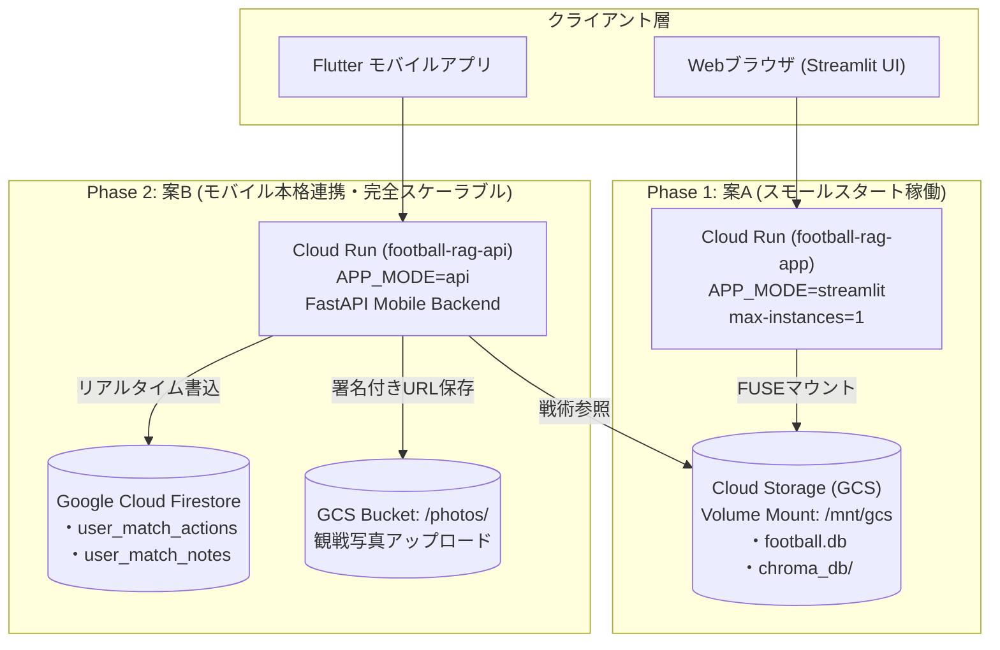

# Jリーグ戦術分析・観戦ガイドRAG システム仕様書
## GCP クラウド移行＆ハイブリッド運用仕様書 (GCP Migration Specification)

---

### 1. 移行の背景と目的

本システムはこれまで Streamlit Community Cloud にて運用されていましたが、以下の制約を根本解消し、将来的なネイティブモバイルアプリ（Flutter）との本格連携を実現するために Google Cloud Platform (GCP) へ移行します。

1. **メモリ制限・OOM強制終了の解消**: 複雑な戦術チャート描画やChromaDBベクトルのメモリ展開によるクラッシュを防止（Cloud Runで2GiB〜4GiBを確保）。
2. **データ揮発の防止とデータ分離**: コンテナ再起動やデプロイ時にデータが初期化されるのを防ぎ、プログラム本体と試合データ（SQLite + ChromaDB）を完全に分離。
3. **モバイルAPI（FastAPI）の安定ホスティング**: スタジアム観戦時のGood/Badアクション同期、観戦メモ、写真アップロードを高速処理。

---

### 2. 移行アーキテクチャとロードマップ



#### フェーズ別ロードマップ
- **Phase 1（初期動作確認・現在）**:
  - Cloud Run 単一サービス（`APP_MODE=streamlit`）に GCS バケットを直接ボリュームマウント（`/mnt/gcs`）。
  - コード改修ゼロで、既存の `football.db` と `chroma_db` を安全に永続化。
- **Phase 2（モバイル本格連携・案B）**:
  - FastAPI バックエンド（`api/main.py`）を独立デプロイ。
  - スマホからの高頻度書き込み（Good/Badボタン連打、ハーフタイム観戦メモ）を **Firestore** に格納し、SQLiteの書き込みロック制約を完全撤廃。
  - 複数インスタンスへのオートスケール（`max-instances=N`）を解禁。

---

### 3. コンテナ設計・環境変数仕様

#### 3.1 単一マルチユース・イメージ設計
1つの Docker イメージ（`Dockerfile`）で Web UI（Streamlit）と モバイルAPI（FastAPI）の両方を起動可能。

| 環境変数名 | デフォルト値 | 説明 |
| :--- | :--- | :--- |
| `APP_MODE` | `streamlit` | 起動モード。`streamlit` で `app.py`、`api` で `api.main:app` を起動。 |
| `PORT` | `8080` | Cloud Run が動的に割り当てるリッスンポート。 |
| `FOOTBALL_DB_PATH` | `data/football.db` | SQLiteデータベースのファイルパス。GCSマウント時は `/mnt/gcs/football.db`。 |
| `CHROMA_PERSIST_DIR` | `data/chroma_db` | ChromaDBの永続化ディレクトリ。GCSマウント時は `/mnt/gcs/chroma_db`。 |
| `PHOTO_STORAGE_BACKEND` | `local` | 写真保存先バックエンド。`local`（ローカル保存）または `gcs`（Cloud Storage直接保存）。 |
| `GCS_PHOTO_BUCKET` | *(デプロイバケット名)* | GCS写真保存時のターゲットバケット名（例: `football-rag-app-football-rag-data`）。 |
| `GCS_PHOTO_PREFIX` | `photos` | GCS写真保存時のバケット内ディレクトリプレフィックス。 |
| `GEMINI_API_KEY` | *(Secret Manager)* | Google Gemini API利用キー。 |
| `APP_PASSWORD` | *(Secret Manager)* | Web UIのプライベート認証パスワード。 |

#### 3.2 データ分離ポリシー（`.dockerignore`）
- コンテナイメージ内に `data/` 配下のファイル（SQLite、ChromaDB、生HTML、写真等）は一切含めない。
- これによりイメージビルド時間を短縮し、データ更新時のイメージ再構築を不要化。

#### 3.3 観戦写真ストレージ永続化設計（StorageAdapter）
- `pipeline/storage_adapter.py` により、環境変数 `PHOTO_STORAGE_BACKEND` および `GCS_PHOTO_BUCKET` に基づいて保存先を動的解決。
  - **ローカル開発・テスト時 (`local`)**: `data/uploads/photos/` に保存し、相対URL `/uploads/photos/<filename>` を返却。
  - **Cloud Run本番運用時 (`gcs`)**: Google Cloud Storage (`gs://<bucket>/photos/<filename>`) へ直接アップロードし、公開URL `https://storage.googleapis.com/<bucket>/photos/<filename>` をDBに格納。
  - **フォールバック保証**: GCSクライアント初期化エラーや認証未設定時は自動で `LocalStorageAdapter` にフォールバックし、API停止を回避。

---

### 4. 運用・デプロイ手順

#### 4.1 デプロイ手順（PowerShellワンライナー）
```powershell
# Web UI (Streamlit) のデプロイ
.\scripts\gcp_deploy.ps1 -ProjectId "football-rag-app" -Region "asia-northeast1" -AppMode streamlit

# モバイル向け FastAPI バックエンド (football-rag-api) のデプロイ (共通イメージ再利用)
.\scripts\gcp_deploy.ps1 -ProjectId "football-rag-app" -Region "asia-northeast1" -AppMode api -SkipBuild
```

#### 4.2 本番稼働エンドポイント（Phase 1 & Phase 2 稼働中）
- **Web UI (Streamlit)**: [https://football-rag-app-717245533761.asia-northeast1.run.app](https://football-rag-app-717245533761.asia-northeast1.run.app)
- **Mobile Backend (FastAPI)**: [https://football-rag-api-717245533761.asia-northeast1.run.app](https://football-rag-api-717245533761.asia-northeast1.run.app)
  - Swagger UI: [https://football-rag-api-717245533761.asia-northeast1.run.app/docs](https://football-rag-api-717245533761.asia-northeast1.run.app/docs)
  - Health API: [https://football-rag-api-717245533761.asia-northeast1.run.app/api/health](https://football-rag-api-717245533761.asia-northeast1.run.app/api/health)
- **GCP プロジェクト**: `football-rag-app` (プロジェクト番号: `717245533761`)
- **データバケット**: `gs://football-rag-app-football-rag-data`
- **コンテナリポジトリ**: `asia-northeast1-docker.pkg.dev/football-rag-app/football-rag/football-rag-app:latest`

#### 4.3 秘密情報（Gemini API Key / パスワード）の設定
Secret Manager の `GEMINI_API_KEY` は登録済みで、Cloud Run の両サービスへ自動マウントされます。
```powershell
# APIキー更新時
Write-Output "your-gemini-api-key" | gcloud secrets versions add GEMINI_API_KEY --data-file=- --project=football-rag-app

#### 4.4 週末のデータ更新運用フロー
PCローカルで試合データ収集・戦術エンリッチを実行後、GCSへ差分同期するだけで完了（コンテナ再ビルド不要）：
```powershell
# 1. ローカルで試合データ更新
python scripts/update_matchweek.py --mw 14

# 2. GCSへデータを同期
gcloud storage rsync -r data/ gs://football-rag-app-football-rag-data/
```
同期後、Cloud Run側でマウントされた最新データが即座に反映されます。

---

### 5. コスト試算（東京リージョン）

- **Cloud Run (0インスタンス〜1インスタンス)**:
  - リクエスト駆動アイドル時：0円。
  - 個人閲覧（月間数百リクエスト）：無料枠（月間200万リクエスト、36万GB-秒）内に収まり **実質 0円〜300円/月**。
- **Cloud Storage (Standard 100MB未満)**:
  - 5GB無料枠内により **0円**。
- **Firestore (案B移行後)**:
  - 1GiB保存、5万読取/日、2万書込/日まで無料枠内により **0円**。
- **合計概算コスト**: 月額 **0円 〜 約300円**（Gemini API利用料別）。
