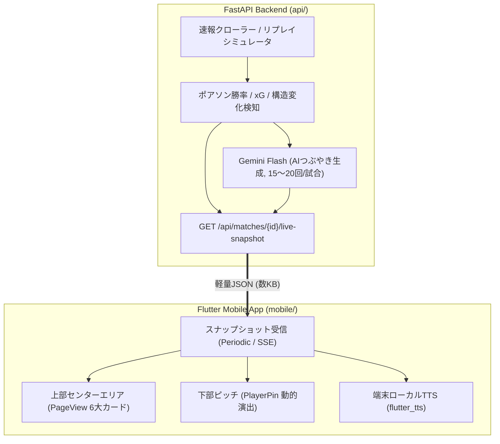

# ⚽ 観戦特化型モバイルアプリ センターエリア＆ライブ配信 確定設計仕様書
## (MOBILE_APP_LIVE_DESIGN.md)

---

## 1. 概要・確定アーキテクチャ方針

本設計書は、NotebookLMで策定された仕様（`docs/mobile_app_live_spec.md`）および `/grill-me` インタビューを通じて確定した、モバイルアプリのセンターエリアUI/UX・ライブ配信基盤・AI自動実況の実装仕様を定義する。

---

## 2. 確定仕様一覧

### 2.1 配信基盤（フェーズ分割アプローチ）
* **フェーズ1（即時開発）**：既存FastAPIサーバー（`api/`）に `/api/matches/{id}/live-snapshot` エンドポイントおよびリプレイシミュレータを実装。
* **フェーズ2（本番クラウド展開）**：UIおよび動作が安定した段階で、Cloud Run Worker ＋ Firestore Realtime Listener へ移行。

### 2.2 操作ジェスチャー（親指ゾーン）
| 操作 | アクション | フィードバック |
| :--- | :--- | :--- |
| **上下スワイプ** | 上: Good! / 下: Bad! を即座に記録 | Haptic（Medium） ＋ 選手枠フラッシュ |
| **シングルタップ** | 詳細評価・プレーカテゴリ選択シート起動 | Haptic ＋ ボトムシート展開 |
| **ダブルタップ** | 上部センターエリアを「② 選手詳細カード」へ即時ジャンプ | 上部カード自動スクロール |

### 2.3 下部ピッチ（選手カード）の動的演出
* **サイズ固定**：ピンの基本レイアウト・寸法は変えない。
* **極小バッジ・バー**：警告（`・`）、ゴール、極小タッチ数バーをピン隅に配置。
* **👻 消えてる（フェードアウト）演出** (MF/FW/WG限定)：直近10分間のタッチ回数が閾値（例: 2回以下）を下回ると、不透明度を50%に半透明化。
* **⚡ がんばってる（オーバードライブ）演出**：直近5分間のスプリント数が急増した場合、枠線がゴールドに発光（グローアニメーション）。

### 2.4 上部センターエリア（6大スワイプカード ＆ 通知バナー）
* **初期表示カード**：「① チームスタッツ」または「④ クラブの狙い」をデフォルト表示。
* **カード構成**：
  1. **チームスタッツ**：Field Tilt（押し込み度）、Proxy-PPDA（守備強度）、PA進入矢印。
  2. **選手詳細**：公式顔写真、通算CBP、評点推移、事前インタビュー。
  3. **モメンタム ✕ G/Bログ**：0〜90分モメンタム波形とGood/Badタップの重ね合わせ。
  4. **クラブの狙い**：プランA達成度ゲージ、通算戦績、既存Webへの「🌐 Web詳細」ボタン。
  5. **AI解説 ✕ つぶやきタイムライン**：AIつぶやき吹き出しログ、音声再生ボタン。
  6. **速報生リスト**：時系列テキストログ。
* **通知・イベントスライドイン**：
  * 警戒時間帯到達（例: 60分）やAIつぶやき発生時は、上部に通知バナーがスライドイン。バイブが鳴り、タップで該当カードへジャンプ。

### 2.5 AIつぶやき ＆ 音声自動読み上げ（Ear-First UX）
* **生成処理**：FastAPI側がイベント検知時（シュート、交代、警戒時間到達等、1試合15〜20回）にGemini Flashで生成し、スナップショットJSONに格納。
* **読み上げ**：Flutter側で `flutter_tts` を利用し、トグルON時に端末内で完全無料・低遅延で自動読み上げ。
* **ペルソナ設定**：プリセット4種（戦術オタク、データ中毒、関西弁サポ、ベテラン解説）＋カスタムプロンプト。

### 2.6 テスト・シミュレータ環境
* FastAPIに `/api/matches/{id}/simulate` を用意し、過去試合の時系列データを1分刻みで早送り・再生可能にする。

---
