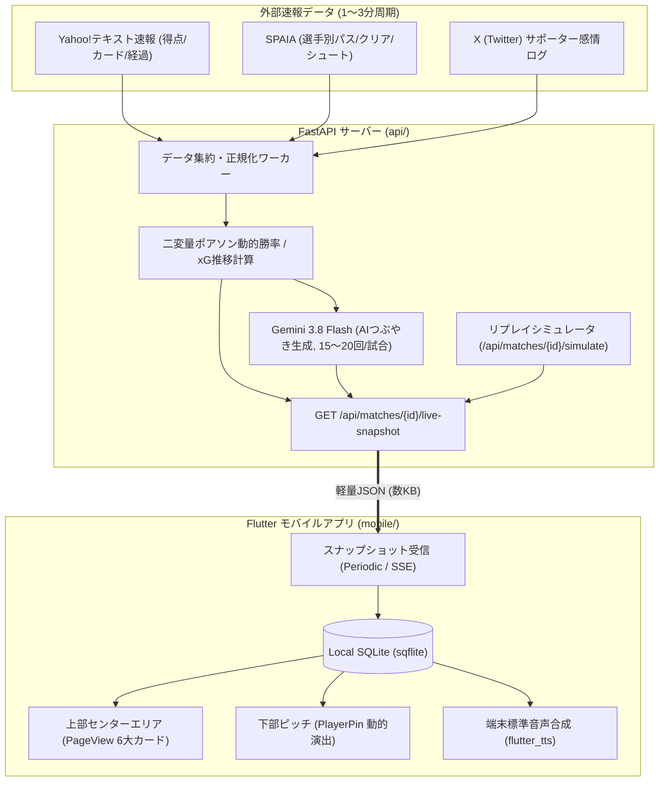

# ⚽ 観戦特化型モバイルアプリ ライブ速報・センターエリア＆AI自動実況仕様書
## (MOBILE_APP_LIVE_SPECIFICATION.md)

---

## 1. 概要・設計理念

本仕様書は、Jリーグのリアルタイム観戦（スタジアム現地観戦およびDAZN/TV視聴）において、**「観戦者の視線と意識をピッチから奪わず、手元と耳で最高精度の戦術インサイトを提供する」**ためのモバイルアプリ・センターエリアUI/UX、動的ビジュアル演出、サーバー集約型ライブデータ配信基盤、およびAI自動実況（Ear-First UX）の完全仕様を定義する。

### 1.1 3大設計理念
1. **2〜3秒の瞬間視認（ glanceable UX ）**：
   - 試合中にスマホ画面を見つめられる時間はわずか2〜3秒。長文を読ませず、色・明暗・光・極小バッジで直感的に状況を脳に届ける。
2. **手ぶら・耳だけ観戦（ Ear-First UX ）**：
   - 重要局面ではバイブレーション振動とともに、端末標準TTS（音声合成）が「裏実況ラジオ」のようにボソッと戦術的因果をつぶやく。
3. **データ遅延のエンタメ化**：
   - 外部速報データの2〜3分遅延を「少し遅れてDAZN配信を見ながらSNSにつぶやくサッカー友達」という世界観で吸収し、遅延のストレスを心理的リアリティに転換する。

---

## 2. システム構成・データ配信アーキテクチャ

スタジアムの4G/5G通信混雑および外部サイトのレートリミットを考慮し、**「サーバー集約 ➔ 軽量JSON配信 ➔ モバイルLocal-First描画」**のラインを採用する。



### 2.1 配信フェーズ戦略
* **フェーズ1（即時開発）**：既存FastAPI（`api/`）に `/api/matches/{id}/live-snapshot` エンドポイントを新設。過去試合ログを用いた「リプレイシミュレータ」で動作確認。
* **フェーズ2（クラウド本番化）**：UIおよび機能安定後、GCP Cloud Run Worker ＋ Firebase Firestore Realtime Listener / SSE へ移行。

### 2.2 軽量スナップショットJSON仕様
```json
{
  "match_id": "20261031_OKA_FCT",
  "status": "IN_MATCH",
  "elapsed_minute": 65,
  "formatted_time": "65:20",
  "score": {"home": 1, "away": 0},
  "win_prob": {"home": 0.62, "draw": 0.25, "away": 0.13},
  "metrics": {
    "field_tilt": {"home": 0.68, "away": 0.32},
    "proxy_ppda": {"home": "HIGH", "away": "LOW"},
    "pa_entries": {"left": 2, "center": 5, "right": 1}
  },
  "player_live_status": {
    "P_FCT_10": {"touch_count_10m": 1, "sprint_count_5m": 0, "status": "faded"},
    "P_FCT_26": {"touch_count_10m": 7, "sprint_count_5m": 4, "status": "overdrive"}
  },
  "timeline_alert": {
    "active": true,
    "title": "⚠️ 警戒時間帯 (60〜75分)",
    "message": "相手は後半60分以降のクロス被失点率がリーグ最多(38%)です。"
  },
  "latest_ai_tweet": {
    "id": "tweet_65m_01",
    "persona": "tactical_geek",
    "speaker_name": "戦術オタクの友人",
    "text": "相手、完全に4-4-2のローブロックに切り替えたね。こうなるとサイドバックの押し上げが鍵になるなぁ…",
    "timestamp": "65'"
  }
}
```

---

## 3. 画面レイアウト＆UI/UX仕様

画面は垂直スタックで構成され、下部の親指操作ゾーンを常時固定、中央上部を広大な情報エリア（`Expanded`）として確保する。

### 3.1 下部ピッチ操作ゾーン（親指ジェスチャー）
下部ハーフピッチ（`PitchBoard`, 高さ362px）上の選手ピン（`PlayerPin`）の操作を明確に分離する。

| 操作ジェスチャー | 動作・発火機能 | フィードバック |
| :--- | :--- | :--- |
| **上スワイプ** | 該当選手に「👍 Good!」を記録 | `mediumImpact()` 振動 ＋ 緑フラッシュ |
| **下スワイプ** | 該当選手に「👎 Bad!」を記録 | `mediumImpact()` 振動 ＋ 赤フラッシュ |
| **シングルタップ** | 評価詳細・プレーカテゴリ選択シート展開 | `mediumImpact()` 振動 ＋ ボトムシート |
| **ダブルタップ** | 上部センターエリアを「② 選手詳細カード」へ即時ジャンプ | 上部カード自動スクロール |

### 3.2 下部ピッチ：選手ピンの動的ビジュアル演出
カードの寸法（`90x50`）は変えずに、微小要素とカード状態変化（エフェクト）で可視化する。

1. **極小バッジ (`・`) ＆ タッチバー**：
   - カード隅に極小のカラーマーク（イエロー/レッド/ゴール等）を付与。
   - カード下端に極小のボールタッチ進捗バーを表示。
2. **👻 「消えてる（フェードアウト）」演出（※MF/FW/WG限定）**：
   - **条件**：直近10分間のボールタッチ数が閾値（例: 2回以下）を下回った場合。
   - **表現**：カード全体の不透明度（Opacity）を **50%に半透明化**。交代枠の検討等に即役立つ（守備専念のCB/GKは除外）。
3. **⚡ 「がんばってる（オーバードライブ）」演出**：
   - **条件**：直近5分間のスプリント数が急増した場合。
   - **表現**：カード背景枠が **シャイニングゴールドに光り輝く（グローアニメーション）**。

---

## 4. 上部センターエリア（PageView 6大カード ＆ 通知バナー）

`_buildLiveNewsPlaceholder` を置き換え、左右スワイプで切り替え可能な `PageView` を配置する。

### 4.1 初期表示とイベントスライドイン
- **初期表示（デフォルト）**：「① チームスタッツカード」または「④ クラブの狙いカード」。
- **イベント検知時の挙動**：
  - 警戒時間帯到達（60分到達等）やAIつぶやき発生時は、上部に**「通知バナー」がスライドイン表示**。
  - 短いバイブレーションが鳴り、バナーをタップすると該当カード（AI解説やつぶやき）へ自動スクロール。

### 4.2 6大カード構成一覧

| 番号 | カード名称 | 主要コンテンツ・UI表現 |
| :---: | :--- | :--- |
| **①** | **チームスタッツ** | 座標不要で直感的にわかる指標群。<br>・**Field Tilt（押し込み度比率）**：3サード分割ヒートカラーバー<br>・**Proxy-PPDA（プレス強度）**：ゲージメーター（高/中/低）<br>・**PA進入方向**：ピッチ図上の太さ変化矢印（左・中央・右）<br>・**1シュートあたりxG**：決定機クオリティ（★1〜★5） |
| **②** | **選手詳細** | 下部ピッチのダブルタップに連動。<br>・公式顔写真アバター、背番号、ポジション<br>・通算CBP、直近3試合評点推移、前半スタッツ<br>・事前インタビュー・言説カード（Chroma言説DBより引用） |
| **③** | **モメンタム ✕ G/Bログ** | 0〜90分の試合の勢い波形（モメンタム）と、自分が下部ピッチで打ち込んだ「Good/Bad」のタイムスタンプログを重ね合わせて描画。自分の直感とデータの同期度を可視化。 |
| **④** | **クラブの狙い** | ・事前プランA達成度ゲージ（例: 70%）<br>・今季通算戦績（勝敗・順位・平均得失点・直近5試合 `W D W W L`）<br>・戦術スタイル要約（ポゼッション・前進力・ハイプレス等の傾向）<br>・**「🌐 Web詳細」ボタン**（既存Webチームビューへのダイレクト導線） |
| **⑤** | **AI解説 ✕ つぶやきタイムライン** | ・AIつぶやき吹き出しログ（キャラ別アバター付き）<br>・各つぶやきの「🔊 再生」ボタン<br>・「🎤 今の状況を解説」ボタン（15秒音声解説）<br>・「💬 なぜ？をLLMに質問」ボタン（定型・音声質問） |
| **⑥** | **速報生リスト** | 試合の流れや得点経過、選手交代ログをプレイバックできる時系列テキスト生ログ。 |

---

## 5. 自動実況モード（Ear-First UX） ＆ カスタムキャラクター

### 5.1 動作仕様
- 設定画面で「自動実況モード」をONにしておくと、試合中の重要な変化（シュート/xG急変、交代、陣形変化、警戒時間到達等）のタイミングで以下の連動が走る：
  1. スマホが「ト・トン」と短く振動（バイブ）。
  2. 上部エリアに吹き出しカードがスライドイン。
  3. 音声ONなら、端末内TTS（`flutter_tts`）が**バックグラウンドでも自動的にボイスを読み上げる**。
- イヤホンを装着していれば、画面をポケットに入れたまま「手ぶら・耳だけ観戦」が可能。

### 5.2 キャラクター設定（プリセット ✕ カスタム）
- **プリセットキャラクター（4種）**：
  1. 🤓 **戦術オタクの友人**：論理的・構造的な変化（「相手、4-4-2のローブロックに落としたね」）を指摘。
  2. 📊 **データ中毒アナリスト**：数値ベース（「今のシュート、xG 0.03しかないよ笑」）で冷静につぶやく。
  3. 🔥 **関西弁の熱狂サポーター**：感情豊かに選手のがんばり（「〇〇ちゃんカード光り輝いてるで！」）を称賛。
  4. 🎙️ **冷静なベテラン解説者**：試合前インタビューと目の前の現象のギャップを解説。
- **カスタムプロンプト自由記述フォーム**：
  - 設定ダイアログ内にシステムプロンプト編集フォームを設置し、ユーザー独自の口調・視点・ペルソナ（100文字以内）を登録可能。

---

## 6. テスト・リプレイシミュレータ設計

試合のない平日やオフシーズンでも開発・動作検証ができるよう、FastAPIにシミュレータAPIを配備する。

* **エンドポイント**：`POST /api/matches/{match_id}/simulate`
* **機能**：
  * `target_minute`（例: 65分）を指定すると、その時間までのイベント・スタッツ・動的演出状態・AIつぶやきを即座に計算・復元したスナップショットを返却。
  * `play_speed`（例: 10倍速、リアルタイム）を指定して時系列に自動進行させるストリーミングモードもサポート。

---
