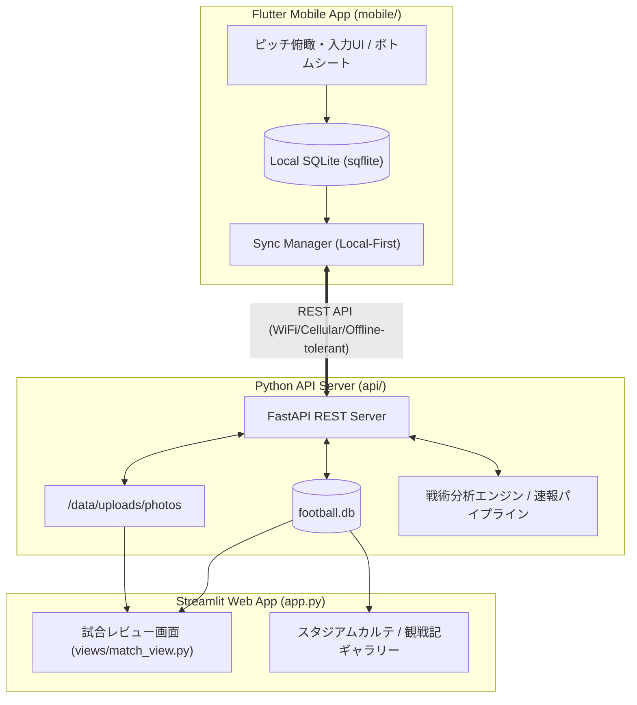

# 観戦特化型モバイルアプリ 仕様書 (MOBILE_APP_SPECIFICATION)

## 1. 概要・目的
スタジアムやTVの前で試合を観戦しながら、**「試合の瞬間を見逃さず」**、片手でスピーディーに両チームの選手評価（Good/Bad）、観戦メモ、写真を記録できるFlutterモバイルアプリ。
サーバー（FastAPI）と連携し、事前戦術分析・リアルタイム速報・観戦ガイドを参照できるほか、記録した観戦メモや写真は既存のWebサイト（Streamlit）の試合レビュー画面へ自動的に統合・反映される。

---

## 2. システム構成（全体アーキテクチャ）



---

## 3. モバイルアプリ コア機能・UI仕様

### 3.1 画面レイアウト構成＆片手親指操作UI（メイン入力画面）
- **垂直スタック構成（上から順）**:
  1. **【最上部】**: 試合スコア・スタジアム情報・設定（AppBar, 56px）
  2. **【中央部】**: **広大な試合速報・戦術ハイライト最新情報エリア（Expanded）**
     - ゴール速報、xG推移、ボール支配率、シュート数、AI戦術インサイト・モメンタム速報を表示可能な広々としたメイン表示枠。
  3. **【下半分】**: **自チームハーフコート（親指操作ゾーン, height: 330px）**
     - **ベンチ選手トレイ（48px）**: 控え選手一覧の横スクロール・即時評価
     - **ハーフコートピッチ（282px）**: 自陣ゴール（下端）からハーフウェイライン（上端）までの自チーム半面ピッチ。GKからFWまで11名全員が親指の届く下半分に集中配置。
  4. **【ピッチ直下】**: **チーム切り替えトグルボタン（HOME / AWAY）**
     - ピッチのすぐ下に配置され、親指の自然なストロークで 0.1 秒で即座に切り替え可能。
  5. **【最下部】**: タイマーコントローラー（分送り/戻し）＆ 直近入力アクションログ
- **自チームハーフコート（半面ピッチ）白線描画仕様**:
  - `_SoccerPitchPainter` により、従来のフルコート白線（相手ペナルティエリア）を廃止し、自チーム専用のハーフピッチを描画。
  - **上端**: ハーフウェイライン（センターライン）＋センターサークル円弧（半円アーク）＋センターマーク
  - **下端**: 自陣ゴールライン＋自陣ペナルティエリア（大枠）＋ゴールエリア（小枠）＋PKスポット（ドット）
  - 相手ゴールエリアの余計な枠線がなくなり、1チーム11名のフォーメーションがピッチ全体に美しく整列。
- **ピッチ描画とフォーメーション座標パターン**:
  - ポジションコード（LSB, LCB, CB, RCB, RSB, LWB, RWB, LCM, RCM, LSH, RSH, LOM, ROM, LCF, RCF, CF, GK）に基づき、標準座標辞書（`POSITION_COORDINATES`）から親指操作ゾーンに最適化された座標を自動アサイン。
  - **3バック時の動的ワイド展開**: 中央CB（`CB`）の存在を検知した場合、左右CB（`LCB` / `RCB`）を自動的にワイド（X: 24.0% / 76.0%）に展開し、中央CBおよびGKとのピンの重なりを完全排除。
- **Good / Bad ハイブリッド入力**:
  - **基本操作（最速）**: 選手アイコンを上スワイプで「Good!（いいね）」、下スワイプで「Bad!」を即時記録（バイブレーションによる触覚フィードバック付き）。
  - **詳細付加（余裕がある時）**: 選手アイコンを長押し、または直後のミニポップアップで「プレー種別（パス、プレス、ドリブル、シュート、デュエル等）」やピッチ上の位置・簡易メモを追記可能。
  - **試合時間カウント連動**: 試合開始ボタンを押すとタイマーが進行（手動で分調整も可能）。記録イベントには正確な「試合分（例: 23'）」が自動付与される。

### 3.2 ボトムシート／ティッカー型（リアルタイム分析・観戦ガイド）
- メインピッチ画面の下部に、最新の**「AI戦術速報・モメンタム」ティッカー**を常時1行表示。
- 下部から上へスワイプすることで**展開式ボトムシート**が立ち上がる：
  - **戦術予習・観戦ガイド**: 事前分析データ、キーマッチアップ、注目選手の戦術的役割。
  - **リアルタイム速報**: xG推移、支配率、シュート数、AIによる試合の流れの解説。
- 下スワイプですぐにピッチ入力画面に復帰（片手操作を阻害しない）。

### 3.3 観戦メモ記録（フェーズ別）
- 観戦フェーズに応じた3段階のメモUI：
  1. **観戦前（Pre-Match）**: スタジアム到着、天候、座席の雰囲気、スタメン発表時の期待・戦術展望。
  2. **ハーフタイム（Half-Time）**: 前半の戦術的収穫・課題、後半への修正期待。
  3. **試合後（Full-Time）**: 試合全体の総括、MOM（最優秀選手）選定、次節への提言。
- メモはMarkdownに対応。

### 3.4 スタジアム＆観戦写真管理
- **撮影・アップロード**: アプリ内カメラ起動またはギャラリーからの選択。
- **両軸整理メタデータ**:
  - 試合ID（`match_id`）
  - 観戦フェーズ（`pre_match`, `in_match`, `half_time`, `post_match`）
  - スタジアムID（`stadium`）
  - キャプション／メモ
- **ギャラリービュー**: アプリ内でスタジアムごとのアルバムや、過去の観戦履歴を閲覧可能。

---

## 4. 通信・データ同期仕様（Local-First戦略）

1. **スタジアム電波耐性**:
   - ネット接続の有無にかかわらず、全てのGood/Bad入力・メモ・写真メタデータは端末ローカルDB（`sqflite`）に同期的に書き込まれるため、操作が一切ブロックされない。
2. **バックグラウンド自動同期**:
   - 接続検知（Connectivity）およびタイマーにより、通信可能時にバックグラウンドで未同期キュー（`is_synced = 0`）をFastAPIサーバーへ自動送信。
   - 失敗時は指数バックオフで再試行。
3. **写真の最適化**:
   - アップロード前にクライアント側で解像度リサイズ（長辺1920px程度）およびJPEG圧縮を施し、スタジアムの細い帯域でも高速に送信。

---

## 5. データベース設計（SQLiteテーブル拡張）

### 5.1 `user_match_actions`（Good/Bad評価イベント）
```sql
CREATE TABLE IF NOT EXISTS user_match_actions (
    id TEXT PRIMARY KEY,
    match_id TEXT NOT NULL,
    player_id TEXT NOT NULL,
    team_id TEXT NOT NULL,
    action_type TEXT NOT NULL, -- 'good' | 'bad'
    match_minute INTEGER NOT NULL,
    play_category TEXT,        -- 'pass', 'press', 'dribble', 'shot', 'duel', etc.
    note TEXT,
    created_at TIMESTAMP DEFAULT CURRENT_TIMESTAMP,
    is_synced INTEGER DEFAULT 1
);
CREATE INDEX IF NOT EXISTS idx_actions_match ON user_match_actions(match_id, player_id);
```

### 5.2 `user_match_notes`（観戦メモ）
```sql
CREATE TABLE IF NOT EXISTS user_match_notes (
    id TEXT PRIMARY KEY,
    match_id TEXT NOT NULL,
    phase TEXT NOT NULL,       -- 'pre_match', 'half_time', 'post_match'
    note TEXT NOT NULL,
    mom_player_id TEXT,
    created_at TIMESTAMP DEFAULT CURRENT_TIMESTAMP,
    updated_at TIMESTAMP DEFAULT CURRENT_TIMESTAMP,
    is_synced INTEGER DEFAULT 1
);
CREATE UNIQUE INDEX IF NOT EXISTS idx_notes_match_phase ON user_match_notes(match_id, phase);
```

### 5.3 `user_stadium_photos`（観戦・スタジアム写真）
```sql
CREATE TABLE IF NOT EXISTS user_stadium_photos (
    id TEXT PRIMARY KEY,
    match_id TEXT NOT NULL,
    stadium_id TEXT NOT NULL,
    phase TEXT,                -- 'pre_match', 'in_match', 'half_time', 'post_match'
    file_path TEXT NOT NULL,   -- サーバー側の相対パス (/data/uploads/photos/...)
    caption TEXT,
    created_at TIMESTAMP DEFAULT CURRENT_TIMESTAMP,
    is_synced INTEGER DEFAULT 1
);
CREATE INDEX IF NOT EXISTS idx_photos_match ON user_stadium_photos(match_id);
CREATE INDEX IF NOT EXISTS idx_photos_stadium ON user_stadium_photos(stadium_id);
```

---

## 6. バックエンドAPI設計 (FastAPI)

- `GET /api/matches/{match_id}/app_context`:
  - 試合基本情報、両チームスタメン・ベンチ選手リスト（フォーメーション座標付き）、事前分析サマリー、リアルタイム速報データを一括返却。
- `POST /api/sync/actions`:
  - 端末で蓄積されたGood/Badアクションを一括アップロード・マージ。
- `GET /api/matches/{match_id}/actions/summary`:
  - 選手ごとのGood/Bad集計数、時系列分布を返却（Web側レビューやアプリ内の統計グラフ用）。
- `POST /api/sync/notes`:
  - フェーズ別観戦メモの保存・更新。
- `POST /api/sync/photos`:
  - 写真バイナリのマルチパートアップロード＋メタデータ保存。
- `GET /api/stadiums/{stadium_id}/photos`:
  - スタジアム別の写真一覧。

---

## 7. Streamlit Webレビュー画面との連携

- `views/match_view.py` に「現地観戦レポート・サポーター評価」セクションを追加：
  1. **選手別サポーター採点/リアクション**: 観戦中に入力されたGood/Badの比率とコメントを選手カードにバッジ表示。
  2. **現地観戦メモ（タイムライン）**: Pre-Match、Half-Time、Post-Matchのメモを時系列タイムラインで美しく表示。
  3. **現地フォトギャラリー**: 試合中に撮影されたスタジアム風景やピッチ写真をグリッド表示。

---

## 8. コーディング・品質規約（Flutter / Dart）

- **ネスト防止とWidget分割**:
  - 1つのbuildメソッドやWidgetが深くなりすぎないよう、ピッチ用コンポーネント（`PitchBoard`）、選手ピン（`PlayerPin`）、ベンチトレイ（`BenchTray`）、ボトムシート（`TacticalBottomSheet`）等に細かく分割。
  - 末尾カンマ（Trailing comma）を徹底し、自動フォーマットを常に整える。
  - `{ }` やカッコの閉じ漏れ・不一致を厳格に防止。
- **テスト駆動**:
  - バックエンドAPIは `pytest` による単体・結合テストを作成。
  - Flutter側は `flutter test` によるモデルのシリアライズ・ローカルDB・Widgetテストを作成。

---

## 9. レイアウト・アクセシビリティ対応（フォント倍率耐性）

- **端末文字サイズ拡大対応 (`FittedBox`)**:
  - Android OSのフォントサイズ変更（1.15倍〜1.5倍など）によってピッチ上の選手ピン内で `RenderFlex overflowed` が発生するのを防止。
  - `PlayerPin` 内部のテキスト群を `FittedBox(fit: BoxFit.scaleDown)` で保護し、枠内に安全に自動スケーリング。
  - ピンの寸法を `width: 82.0, height: 46.0` に最適化し、背番号・ポジション・氏名が視認しやすくタップしやすいタッチターゲットを確保。
  - Widgetの分割（`_buildBoxDecoration`, `_buildNumberBadge`, `_buildPositionLabel`, `_buildPlayerNameText`）によりネストを浅く保ち、末尾カンマを徹底。

---

## 10. 実データ連携仕様 (第13節 ファジアーノ岡山 vs FC東京)

- **2024年混入データの完全排除**:
  - SQLiteデータベースから `season = 2024` の全レコード（試合、選手スタッツ、イベント）を抹消。
  - 2026年第13節公式記録（2026年10月31日）に完全統一。
- **ファジアーノ岡山 (HOME, 3-4-2-1)**:
  - **スタメン (11名)**:
    - GK: 52 濱田 太郎 (50.0, 90.0)
    - DF (3バック): 43 鈴木 喜丈 (LCB: 24.0, 72.0), 44 森 壮一朗 (CB: 50.0, 70.0), 48 立田 悠悟 (RCB: 76.0, 72.0)
    - MF (4枚): 26 本山 遥 (LWB: 12.0, 52.0), 41 宮本 英治 (LCM: 38.0, 52.0), 80 オベルダン (RCM: 62.0, 52.0), 51 白井 康介 (RWB: 88.0, 52.0)
    - MF (2シャドー): 8 江坂 任 (LOM: 32.0, 32.0), 10 ナ サンホ (ROM: 68.0, 32.0)
    - FW (1トップ): 99 ルカオ (CF: 50.0, 16.0)
  - **控え (9名)**:
    - GK: 1 レナート モーザー / DF: 55 藤井 葉大 / MF: 7 竹内 涼, 24 藤田 息吹, 28 松本 昌也, 79 ブラウンノア 賢信, 88 山根 永遠 / FW: 9 レオ ガウショ, 20 河野 孝汰
- **FC東京 (AWAY, 4-4-2)**:
  - **スタメン (11名)**:
    - GK: 81 キム スンギュ (50.0, 90.0)
    - DF (4バック): 6 バングーナガンデ 佳史扶 (LSB: 14.0, 72.0), 4 稲村 隼翔 (LCB: 38.0, 72.0), 24 アレクサンダー ショルツ (RCB: 62.0, 72.0), 22 石原 広教 (RSB: 86.0, 72.0)
    - MF (4枚): 7 安斎 颯馬 (LSH: 14.0, 48.0), 8 高 宇洋 (LCM: 38.0, 52.0), 20 永野 修都 (RCM: 62.0, 52.0), 10 佐藤 恵允 (RSH: 86.0, 48.0)
    - FW (2トップ): 26 長倉 幹樹 (LCF: 35.0, 18.0), 39 仲川 輝人 (RCF: 65.0, 18.0)
  - **控え (9名)**:
    - GK: 1 田中 颯 / DF: 3 森重 真人, 15 大森 理生, 42 橋本 健人, 44 鈴木 楓 / MF: 19 本間 至恩, 33 俵積田 晃太, 71 山田 楓喜 / FW: 99 ダニ ゴメス

---

## 11. これまでの実装進捗サマリー (Changelog)

| ステップ / バージョン | 主な実装・修正内容 | 動作検証・テスト状態 |
|---|---|---|
| **Step 1: バックエンドAPI基盤** | - `pipeline/db.py`: `user_match_actions`, `user_match_notes`, `user_stadium_photos` テーブル新設<br>- FastAPIルーター (`actions`, `notes_photos`, `context`) 実装<br>- `GET /api/matches/{id}/app_context`, `GET /api/matches/recent` | `tests/test_api_mobile.py` 6件合格 (OK) |
| **Step 2: Flutter観戦プロトタイプ** | - Flutterプロジェクト初期化、Riverpod + sqflite + dio導入<br>- `MatchTrackingScreen`, `PitchBoard`, `PlayerPin`, `ActionTicker` 実装<br>- 上スワイプ(Good)/下スワイプ(Bad)/タップ(タグ選択)の入力とLocal-First自動同期 | Galaxy S24 Ultra (`SM-S928Q`) 実機インストール完了 |
| **Step 2.1: フォント拡大対応** | - 端末フォント拡大（1.15倍〜1.5倍）時の `RenderFlex overflowed` を `FittedBox(fit: BoxFit.scaleDown)` で完全防止<br>- ピン寸法を `82.0 x 46.0` に適正化、Widgetを細かく分割 | `widget_test.dart` 1.5倍スケールテスト追加・全件パス |
| **Step 2.2: 2026年公式ロスター統一** | - SQLiteから2024年データを完全削除<br>- 第13節「岡山 vs FC東京」の公式スタメン11名・控え9名および具体的ポジション（3-4-2-1, 4-4-2）をインジェスト<br>- `POSITION_COORDINATES` 辞書と3バック動的ワイド配置ロジック | `test_formation_pattern_coordinates` テスト追加・合格 |
| **Step 2.3: ハーフコート＆親指操作UI** | - 画面中央部を広大な試合情報エリア（`Expanded`）として確保<br>- ピッチを画面下部（`height: 330`）の自チームハーフコート（自陣ゴール〜センターライン）に改修<br>- チーム切替ボタン（HOME/AWAY）をピッチ直下に配置し、片手親指で全選手・ボタンの操作を完結 | 実機画面キャプチャにて重なり・エラーゼロ、0.1秒切替を確認 |
| **Step 2.4: ピッチ選手カードUI刷新＆ライン等間隔化** | - **背番号丸バッジ統一**: 1桁/2桁問わず `18x18` の真円（`BoxShape.circle`）に固定<br>- **1段目文字固定**: 2段目の名前が長くても背番号・ポジションが縮小されない固定レイアウト（OS拡大時も `noScaling` でオーバーフロー完全防止）<br>- **短縮呼び名対応**: ピッチカード用短縮名（ショルツ、バングーナガンデ、ブラウンノア、モーザー等）の自動適用<br>- **縦方向ライン等間隔化**: 4-4-2（23%刻み）および 3-4-2-1（18%刻み）でGK〜FWの縦間隔を完全等間隔化<br>- **ホーム／アウェイ視覚識別**: ホーム（岡山）＝ファジレッド（`0xFF7D1B2D`）、アウェイ（FC東京）＝白色（`Colors.white`）のユニフォームカラーで一目識別 | `flutter test` 5件、`pytest` 7件合格 (OK) |
| **Step 2.5: スコアグラデーション（-5〜+15点）＆ログ操作UI** | - **背番号◯カラー動的変化**: 下限-5点（ディープクリムゾン `#991B1B`）〜 0点（基準色）〜 上限+15点（黄金ゴールド `#FFD700`）へ1点刻みの連続グラデーション設定<br>- **下部ログタップ加点**: ActionTickerのログチップを1タップごとに+1点を追加（ボーナス点加算＆リアルタイム背番号昇格）<br>- **下部ログ長押し削除**: ログチップ長押しで削除ダイアログ表示、削除実行でスコアと背番号色を即時復旧 | `flutter test` 6件、`flutter analyze` No issues |
| **Step 2.6: プラス／マイナス点分離集計・触覚フィードバック・リアルタイムストップウォッチ** | - **システムデータ分離集計**: 各アクションに `positive_points`（Good数+ボーナス）と `negative_points`（Bad数）を完全独立記録。`PlayerScoreSummary` モデル新設<br>- **触覚フィードバック（Haptics）**: 選手評価スワイプ、ログ加点、タイマー切替時に `HapticFeedback.selectionClick()` によるカチッとしたクリック振動<br>- **リアルタイムストップウォッチ (mm:ss)**: 1秒刻みでリアルタイム進行するストップウォッチ。タップで再生／一時停止<br>- **停止中分調整**: タイマー停止中は [ − ] [ ＋ ] ボタンで分単位（±60秒）の直感的な時間操作が可能（動作中は自動非表示）<br>- **45分超警告カラー**: 45分（前半・後半目安）を超過するとタイマー背景が自動で鮮やかなオレンジ（`#EA580C`）に変化<br>- **60分自動停止**: アディショナルタイムを含め60分（3600秒）に達すると安全のため自動でタイマーストップ<br>- **長押しクイック設定**: タイマー長押しで「前半開始 (00:00にリセット)」または「後半開始 (45:00に設定)」を選択できるクイックダイアログを表示 | `flutter test` 8件全パス、`flutter analyze` No issues |
| **Step 2.7: ハプティクス強度強化（Medium Impact）** | - **打感フィードバック強化**: 選手ピンのスワイプ評価（Good/Bad）、下部ログタップ加点、タイマー操作（再生/一時停止/分加減）の振動フィードバックを `selectionClick` から力強く手元に伝わる **`mediumImpact()`** へ引き上げ。実機での操作確実性を向上 | `flutter test` 8件全パス、`flutter analyze` No issues |
| **Step 2.8: タクティカル下部拡張（選手交代・ポジション入替・評価ランキング）** | - **ピッチ上タクティカルバー (`TacticalActionBar`)**: 使用頻度を考慮し、ピッチの上のサブ選手一覧の直上にスリム配置（高さ32px）。`[🔄 選手交代]` `[⇄ 位置入替]` `[📊 評価ランク]` の3機能をワンタップ起動<br>- **選手交代モーダル (`SubstitutionModal`)**: スタメン11名（OUT）と控え9名（IN）を選択し、現試合分で交代アクションログ自動記録＋ピッチ座標・ポジションをIN選手へ継承<br>- **ポジション入替モーダル (`PositionSwapModal`)**: スタメン2名を選択し、ピッチ上の座標とポジション表記を即時スワップ＋位置変更アクションログ記録<br>- **選手評価ランキングシート (`PlayerRankingSheet`)**: 🥇🥈🥉順位メダル、背番号スコアグラデーション◯サークル、ネット得点（PTS）、Good/Bad/アクション件数内訳を美麗なボトムシートで一覧表示<br>- **アクションチップ表示強化**: ActionTickerログ内で交代（`sub`: 黄土色）および入替（`swap`: シアン色）の専用アイコン・カラーチップ表示 | `flutter test` 16件全パス、`flutter analyze` No issues |
