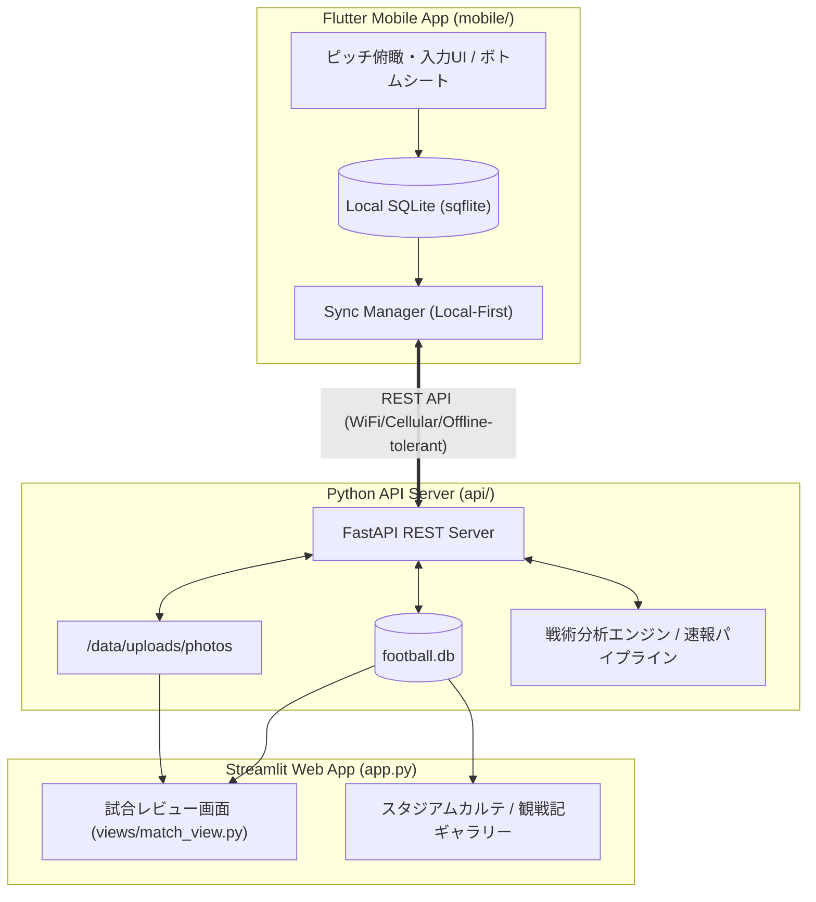

# 観戦特化型モバイルアプリ 仕様書 (MOBILE_APP_SPECIFICATION)

## 1. 概要・目的
スタジアムやTVの前で試合を観戦しながら、**「試合の瞬間を見逃さず」**、片手でスピーディーに両チームの選手評価（Good/Bad）、観戦メモ、写真を記録できるFlutterモバイルアプリ。
サーバー（FastAPI）と連携し、事前戦術分析・リアルタイム速報・観戦ガイドを参照できるほか、記録した観戦メモや写真は既存のWebサイト（Streamlit）の試合レビュー画面へ自動的に統合・反映される。

---

## 2. システム構成（全体アーキテクチャ）



---

## 3. モバイルアプリ コア機能・UI仕様

### 3.1 画面レイアウト構成＆片手親指操作UI（メイン入力画面）
- **垂直スタック構成（上から順）**:
  1. **【最上部】**: 試合スコア・スタジアム情報・設定（AppBar）
  2. **【中央部】**: **試合速報・戦術ハイライト最新情報エリア**（速報データやイベントを常時参照可能）
  3. **【下半分】**: **ピッチボード（親指操作ゾーン）**
     - ベンチ選手トレイ（控え選手一覧・横スクロール）
     - サッカーピッチ（GK〜FWが親指の届く下半分に集中配置）
  4. **【ピッチ直下】**: **チーム切り替えトグルボタン（HOME / AWAY）**
     - 親指で即座にホーム/アウェイを 0.1 秒で切り替え可能
  5. **【最下部】**: タイマーコントローラー（分送り/戻し）＆ 直近入力アクションログ
- **ピッチ描画とフォーメーション座標パターン**:
  - ポジションコード（LSB, LCB, CB, RCB, RSB, LWB, RWB, LCM, RCM, LSH, RSH, LOM, ROM, LCF, RCF, CF）に基づき、標準座標辞書（`POSITION_COORDINATES`）から親指操作ゾーンに最適化された座標を自動アサイン。
  - 3バック時は中央CBの有無を検出し、左右CBを自動的にワイド（X: 24.0 / 76.0）に展開して重なりを完全排除。
- **Good / Bad ハイブリッド入力**:
  - **基本操作（最速）**: 選手アイコンを上スワイプで「Good!（いいね）」、下スワイプで「Bad!」を即時記録（バイブレーションによる触覚フィードバック付き）。
  - **詳細付加（余裕がある時）**: 選手アイコンを長押し、または直後のミニポップアップで「プレー種別（パス、プレス、ドリブル、シュート、デュエル等）」やピッチ上の位置・簡易メモを追記可能。
  - **試合時間カウント連動**: 試合開始ボタンを押すとタイマーが進行（手動で分調整も可能）。記録イベントには正確な「試合分（例: 23'）」が自動付与される。

### 3.2 ボトムシート／ティッカー型（リアルタイム分析・観戦ガイド）
- メインピッチ画面の下部に、最新の**「AI戦術速報・モメンタム」ティッカー**を常時1行表示。
- 下部から上へスワイプすることで**展開式ボトムシート**が立ち上がる：
  - **戦術予習・観戦ガイド**: 事前分析データ、キーマッチアップ、注目選手の戦術的役割。
  - **リアルタイム速報**: xG推移、支配率、シュート数、AIによる試合の流れの解説。
- 下スワイプですぐにピッチ入力画面に復帰（片手操作を阻害しない）。

### 3.3 観戦メモ記録（フェーズ別）
- 観戦フェーズに応じた3段階のメモUI：
  1. **観戦前（Pre-Match）**: スタジアム到着、天候、座席の雰囲気、スタメン発表時の期待・戦術展望。
  2. **ハーフタイム（Half-Time）**: 前半の戦術的収穫・課題、後半への修正期待。
  3. **試合後（Full-Time）**: 試合全体の総括、MOM（最優秀選手）選定、次節への提言。
- メモはMarkdownに対応。

### 3.4 スタジアム＆観戦写真管理
- **撮影・アップロード**: アプリ内カメラ起動またはギャラリーからの選択。
- **両軸整理メタデータ**:
  - 試合ID（`match_id`）
  - 観戦フェーズ（`pre_match`, `in_match`, `half_time`, `post_match`）
  - スタジアムID（`stadium`）
  - キャプション／メモ
- **ギャラリービュー**: アプリ内でスタジアムごとのアルバムや、過去の観戦履歴を閲覧可能。

---

## 4. 通信・データ同期仕様（Local-First戦略）

1. **スタジアム電波耐性**:
   - ネット接続の有無にかかわらず、全てのGood/Bad入力・メモ・写真メタデータは端末ローカルDB（`sqflite`）に同期的に書き込まれるため、操作が一切ブロックされない。
2. **バックグラウンド自動同期**:
   - 接続検知（Connectivity）およびタイマーにより、通信可能時にバックグラウンドで未同期キュー（`is_synced = 0`）をFastAPIサーバーへ自動送信。
   - 失敗時は指数バックオフで再試行。
3. **写真の最適化**:
   - アップロード前にクライアント側で解像度リサイズ（長辺1920px程度）およびJPEG圧縮を施し、スタジアムの細い帯域でも高速に送信。

---

## 5. データベース設計（SQLiteテーブル拡張）

### 5.1 `user_match_actions`（Good/Bad評価イベント）
```sql
CREATE TABLE IF NOT EXISTS user_match_actions (
    id TEXT PRIMARY KEY,
    match_id TEXT NOT NULL,
    player_id TEXT NOT NULL,
    team_id TEXT NOT NULL,
    action_type TEXT NOT NULL, -- 'good' | 'bad'
    match_minute INTEGER NOT NULL,
    play_category TEXT,        -- 'pass', 'press', 'dribble', 'shot', 'duel', etc.
    note TEXT,
    created_at TIMESTAMP DEFAULT CURRENT_TIMESTAMP,
    is_synced INTEGER DEFAULT 1
);
CREATE INDEX IF NOT EXISTS idx_actions_match ON user_match_actions(match_id, player_id);
```

### 5.2 `user_match_notes`（観戦メモ）
```sql
CREATE TABLE IF NOT EXISTS user_match_notes (
    id TEXT PRIMARY KEY,
    match_id TEXT NOT NULL,
    phase TEXT NOT NULL,       -- 'pre_match', 'half_time', 'post_match'
    note TEXT NOT NULL,
    mom_player_id TEXT,
    created_at TIMESTAMP DEFAULT CURRENT_TIMESTAMP,
    updated_at TIMESTAMP DEFAULT CURRENT_TIMESTAMP,
    is_synced INTEGER DEFAULT 1
);
CREATE UNIQUE INDEX IF NOT EXISTS idx_notes_match_phase ON user_match_notes(match_id, phase);
```

### 5.3 `user_stadium_photos`（観戦・スタジアム写真）
```sql
CREATE TABLE IF NOT EXISTS user_stadium_photos (
    id TEXT PRIMARY KEY,
    match_id TEXT NOT NULL,
    stadium_id TEXT NOT NULL,
    phase TEXT,                -- 'pre_match', 'in_match', 'half_time', 'post_match'
    file_path TEXT NOT NULL,   -- サーバー側の相対パス (/data/uploads/photos/...)
    caption TEXT,
    created_at TIMESTAMP DEFAULT CURRENT_TIMESTAMP,
    is_synced INTEGER DEFAULT 1
);
CREATE INDEX IF NOT EXISTS idx_photos_match ON user_stadium_photos(match_id);
CREATE INDEX IF NOT EXISTS idx_photos_stadium ON user_stadium_photos(stadium_id);
```

---

## 6. バックエンドAPI設計 (FastAPI)

- `GET /api/matches/{match_id}/app_context`:
  - 試合基本情報、両チームスタメン・ベンチ選手リスト（フォーメーション座標付き）、事前分析サマリー、リアルタイム速報データを一括返却。
- `POST /api/sync/actions`:
  - 端末で蓄積されたGood/Badアクションを一括アップロード・マージ。
- `GET /api/matches/{match_id}/actions/summary`:
  - 選手ごとのGood/Bad集計数、時系列分布を返却（Web側レビューやアプリ内の統計グラフ用）。
- `POST /api/sync/notes`:
  - フェーズ別観戦メモの保存・更新。
- `POST /api/sync/photos`:
  - 写真バイナリのマルチパートアップロード＋メタデータ保存。
- `GET /api/stadiums/{stadium_id}/photos`:
  - スタジアム別の写真一覧。

---

## 7. Streamlit Webレビュー画面との連携

- `views/match_view.py` に「現地観戦レポート・サポーター評価」セクションを追加：
  1. **選手別サポーター採点/リアクション**: 観戦中に入力されたGood/Badの比率とコメントを選手カードにバッジ表示。
  2. **現地観戦メモ（タイムライン）**: Pre-Match、Half-Time、Post-Matchのメモを時系列タイムラインで美しく表示。
  3. **現地フォトギャラリー**: 試合中に撮影されたスタジアム風景やピッチ写真をグリッド表示。

---

## 8. コーディング・品質規約（Flutter / Dart）

- **ネスト防止とWidget分割**:
  - 1つのbuildメソッドやWidgetが深くなりすぎないよう、ピッチ用コンポーネント（`PitchBoard`）、選手ピン（`PlayerPin`）、ベンチトレイ（`BenchTray`）、ボトムシート（`TacticalBottomSheet`）等に細かく分割。
  - 末尾カンマ（Trailing comma）を徹底し、自動フォーマットを常に整える。
  - `{ }` やカッコの閉じ漏れ・不一致を厳格に防止。
- **テスト駆動**:
  - バックエンドAPIは `pytest` による単体・結合テストを作成。
  - Flutter側は `flutter test` によるモデルのシリアライズ・ローカルDB・Widgetテストを作成。

---

## 9. レイアウト・アクセシビリティ対応（フォント倍率耐性）

- **端末文字サイズ拡大対応 (`FittedBox`)**:
  - Android OSのフォントサイズ変更（1.15倍〜1.5倍など）によってピッチ上の選手ピン内で `RenderFlex overflowed` が発生するのを防止。
  - `PlayerPin` 内部のテキスト群を `FittedBox(fit: BoxFit.scaleDown)` で保護し、枠内に安全に自動スケーリング。
  - ピンの寸法を `width: 82.0, height: 46.0` に最適化し、背番号・ポジション・氏名が視認しやすくタップしやすいタッチターゲットを確保。
  - Widgetの分割（`_buildBoxDecoration`, `_buildNumberBadge`, `_buildPositionLabel`, `_buildPlayerNameText`）によりネストを浅く保ち、末尾カンマを徹底。

---

## 10. 実データ連携仕様 (第13節 ファジアーノ岡山 vs FC東京)

- **岡山 (HOME) スタメン (11名)**:
  - GK 52 濱田 太郎 / DF 43 鈴木 喜丈, 44 森 壮一朗, 48 立田 悠悟 / MF 8 江坂 任, 10 ナ サンホ, 26 本山 遥, 41 宮本 英治, 51 白井 康介, 80 オベルダン / FW 99 ルカオ
- **岡山 (HOME) 控え (7名)**:
  - GK 1 レナート モーザー, DF 2 高木 友也, DF 6 大森 博, MF 14 田部井 涼, MF 17 末吉 塁, FW 9 グレイソン, FW 11 木村 太哉
- **FC東京 (AWAY) スタメン (11名)**:
  - GK 81 キム スンギュ / DF 4 稲村 隼翔, 6 バングーナガンデ 佳史扶, 22 石原 広教, 24 アレクサンダー ショルツ / MF 7 安斎 颯馬, 8 高 宇洋, 10 佐藤 恵允, 20 永野 修都 / FW 26 長倉 幹樹, 39 仲川 輝人
- **FC東京 (AWAY) 控え (7名)**:
  - GK 1 児玉 剛, DF 3 森重 真人, MF 27 常盤 亨太, MF 37 小泉 慶, MF 71 荒木 遼太郎, FW 11 遠藤 渓太, FW 98 白井 陽斗
- **自動配置アルゴリズム**:
  - `api/routes/context.py` の `_auto_layout_starters` により、GK(Y:88%), DF(Y:72%), ボランチ(Y:55%), トップ下/サイド(Y:38%), FW(Y:18%) のピッチラインへ人数に応じて自動等間隔分散配置。重なりを完全排除。
