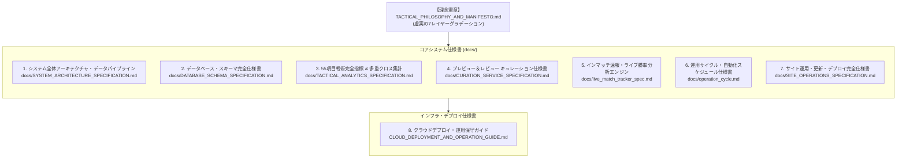

# J1戦術分析・観戦ガイドRAG システム仕様書 総合目次 (Documentation Index)

本ディレクトリ（`docs/`）は、Jリーグ2026シーズンを対象としたAI統合型戦術分析・観戦ガイドRAGプラットフォームの **全システム仕様、データモデル、アルゴリズム、運用設計書** を網羅的に管理・保管する公式ドキュメント基盤です。

---

## 📚 仕様書体系マップ (Documentation Hierarchy)

---

## 📑 仕様書一覧と担当範囲

| 仕様書名 | 主な内容・対象コンポーネント | リンク |
| :--- | :--- | :--- |
| **0. 理念憲章** | 『虚実のグラデーション（The 7-Layer Spectrum of Football Truth）』 事実の羅列とハルシネーションを排し、客観事実とロマンを共存させる哲学。 | [TACTICAL_PHILOSOPHY_AND_MANIFESTO.md](file:///d:/workspace/flutter/football_rag/TACTICAL_PHILOSOPHY_AND_MANIFESTO.md) |
| **1. 全体アーキテクチャ** | 外部データ取得 $\to$ 正規化 $\to$ 永続化 $\to$ エンリッチ $\to$ キュレーション $\to$ 配信UIの一連のシステム構造図とデータフロー。 | [SYSTEM_ARCHITECTURE_SPECIFICATION.md](file:///d:/workspace/flutter/football_rag/docs/SYSTEM_ARCHITECTURE_SPECIFICATION.md) |
| **2. DBスキーマ完全仕様** | SQLite `football.db` の全11テーブル完全定義。 Football LAB 75項目、選手出場スタッツ22項目、言説4,500件、ER図。 | [DATABASE_SCHEMA_SPECIFICATION.md](file:///d:/workspace/flutter/football_rag/docs/DATABASE_SCHEMA_SPECIFICATION.md) |
| **3. 55項目戦術指標仕様** | 空間幾何学（Convex Hull, Voronoi）、ネットワーク理論（PageRank）、確率統計（ポアソンxPTS, ピタゴラス勝率）、15分動的マトリクス、相手分類耐性。 | [TACTICAL_ANALYTICS_SPECIFICATION.md](file:///d:/workspace/flutter/football_rag/docs/TACTICAL_ANALYTICS_SPECIFICATION.md) |
| **4. キュレーション仕様** | 試合前プレビュー（3案分岐シナリオ）および試合後戦術カルテ生成仕様。 事実と推測のタグ付け、結果バイアスの排除ロジック。 | [CURATION_SERVICE_SPECIFICATION.md](file:///d:/workspace/flutter/football_rag/docs/CURATION_SERVICE_SPECIFICATION.md) |
| **5. ライブ速報エンジン** | インマッチ速報、SPAIA詳細スタッツ連携、二変量ポアソン畳み込みによるリアルタイム動的勝率推論。 | [live_match_tracker_spec.md](file:///d:/workspace/flutter/football_rag/docs/live_match_tracker_spec.md) |
| **6. 運用サイクル仕様** | KOからの相対時間（KO-48h, KO-1h, Stage 1: KO+3h, Stage 2: KO+48h）による日次・試合日自動バッチパイプライン。 | [operation_cycle.md](file:///d:/workspace/flutter/football_rag/docs/operation_cycle.md) |
| **7. サイト運用仕様** | 4つの独立運用モード（試合単体/チーム単体/リーグ全体/デプロイ）、安全ガードレール、該当試合ダイレクト4大外部リンク仕様。 | [SITE_OPERATIONS_SPECIFICATION.md](file:///d:/workspace/flutter/football_rag/docs/SITE_OPERATIONS_SPECIFICATION.md) |
| **8. クラウド運用ガイド** | Streamlit Cloud、GitHub Actions、Google Drive同期、OneDrive連携のインフラ設定とデプロイ手順。 | [CLOUD_DEPLOYMENT_AND_OPERATION_GUIDE.md](file:///d:/workspace/flutter/football_rag/CLOUD_DEPLOYMENT_AND_OPERATION_GUIDE.md) |

---

## 🛠️ 仕様書と実装コードの対応表

| 実装モジュール / スクリプト | 対応する仕様書 | 主要テストスイート |
| :--- | :--- | :--- |
| `pipeline/flab_team_stats_ingester.py` | `DATABASE_SCHEMA_SPECIFICATION.md` | `tests/test_flab_team_stats_ingester.py` |
| `pipeline/match_tactical_enricher.py` | `SYSTEM_ARCHITECTURE_SPECIFICATION.md` | `tests/test_match_tactical_enricher.py` |
| `pipeline/team_55_metrics_calculator.py` | `TACTICAL_ANALYTICS_SPECIFICATION.md` | `tests/test_team_55_metrics_calculator.py` |
| `pipeline/team_cross_analytics.py` | `TACTICAL_ANALYTICS_SPECIFICATION.md` | `tests/test_team_cross_analytics.py` |
| `scripts/batch_update_all_teams_tactics.py` | `TACTICAL_ANALYTICS_SPECIFICATION.md` | `tests/test_team_55_metrics_calculator.py` |
| `pipeline/fctokyo_55_metrics_calculator.py` | `TACTICAL_ANALYTICS_SPECIFICATION.md` | `tests/test_fctokyo_55_metrics_calculator.py` |
| `pipeline/fctokyo_cross_analytics.py` | `TACTICAL_ANALYTICS_SPECIFICATION.md` | `tests/test_fctokyo_cross_analytics.py` |
| `pipeline/preview_curation_service.py` | `CURATION_SERVICE_SPECIFICATION.md` | `tests/test_preview_curation_service.py` |
| `pipeline/review_curation_service.py` | `CURATION_SERVICE_SPECIFICATION.md` | `tests/test_review_curation_service.py` |
| `pipeline/external_links.py` | `SITE_OPERATIONS_SPECIFICATION.md` | `tests/test_external_links.py` |
| `.agents/skills/site-operations/` | `SITE_OPERATIONS_SPECIFICATION.md` | `tests/test_spec_conformance.py` |
| `scripts/live_match_forecaster.py` | `live_match_tracker_spec.md` | `tests/test_live_match_forecaster.py` |
| `scripts/run_scheduled_pipeline.py` | `operation_cycle.md` | `tests/test_run_scheduled_pipeline.py` |

