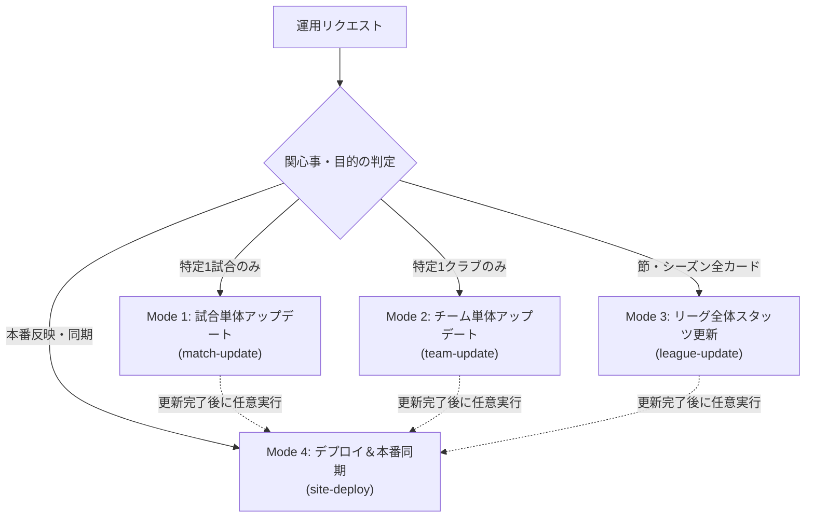

# J1戦術分析・観戦ガイドRAG システム仕様書
## サイト運用・更新・デプロイ完全仕様書 (Site Operations & Deployment Specification)

---

### 1. 概要・運用原則

本仕様書は、Jリーグ戦術分析・観戦ガイドRAGシステムにおいて、試合データの最新化、戦術分析レポートの生成、テスト検証、Git同期、および Streamlit Community Cloud への本番反映を行うための **運用プロトコルおよびデプロイ仕様** を定義するものです。

システムの変更コストと実行リスクを最小化するため、以下の **4つの独立運用モード** に明確に分離されています。



---

### 2. 共通安全制約プロトコル (Safety Guardrails)

エージェントおよび開発者は、デプロイやデータ更新において以下の安全制約を厳格に遵守します。

1. **事前ユーザー承認ルール (No Unauthorized Commit)**:
   - コミットおよびプッシュは、事前に必ずユーザーに内容を提示し、明示的な指示（「コミットして」「プッシュして」等）を得てから実行する。勝手なコミットは禁止。
2. **フルテスト必須ガードレール (100% Pass Requirement)**:
   - コミット前に必ず `python -m unittest discover tests`（365件以上）を実行し、全テスト合格を確認する。1件のエラーも許容しない。
3. **かっこの閉じ漏れ・コード品質の防御**:
   - 1つのメソッドのネストが深くなりすぎないよう、細かく関数やモジュールに切り出す。
   - 末尾カンマを徹底し、コミット前に `python -m py_compile` による構文チェックを行う。
4. **Git Rebase とバイナリコンフリクト自動解決**:
   - リモート（GitHub Actions による定期実行コミット等）と履歴が分岐した場合は、`git pull --rebase origin main` で同期する。
   - `data/football.db` 等のバイナリファイルでコンフリクトが発生した場合、最新データを保持している側（`git checkout --theirs <file>`）を採用して解決する。

---

### 3. 4つの独立運用モード詳細仕様

#### 3.1 Mode 1: 試合単体アップデート (`match-update`)
- **目的**: 特定の1試合のみを迅速に最新化し、レポートやリンクを生成する。
- **入力パラメータ**: `match_id`（例: `20261031_OKA_FCT`）または `home`, `away`, `date`
- **主要パイプライン**:
  1. `data/football.db` への試合メタ情報、チームスタッツ、出場選手30名（実名・背番号・ポジション・スタッツ・CBP）、マッチイベントの登録。
  2. `pipeline/match_tactical_enricher.py` による `match_context` 付き構造化戦術JSON (`data/structured/{match_id}_tactical.json`) の生成。
  3. `pipeline/review_curation_service.py` による Layer 2 仮説導出レビュー (`exports/{match_id}_review_curated.md`) の生成。
  4. `pipeline/external_links.py` による該当試合ダイレクト4大外部リンクの生成。

#### 3.2 Mode 2: チーム単体アップデート (`team-update`)
- **目的**: 特定の1クラブのみのスカッド情報、負傷者、戦術プロファイルを更新する。
- **入力パラメータ**: `team_id`（例: `FCT`, `OKA`）
- **主要パイプライン**:
  1. 所属選手名鑑・個人スタッツの更新 (`scripts/export_team_players_sheet.py --team <TEAM_ID>`)。
  2. 負傷者トラッカー (`config/injury_tracker.json`) および契約条項 (`config/loan_restrictions.json`) の更新。
  3. チーム戦術プロファイル (`knowledge/team_tactical_profiles.json`) の調整。

#### 3.3 Mode 3: リーグ全体スタッツ更新 (`league-update`)
- **目的**: 指定節（全10試合）またはシーズン全体の全クラブデータを一括同期する。
- **入力パラメータ**: `matchweek`（例: `13`）または `--all`
- **主要パイプライン**:
  1. 指定節の全10試合スコア・チームスタッツの一括投入 (`data/football.db`)。
  2. 全構造化戦術JSONの一括再構築 (`scripts/rebuild_all_tactical_structures.py`)。
  3. 全節戦術カルテ (`exports/J1_2026_全節戦術カルテ.md`) およびシーズン統合分析の更新。

#### 3.4 Mode 4: デプロイ＆本番同期 (`site-deploy`)
- **目的**: ローカルの更新結果をテスト検証し、GitHub 経由で Streamlit Community Cloud へ安全に反映する。
- **実行プロトコル**:
  1. コード構文チェック: `python -m py_compile app.py pipeline/*.py agent/*.py`
  2. 単体テスト実行: `python -m unittest tests/test_external_links.py tests/test_spec_conformance.py ...`
  3. 全体フルテスト実行: `python -m unittest discover tests`（365件全パス確認）
  4. ユーザー承認の取得
  5. リモート履歴同期: `git pull --rebase origin main`（コンフリクト時は `--theirs` 解決）
  6. コミット & プッシュ: `git push origin main`
  7. クラウド稼働確認: Streamlit Cloud 自動ビルド監視

---

### 4. 該当試合ダイレクト4大外部リンク仕様

各試合のヘッダー直下には、該当試合に直接アクセスできる5種類の外部リンクボタンが配置されます（`pipeline/external_links.py`）。

| リンク種別 | リンク先URL仕様 | 用途・表示バッジ |
| :--- | :--- | :--- |
| **📺 YouTube公式ハイライト** | `https://www.youtube.com/results?search_query={season}+J1+第{mw}節+{home}+{away}+ハイライト` | 公式ハイライト動画への検索直結 |
| **⚽ Jリーグ公式 戦評** | `https://www.jleague.jp/match/j1/{season}/{mmdd}{game_seq}/` | Jリーグ公式サイトの該当試合マッチレポート |
| **🏢 ホーム公式レビュー** | 各クラブ公式サイトの試合速報・レポートページ（全20クラブ自動マッピング） | ホーム側クラブ視点の公式レポート・会見 |
| **🏢 アウェイ公式レビュー** | 各クラブ公式サイトの試合速報・レポートページ（全20クラブ自動マッピング） | アウェイ側クラブ視点の公式レポート・会見 |
| **📰 Yahoo! 速報** | `https://soccer.yahoo.co.jp/jleague/category/j1/game/{game_id}/summary` | スポーツナビ 該当試合のテキスト速報・スタッツ |
| **📊 Football LAB** | `https://www.football-lab.jp/{club_slug}/report/?year={YYYY}&month={MM}&date={DD}` | Football LAB 該当試合のCBP・戦術詳細レポート |

---

### 5. 実装モジュール対応表

| モード / 機能 | 実装モジュール | テストスイート |
| :--- | :--- | :--- |
| サイト運用スキル定義 | `.agents/skills/site-operations/SKILL.md` | - |
| 試合単体アップデート | `pipeline/match_tactical_enricher.py`<br>`pipeline/review_curation_service.py` | `tests/test_match_tactical_enricher.py`<br>`tests/test_review_curation_service.py` |
| チーム単体アップデート | `scripts/export_team_players_sheet.py`<br>`pipeline/match_context_service.py` | `tests/test_export_team_players_sheet.py`<br>`tests/test_match_context.py` |
| リーグ全体更新 | `scripts/rebuild_all_tactical_structures.py`<br>`scripts/batch_update_all_teams_tactics.py` | `tests/test_spec_conformance.py` |
| 4大外部リンク生成 | `pipeline/external_links.py` | `tests/test_external_links.py` |
| UI統合表示 | `app.py` (`render_external_links_bar`) | `tests/test_dashboard_helpers.py` |
| 仕様書 NotebookLM 同期 | `scripts/sync_docs_to_nlm.py` | `tests/test_sync_docs_to_nlm.py` |

---

### 6. 仕様書 NotebookLM 自動同期運用 (Doc Sync to NotebookLM)

システム設計書・運用仕様書群（`docs/*.md`）は、Gemini NotebookLM の専用ノートブック（`⚽ football_rag システム仕様書`、エイリアス: `football_rag_docs`）へスマート差分同期されます。

#### 1. 運用コマンド
```bash
# 差分シミュレーション（アップロード・削除を行わず計画のみ表示）
python scripts/sync_docs_to_nlm.py --dry-run

# スマート差分同期実行（ハッシュ検知により変更があったファイルのみ削除・再登録）
python scripts/sync_docs_to_nlm.py

# 強制全件再同期（ハッシュ一致を無視して全件再アップロード）
python scripts/sync_docs_to_nlm.py --force
```

#### 2. スマート差分検出アーキテクチャ
1. **SHA256ハッシュ判定**: ローカルの `docs/*.md` のハッシュ値を計算し、`.nlm_sync_cache.json` と比較。
2. **変更分のみ更新**: 未変更ファイル（8〜9割）はスキップし、変更があったファイルのみ旧ソース削除・最新版アップロードを実施。
3. **新規・削除追従**: ローカルに新規追加されたファイルは NotebookLM に追加、ローカルで削除されたファイルはリモートからも自動削除。
4. **クォータ保護**: NotebookLM の API クォータと不要な ID 再生成を最小限に抑制。


