# J1戦術分析・観戦ガイドRAG システム仕様書
## システム全体アーキテクチャ・データパイプライン仕様書 (System Architecture Specification)

---

### 1. 全体アーキテクチャ概要

本システムは、Jリーグの公式速報、トラッキングデータ、戦術スタッツ、およびメディア・言説データを統合し、客観事実に基づくプレビュー・ライブ速報・戦術分析・RAG QAを提供する **AI統合型フットボール・アナリティクス基盤** です。

```mermaid
flowchart TD
    subgraph DataSources ["1. 外部データ取得レイヤー"]
        S_JL["J.LEAGUE 公式サイト<br>(日程, 速報, 公式記録, 会見)"]
        S_FL["Football LAB<br>(75項目チーム・CBP・進入ログ)"]
        S_YT["YouTube / 戦術メディア<br>(言説ログ, 記者解説, 4500件)"]
        S_SP["SPAIA / トラッキング<br>(選手平均座標, スプリント)"]
    end

    subgraph Ingestion ["2. データインジェスト・正規化パイプライン"]
        I_SCH["schedule_crawler.py<br>(日程同期・試合フェーズ計算)"]
        I_FL["flab_team_stats_ingester.py<br>(75項目パース & CBP上書き防止)"]
        I_PL["player_stats_ingester.py<br>(個人スタッツ & ポジション正規化)"]
        I_EV["match_events / discourse<br>(イベントクレンジング・真ゴール判定)"]
    end

    subgraph Storage ["3. 永続データストア"]
        DB[("data/football.db<br>(SQLite正規化ストア 全11テーブル)")]
        VDB[("data/chroma_db/<br>(ChromaベクトルDB 戦術言説)")]
        RAW[("data/raw/<br>(生JSON・HTMLキャッシュ)")]
    end

    subgraph Enrichment ["4. 戦術エンリッチ・先進推論レイヤー"]
        E_TAC["match_tactical_enricher.py<br>(決定論的エンリッチ・結果バイアス排除)"]
        E_55["fctokyo_55_metrics_calculator.py<br>(55項目戦術完全指標・ポアソン・幾何計算)"]
        E_CRS["fctokyo_cross_analytics.py<br>(15分ダイナミクス, ユニット相性, 相手分類)"]
        E_STR["data/structured/<br>(全試合 tactical.json & シーズン統合JSON)"]
    end

    subgraph CurationRAG ["5. キュレーション・レポーティング・配信"]
        C_PRE["preview_curation_service.py<br>(3案分岐 試合前プレビュー生成)"]
        C_REV["review_curation_service.py<br>(内容vs結果 試合後戦術カルテ)"]
        C_LIV["live_match_forecaster.py<br>(二変量ポアソン ライブ動的勝率予測)"]
        C_QA["agent/qa_engine.py<br>(Gemini連携 戦術RAG QA)"]
    end

    subgraph Delivery ["6. プレゼンテーション・ユーザーインターフェース"]
        UI_APP["Streamlit Web App (app.py)<br>(分析ダッシュボード, 画面表示)"]
        UI_MOB["モバイルHTMLビューア<br>(mobile_viewer/index.html)"]
        UI_DOC["Markdownカルテ / Sheets<br>(exports/ ドキュメント群)"]
    end

    DataSources --> Ingestion
    Ingestion --> Storage
    Storage --> Enrichment
    Enrichment --> CurationRAG
    CurationRAG --> Delivery
```



---

### 2. レイヤー別 詳細機能仕様

#### 2.1 外部データ取得レイヤー (Data Ingestion)
- **`scraper.py` / `scripts/ingest_matchday_immediate.py`**:
  - 試合終了直後（Stage 1: KO+3h）に、Jリーグ公式・速報プロバイダからスコア、得点者、出場選手、監督・選手会見テキストを非同期クローリング。
- **`pipeline/flab_team_stats_ingester.py`**:
  - Football LABより75項目の詳細チームスタッツを自動取得。
  - **重要仕様**: `cbp_team_list` 内の先頭8項目（真のCBPポイント）のみを抽出し、後続の同名成功率データによる上書きを完全防止するガードレールを内蔵。

#### 2.2 戦術エンリッチ・推論レイヤー (Tactical Enrichment)
- **`pipeline/match_tactical_enricher.py`**:
  - スコアによる「結果バイアス」を排除し、Field Tilt、PA進入変換率、インテンシティ、枠内シュート比率を組み合わせ、内容と結果の乖離（実力勝ち、運勝ち、惜敗、守護神効果）を論理的に判定。
  - 全120試合の戦術JSON（`data/structured/{match_id}_tactical.json`）を決定論的（Deterministic）に生成。
- **`pipeline/fctokyo_55_metrics_calculator.py`**:
  - 空間幾何学（Monotone Chain 凸包面積、伸縮指数、LPW比）、情報理論（シャノンエントロピー、ジニ係数）、確率統計（Dixon & Coles ポアソンxPTSシミュレーション、ピタゴラス期待勝率、BPI前進指数）を完全内製NumPyで高速算出。
- **`pipeline/fctokyo_cross_analytics.py`**:
  - 15分刻み時間帯別マトリクス、スタメンCB/DHユニットシナジー、対戦相手3大クラスタリング（ハイプレス、ミドルブロック、ローブロック）耐性を集計し、`data/structured/fctokyo_season_tactical_synthesis.json` に永続化。

#### 2.3 キュレーション・レポーティング・QAレイヤー (Curation & RAG)
- **`pipeline/preview_curation_service.py`**:
  - 次戦対戦相手の戦術タイプとFC東京の耐性マトリクスを照合し、正攻法・迎撃・奇襲の「3案分岐」プレビューを生成。
- **`scripts/live_match_forecaster.py`**:
  - 試合進行中の経過時間、途中スタッツ、得点イベントから、残り時間の二変量ポアソン畳み込みによりリアルタイム勝率・引分率を動的推論。
- **`agent/qa_engine.py`**:
  - ChromaベクトルDB（4,500件の言説データ）と SQLite（確定L1スタッツ/L2 55項目）をハイブリッド参照し、ハルシネーションを根絶した事実根拠付き戦術回答を生成。

#### 2.4 アプリケーション・配信レイヤー (Delivery)
- **`app.py`（Streamlitダッシュボード）**:
  - 戦術カルテ閲覧、クラブ間スタッツ比較、対話型QAインターフェース。
- **`scripts/generate_mobile_viewer.py`**:
  - スマートフォンでの高速オフライン閲覧に特化した単一ファイルHTML（`exports/mobile_viewer/index.html`）を自動ビルド。
- **`scripts/sync_to_cloud_drive.py`**:
  - 生成されたMarkdownレポートやExcelカルテを Google Drive（`K:\マイドライブ\JLeague_RAG`）および OneDrive へ自動同期。

---

### 3. バッチ実行・自動運用フロー

システムは以下のスケジュールで自動パイプラインが実行されます：

```text
[毎日 06:00 JST]
  └─ 日程・試合フェーズ同期 (scripts/run_scheduled_pipeline.py)

[試合日 KO-48h]
  └─ 暫定プレビュー自動生成 (_auto)

[試合中]
  └─ インマッチ速報・リアルタイム勝率推論 (live_match_forecaster.py)

[試合後 KO+3h (Stage 1)]
  └─ 速報スタッツ・会見コメント取り込み、モバイルビューア更新

[試合後 KO+36h〜48h (Stage 2)]
  └─ Football LAB 75項目確定インジェスト、55項目指標算出、戦術カルテ確定 (_curated)
```

