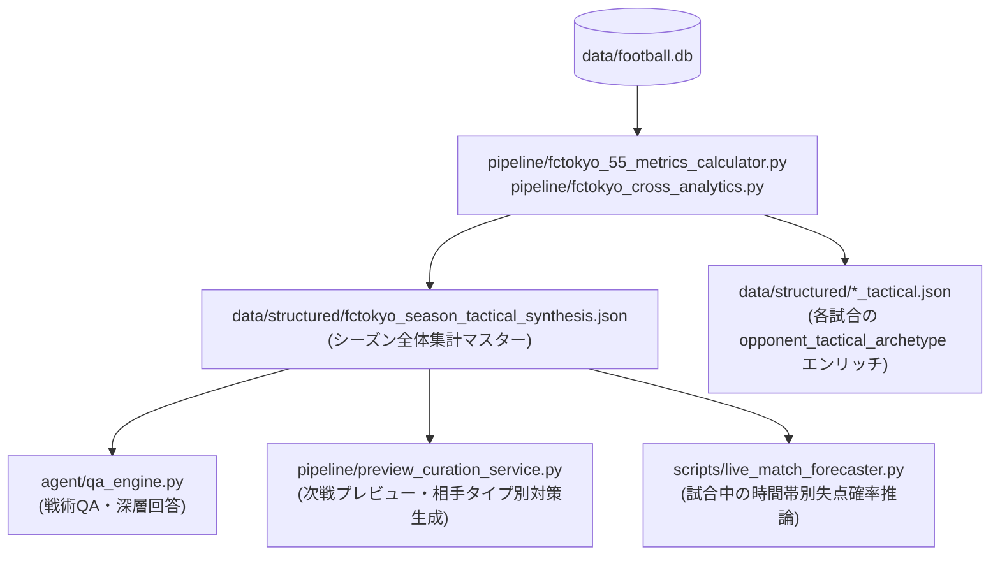

# J1戦術分析・観戦ガイドRAG システム仕様書
## FC東京 55項目戦術指標および多重クロス集計アナリティクス仕様書

---

### 1. 概要・設計思想

本仕様書は、Jリーグ2026シーズンにおける客観事実（Layer 1）および戦術ヒューリスティクス・先進統計モデル（Layer 2）の統合分析基盤の機能仕様を定義するものです。
『虚実のグラデーション（TACTICAL_PHILOSOPHY_AND_MANIFESTO.md）』に基づき、無機質なスタッツの羅列を排し、空間幾何学・ネットワーク理論・確率統計学を融合した高度な戦術解剖・プレビュー・QA機能を提供します。

---

### 2. 全55項目 戦術指標体系

全55項目は、「基本30項目」と「学術・先進25項目（元の8大先進指標を包含）」から構成されます。

#### 2.1 学術・先進25項目（項目31〜55）

| 項目ID | 指標名称 | 理論背景 / 参照 | 算出アルゴリズム・数式 | 判定基準・戦術的意味 |
| :---: | :--- | :--- | :--- | :--- |
| **31** | **チーム凸包面積 (Convex Hull Area)** | Frencken et al. (2011) | 先発FP10名の平均座標 $(x_i, y_i)$ から Monotone Chain アルゴリズムにより外接多角形面積を算出 ($\text{m}^2$) | 1,150$\text{m}^2$未満: 超コンパクト 1,350$\text{m}^2$超: 間延び・ワイド |
| **32** | **伸縮指数 (Stretch Index)** | Bourbousson et al. (2010) | チーム重心 $(\bar{x}, \bar{y})$ から各FP選手位置への平均ユークリッド距離 | 値が小さいほど局所密度が高くブロックが強固 |
| **33** | **縦横アスペクト比 (LPW Ratio)** | 学術標準 | 縦幅 Length / 横幅 Width | 1.0超: 縦に長い縦深陣形 1.0未満: 横幅を使った陣形 |
| **34** | **ボロノイ支配領域推定** | Taki & Hasegawa | 凸包面積とボール保持率からピッチ実効占有率を推定 | 55%超: 空間支配において優位 |
| **35** | **タッチ関与シャノン・エントロピー** | Passos et al. (2011) | $H_{\text{norm}} = -\sum p_i \ln(p_i) / \ln(N)$ | 0.90以上: 全員関与型 0.80未満: 特定選手への依存 |
| **36** | **ビルドアップ集中度ジニ係数** | Grund (2012) | CBP・タッチ配分のローレンツ曲線下面積 | 0.30未満: 分散型均等配分 0.45超: 司令塔固定型 |
| **37** | **有向PageRank中心性** | Buldú et al. (2018) | 得点・アシスト・CBP有向グラフの主固有ベクトル導出 | チーム攻撃を牽引する中核ハブ選手を特定 |
| **38** | **攻撃チャンネル多様性指数** | Simpson's Index | パス、クロス、ドリブルCBP構成比 $p_k$ に対し $1 - \sum p_k^2$ | 0.65以上: 多彩な崩しパターン 0.50未満: 単一経路偏重 |
| **39** | **ゾーン別期待脅威度 (xT近似)** | Karun Singh (2018) | $0.037 \times (\text{30m進入}) + 0.088 \times (\text{PA進入})$ | 危険地帯への前進による得点確率増分 |
| **40** | **アクション価値評価 (Proxy-VAEP)** | Decroos et al. (2019) | $\text{xG} + \text{xA} + 0.015 \times \sum \text{CBP}$ | チーム全体のアクション総価値 |
| **41** | **オン・ザ・ボール価値 (Non-Shot OBV)** | StatsBomb (2021) | $\text{Proxy-VAEP} - \text{xG}$ | シュートに至る手前の前進・好機創出貢献 |
| **42** | **スペース創出推論スコア** | Spearman (2018) | スプリント数、ドリブル数、30m進入数の合成スコア | 相手守備を動かして隙間を創出した度合い |
| **43** | **ポアソン期待勝点 (xPTS)** | Dixon & Coles (1997) | チームxGと相手xGによるポアソン分布シミュレーション勝率 | 内容面から導かれる正当な期待勝点 |
| **43b** | **運指数 (Luck Index)** | - | $\text{実勝点} - \text{xPTS}$ | 正なら運勝ち・GK守護神、負なら決定力下振れ |
| **44** | **サッカー版ピタゴラス期待勝率** | Morey / Hamilton | $\text{xG}^{1.35} / (\text{xG}^{1.35} + \text{相手xG}^{1.35}) \times 100$ | スタッツに基づく統計的実力勝率 (%) |
| **45** | **1シュートあたり期待値 (Shot Quality)** | Trainor (2014) | $\text{xG} / \text{シュート数}$ | 0.12超: 決定的な好機を厳選してシュート |
| **46** | **ベイズ縮小決定力スキル** | Gelman et al. | 事前分布平滑化 $(\text{得点}+1) / (\text{xG}+1)$ | 再現性のある真のフィニッシュ能力 |
| **47** | **ポゼッション補正パステンポ** | 実戦指標 | $(\text{パス数} / \text{支配率}) \times 50$ | 550以上: 高速循環、450未満: 遅攻・停滞 |
| **48** | **BPI（ボール前進総合指数）** | 複合インデックス | 縦志向性 (Directness) $\times$ パス成功率 $\times (\text{30m}/\text{パス})$ | 正確さと推進力を兼ね備えた前進力 |
| **49** | **プレス誘発カウンター変換効率** | ハイプレス理論 | $(\text{奪取CBP} + \text{インターセプト}) / \text{攻撃回数} \times 100$ | 守備奪取から好機へ繋げるショートカウンター効率 |
| **49b** | **プレス強度 (Proxy-PPDA)** | Colin Trainor | $\text{相手パス数} / (\text{タックル} + \text{インターセプト})$ | 低いほどハイプレス、高いほどローブロック |
| **50** | **守備ブロック弾力性 (Box Resistance)** | 守備陣形論 | $1.0 - (\text{被枠内シュート} / \text{相手PA進入数})$ | 0.75以上: ゴール前中央の遮断が強固 |
| **51** | **ゲーム状態効果プロファイル** | 実戦指標 | 先制リード時、同点時、ビハインド時の時間帯別スタッツ補正 | スコア動向に伴う戦術挙動の補正 |
| **52** | **温熱ストレス指数 (Thom不快指数)** | 生物気候学 | 気温・天候からの不快指数とスプリント減衰率 | 夏場・高湿度時の運動量・失速推論 |
| **53** | **交替選手限界価値増分 (Sub-MVA)** | ベンチワーク分析 | 途中交代選手の得点・アシスト・CBP関与度 | 指揮官の交代カードによる戦況好転度 |
| **54** | **ピリオダイゼーション負荷 (ACWR)** | Gabbett (2016) | 直近走行負荷の急性 / 慢性比率 | 0.8〜1.3: スイートスポット、1.5超: 怪我警戒 |
| **55** | **マルコフ連鎖モメンタム安定度** | 確率過程 | 15分ごとの主導権推移から終盤耐性スコアを導出 | 終盤の失点リスク・試合の締めくくり力 |

#### 2.2 基本30項目（項目1〜30）
- ポジショニング・ビルドアップ (1〜6): 実質フォーメーション、3サード滞留比、サイド偏重度、CB縦パス貢献度、30m→PA進入変換率、ドリブル突破スコア
- 守備・トランジション (7〜12): 敵陣ボール奪取指数、セカンドボール回収率、迎撃vsカバーリング比率、危険エリアファウルリスク、前後半運動量減衰率、被カウンター脆弱性
- 選手特性・フィジカル (13〜18): ジョーカーインパクト、最高時速・スプリント密度、連戦蓄積疲労度、利き足×通過レーン適合性、体格×デュエル勝率、スカウティング対策検証スコア
- スカッド運用・編成評価 (19〜24): キャリア適応進捗度、編成費用対効果 (ROI)、選手間平均距離復元率、擬似xG生成量、擬似xA供給量、マッチ評点要因分解
- シミュレーション・分析 (25〜30): ホーム/アウェイ戦力差分、次戦対戦相手適合度シミュレーション、イベント時系列構造、セットプレー期待値寄与率、プレッシング耐性指数、クロスターゲット充足率

---

### 3. 多重クロス集計アナリティクス仕様

手元の確定ログ（L1）を多重グルーピングし、隠れた戦術傾向を導出する3大解析機能です。

#### 3.1 時間帯別15分ダイナミクス（Time-Segment Dynamics）
- **時間区分**: `0-15分`、`16-30分`、`31-45分+`、`46-60分`、`61-75分`、`76-90分+`
- **集計指標**: 得点・失点、枠外シュート・決定機、イエロー/レッドカード、創出xG / 被xG
- **補正仕様**: 後半（2H）で `minute <= 45` の表記データは通算時間（`+45分`）に自動補正。
- **戦術的用途**: チームの「立ち上がりの失点癖」「30〜45分の得点集中」「終盤の失速傾向」を定量化。

#### 3.2 スタメンユニット相性シナジー（Starter Unit Synergy）
- **解析ユニット**:
  - **CBユニット**: センターバックの先発ペア（例: アレクサンダー ショルツ × 稲村 隼翔）
  - **DHユニット**: ボランチの先発コンビ（例: 高 宇洋 × 橋本 拳人）
- **評価メトリクス**: 出場試合数、実勝率 (%)、平均実勝点、平均xPTS、平均チーム凸包面積 ($\text{m}^2$)
- **戦術的用途**: 最もコンパクトな陣形を保ち、勝点を最大化できる「鉄板コンビ」の選定。

#### 3.3 対戦相手戦術タイプ別耐性マトリクス（Opponent Archetype Resistance）
対戦相手のスタッツに基づき、相手を3つの守備アーキタイプに自動クラスタリングします：
1. **ハイプレス型 (`HIGH_PRESS`)**: 相手タックル数 $\ge 18$ または（相手支配率 $\ge 48\%$ かつ 相手クリア数 $\le 16$）
2. **ローブロック・撤退カウンター型 (`LOW_BLOCK`)**: 相手支配率 $< 45\%$ かつ 相手クリア数 $\ge 20$
3. **ミドルブロック型 (`MID_BLOCK`)**: 陣形維持とゾーン迎撃を行う中盤重視型

- **耐性メトリクス**:
  - 対戦タイプごとの勝率 (%)、平均xPTS、BPI（推進力）
  - **30m $\to$ PA進入変換率 (%)**: 相手ブロックの中央を突破できているか
  - **クロス依存率 (%)**: 相手の撤退守備に外回りに追い込まれているか

---

### 4. データ永続化および連携アーキテクチャ

本機能群によって算出されたデータは、以下の構造化ファイルに永続化され、後続パイプラインおよびUI/QAエンジンから参照されます。

- **シーズン統合マスター**: `data/structured/fctokyo_season_tactical_synthesis.json`
- **各試合戦術JSON**: `data/structured/{match_id}_tactical.json`
- **実装ソース**:
  - `pipeline/fctokyo_55_metrics_calculator.py`
  - `pipeline/fctokyo_cross_analytics.py`
- **テストコード**:
  - `tests/test_fctokyo_55_metrics_calculator.py`
  - `tests/test_fctokyo_cross_analytics.py`

