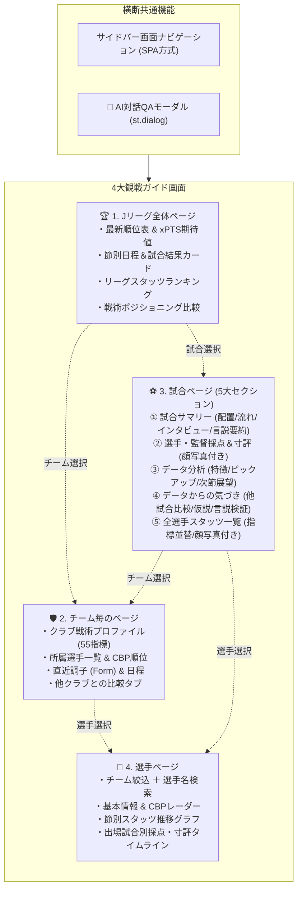

# Jリーグ観戦ガイド UI/UX再編仕様書 (Watching Guide UI Specification)

本書は、Jリーグ戦術分析・観戦ガイドRAGプラットフォームにおける画面構成の刷新、および全4画面（全体・チーム・試合・選手）と横断機能（AI対話モーダル）の機能仕様・UI設計を定義する公式仕様書です。

---

## 1. 画面構成アーキテクチャ概要

従来の単一試合ダッシュボード（`app.py`）から、以下の4つの専用ビューへの再編およびシームレスな相互リンク（ディープリンク）を実現します。



---

## 2. 横断共通機能仕様

### 2.1 ナビゲーション方式（SPA方式）
- **サイドバー切り替え**: `st.sidebar.radio` または `st.segmented_control` による画面切り替え。
- **ディープリンク連携**: `st.session_state` を活用し、全体ページやチームページから試合カードや選手名をクリックした際に、該当ページに対象IDを渡して即時ジャンプ。

### 2.2 どこでもAI対話QA（セクション連動モーダル）
- **起動トリガー**: 各ページの各セクション右上にある「🤖 AIに質問」ボタン。
- **UIコンポーネント**: `st.dialog` を用いたモーダルウィンドウ。
- **コンテキスト引き継ぎ**: 閲覧中のセクション文脈（試合ID、対象チーム、注目指標など）を自動でプロンプトの初期コンテキストとして注入。

---

## 3. 各画面の詳細仕様

### 3.1 🏆 Jリーグ全体ページ (League Overview)
1. **最新順位表 & 期待値 (xPTS / xG / xGA)**
   - 順位、勝点、得失点、勝分敗に加え、Football LABおよびポアソンモデルによる期待勝点（xPTS）、得点期待値（xG）、失点期待値（xGA）を併記。
   - チーム名クリックで「チーム毎のページ」へ遷移。
2. **節別日程・試合結果カード**
   - 節（Matchweek）セレクター。
   - スコアカード、スタジアム、ハイライト動画リンク、公式戦評リンク。
   - カードクリックで「試合ページ」へ遷移。
3. **リーグスタッツランキング**
   - チーム別：ゴール数、ポゼッション率、チャンス構築率、走行距離、スプリント数。
   - 個人別：得点ランク、アシストランク、CBP各部門リーダー。
4. **戦術ポジショニング比較マップ**
   - 散布図：横軸「ボール保持志向（パス数/ポゼッション）」× 縦軸「ハイプレス志向（敵陣ボール奪取率/PPDA）」。
   - 全20チームのクラスタリング可視化。

---

### 3.2 🛡️ チーム毎のページ (Team Profile & Analytics)
1. **チーム選択 & ヘッダーサマリー**
   - J1全クラブのセレクター。
   - チームエンブレム・名称、現在の順位、直近5試合の戦績（Form: W/D/L）。
2. **チーム戦術プロファイル (55戦術指標)**
   - 攻撃／守備／カウンター／プレッシングのスタイルレーダーチャート。
   - 15分時間帯別の得失点マトリクス・ゴール期待値推移。
   - 相手戦術タイプ別の相性・勝率耐性。
3. **所属選手一覧 & CBPランキング**
   - 登録ロスター全選手のポジション、出場時間、ゴール、アシスト。
   - CBP（チャンスビルディングポイント：パス/ドリブル/クロス/奪取/守備）ソート。
   - 選手クリックで「選手ページ」へ遷移。
4. **他クラブ直接対比タブ**
   - 比較対象クラブを選択し、2クラブの主要スタッツ・レーダーチャートをオーバーレイ表示。

---

### 3.3 ⚽ 試合ページ (Match Deep Dive)
従来の9タブを以下の**5つの洗練されたセクション**に再編・統合します。

#### ① 試合サマリー（表示トップ）
- **試合基本情報**: スコア、日時、スタジアム、天候、観客数。
- **公式・外部ダイレクトリンク**: YouTubeハイライト、Jリーグ公式戦評、各クラブ公式、Yahoo速報、Football LAB。
- **試合サマリー**: 試合全体の戦況要約。
- **スタメン配置 & 時間帯別配置の切り替え**: フォーメーションボード（交代後の変化対応）。
- **試合の流れ**: 得点、交代、決定機等のキープレイ・イベントタイムライン。
- **選手・監督インタビューの要約**: 当事者の肉声・コメントの要点まとめ。
- **主要レビューサイト・チャンネルの言説要約**: ネット上の主要な分析言説のまとめ。

#### ② 選手／監督採点 & 寸評
- **顔写真付き**の選手・監督採点カード（10点満点評価）。
- 客観スタッツ（シュート、パス成功率、CBP、奪取数）に基づく寸評。
- MOM（マン・オブ・ザ・マッチ）選出。

#### ③ データ分析
- **主要データからみた試合サマリー**: シュート数、xG、支配率、パス本数等の定量まとめ。
- **指標から読み取れる試合の特徴**: 各チームの観点で3つずつ抽出。
- **特徴的な指標データのピックアップと解説**: 数字とグラフ（バー・レーダー）を活用した深掘り。
- **次節の各チームの展望**: 本試合の課題と次節に向けた戦術的ポイント。

#### ④ データからの気づき
- **他試合・他チーム比較**: リーグ平均やシーズン平均と乖離の大きい特異指標のピックアップと解釈。
- **多変量データ集計による想定仮説**: 各チーム3つずつの戦術的仮説。
- **レビューサイト・言説の妥当性評価**: ネットやメディアで語られている言説を客観データと照らし合わせたファクトチェック。

#### ⑤ 全選手のスタッツ一覧
- **顔写真付き**の選手スタッツテーブル。
- シュート、パス、CBP、奪取、タックル、走行距離など、**指定した指標順での動的ソート**が可能。

---

### 3.4 👤 選手ページ (Player Profile & Analytics)
1. **選手選択 & 検索**
   - 所属チーム絞り込み ＋ 選手名インクリメンタル検索。
2. **選手基本情報**
   - 顔写真、背番号、ポジション、年齢、利き足、出場試合数、総出場時間、得点、アシスト、警告数。
3. **CBPレーダーチャート & スタイル特性**
   - 同一ポジション平均との比較レーダー（シュート、パス、ドリブル、クロス、奪取、守備）。
4. **節別スタッツ推移グラフ**
   - 節ごとの出場時間、CBP、走行距離等の推移折れ線グラフ。
5. **出場試合履歴 & 試合別採点・寸評タイムライン**
   - 出場試合ごとの採点（Rating）および寸評、関与した重要プレイ。
   - 試合名クリックで該当「試合ページ」へ遷移。

---

## 4. ディレクトリ構成とモジュール設計

```text
football_rag/
├── app.py                     # メインエントリー（認証、サイドバーナビゲーション、ルーティング）
├── views/                     # 画面別モジュール
│   ├── league_view.py         # 1. Jリーグ全体ページ
│   ├── team_view.py           # 2. チーム毎のページ
│   ├── match_view.py          # 3. 試合ページ (5大セクション)
│   ├── player_view.py         # 4. 選手ページ
│   └── components/            # 画面共通コンポーネント
│       ├── ai_modal.py        # どこでもAI対話QAモーダル (st.dialog)
│       ├── player_card.py     # 顔写真付き選手カード
│       └── formation_board.py # フォーメーション・ピッチ描画
├── docs/
│   └── WATCHING_GUIDE_UI_SPECIFICATION.md # 本仕様書
└── tests/
    ├── test_views_navigation.py
    ├── test_match_view.py
    ├── test_league_view.py
    ├── test_team_view.py
    └── test_player_view.py
```

---

## 5. 実装ロードマップ（5段階ステップ）

- **【Step 1】 ナビゲーション基盤 & AI対話モーダル & 共通モジュール分離**
  - サイドバー切替（全体/チーム/試合/選手）とディープリンク基盤
  - 共通AI対話ダイアログ（`st.dialog`）の実装
- **【Step 2】 ⚽ 新「試合ページ」の5セクション実装 & テスト**
  - ご指定いただいた5つのセクション（サマリー/採点/データ分析/気づき/全選手スタッツ）を実装
- **【Step 3】 🏆 「Jリーグ全体ページ」の実装 & テスト**
  - 順位表・xPTS、日程結果、個人・チームランキング、戦術比較
- **【Step 4】 🛡️ 「チーム毎のページ」の実装 & テスト**
  - 単独深掘り、55指標、選手CBP、他チーム比較タブ
- **【Step 5】 👤 「選手ページ」の実装 & テスト**
  - 検索、CBPレーダー、スタッツ推移、出場試合採点一覧

