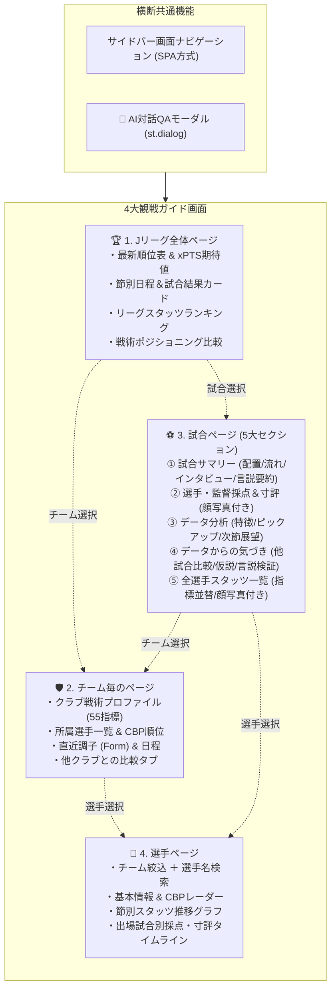
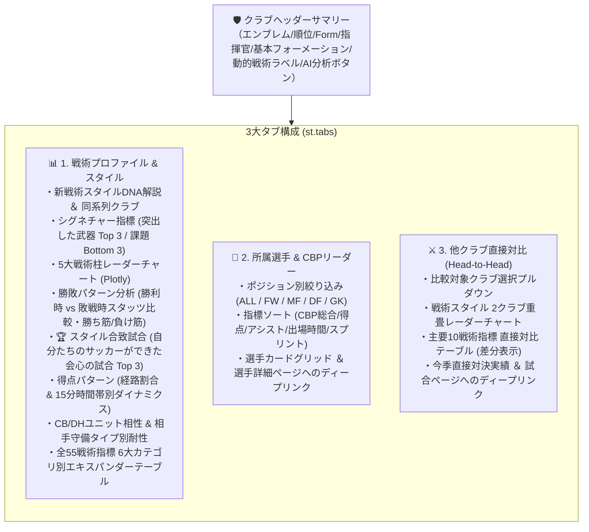

# Jリーグ観戦ガイド UI/UX再編仕様書 (Watching Guide UI Specification)

本書は、Jリーグ戦術分析・観戦ガイドRAGプラットフォームにおける画面構成の刷新、および全4画面（全体・チーム・試合・選手）と横断機能（AI対話モーダル）の機能仕様・UI設計を定義する公式仕様書です。

---

## 1. 画面構成アーキテクチャ概要

従来の単一試合ダッシュボード（`app.py`）から、以下の4つの専用ビューへの再編およびシームレスな相互リンク（ディープリンク）を実現します。



---

## 2. 横断共通機能仕様

### 2.1 ナビゲーション方式（SPA方式）
- **サイドバー切り替え**: `st.sidebar.radio` または `st.segmented_control` による画面切り替え。
- **ディープリンク連携**: `st.session_state` を活用し、全体ページやチームページから試合カードや選手名をクリックした際に、該当ページに対象IDを渡して即時ジャンプ。

### 2.2 どこでもAI対話QA（セクション連動モーダル）
- **起動トリガー**: 各ページの各セクション右上にある「🤖 AIに質問」ボタン。
- **UIコンポーネント**: `st.dialog` を用いたモーダルウィンドウ。
- **コンテキスト引き継ぎ**: 閲覧中のセクション文脈（試合ID、対象チーム、注目指標など）を自動でプロンプトの初期コンテキストとして注入。

---

## 3. 各画面の詳細仕様

### 3.1 🏆 Jリーグ全体ページ (League Overview) - `views/league_view.py`
縦スクロール1画面方式により、リーグ全体の戦況・期待値・全節カード・リーダーボード・戦術分布を一望できる画面構成です。

1. **最新順位表 & 期待値 (xPTS / xG / xGA)**
   - **全20クラブのカード一覧形式**: 1行2列のグリッドで各クラブの順位カードを展開。
   - **公式エンブレム表示**: 各クラブカードの左上に公式SVGエンブレム（38px×38px、ドロップシャドウ付き）を表示。
   - **表示指標**: 順位メダル/順位番号、クラブ名、消化試合数、勝分敗、実勝点（PTS）、得失点差（GD）、ポアソン期待勝点（xPTS）、運指数（Luck Index = 勝点 - xPTS）、直近5試合の戦績バッジ（Form: 🟢勝 / ⚪分 / 🔴負）。
   - **ディープリンク遷移**: 「クラブ詳細 ❯」ボタンクリックで `navigate_to(VIEW_TEAM, team_id=...)` を発火し、対象クラブの55指標プロファイルへ遷移。
   - **AI対話連携**: セクション右上の「🤖 順位表をAI分析」ボタンから、順位・xPTS文脈を注入したAI対話モーダルを起動。

2. **節別日程・全節試合カード**
   - **節セレクター**: `st.selectbox` による第1節〜第38節の切り替え（デフォルトは最新消化節を自動選択）。
   - **横2列の試合カードグリッド**: 対戦カード、開催日、スタジアム、実スコア、両軍ゴール期待値（xG: `h_xg` - `a_xg`）。
   - **外部ダイレクトリンク**: YouTubeハイライト動画検索リンク、Jリーグ公式戦評リンク。
   - **ディープリンク遷移**: 「試合詳細 ❯」ボタンクリックで `navigate_to(VIEW_MATCH, match_id=...)` を発火し、該当試合の5大セクション分析へジャンプ。
   - **AI対話連携**: 「🤖 日程カードをAI分析」ボタンを配置。

3. **リーグスタッツランキング (Top 5 リーダーボード)**
   - **ピル・タブ切り替え**: 「🛡️ チーム部門ランキング」と「👤 個人部門ランキング」をタブでスムーズに切り替え。
   - **チーム部門**: 平均ボール保持率 (%)、チャンス構築率 (%)、平均総走行距離 (km/試合)、平均スプリント数 (回/試合)。
   - **個人部門**: 得点ランキング、アシストランキング、CBP（チャンスビルディングポイント）総合リーダー、スプリント回数リーダー。
   - **ディープリンク遷移**: 個人ランキングの「詳細」ボタンから `navigate_to(VIEW_PLAYER, player_id=...)` を発火し、選手名鑑画面へジャンプ。
   - **AI対話連携**: 「🤖 スタッツをAI分析」ボタンを配置。

4. **戦術ポジショニング比較マップ (4象限 Plotly 散布図)**
   - **全クラブ公式エンブレム重畳表示**: 散布図上の各プロット（ドット）を各クラブの正式エンブレム画像（透過PNG/公式SVG）に置き換え、一目で各クラブの位置関係を把握可能。
   - **比較軸プリセット切り替え**:
     - ① 🎯 戦術スタイル: 横軸「ボール保持率 (%)」× 縦軸「プレッシング奪取 (平均CBP奪取 pt)」
     - ② ⚔️ 攻守期待値: 横軸「攻撃期待値 (1試合平均xG)」× 縦軸「守備被期待値 (1試合平均xGA)」
     - ③ ⚡ フィジカル強度: 横軸「チーム総走行距離 (km)」× 縦軸「チーム総スプリント回数 (回)」
   - **リーグ平均十字線**: X軸・Y軸それぞれのリーグ平均値に破線を自動描画し、4つの戦術象限（例: 支配ハイプレス型、速攻ハイプレス型、ポジショナルブロック型、リトリートカウンター型）のラベルを配置。
   - **インタラクティブホバー & ジャンプ**: 各プロット点にクラブ短縮名と順位を表示。下部のクラブ選択プルダウンから即座に対象クラブ詳細へ遷移可能。
   - **AI対話連携**: 「🤖 戦術マップをAI分析」ボタンを配置。

5. **パフォーマンス設計 (データキャッシュ)**
   - `pipeline/league_overview_data.py` の全集計関数に `@st.cache_data(ttl=600)`（TTL 10分）を適用し、大規模データ読み込み時のレンダリング遅延をゼロ化。

---

### 3.2 🛡️ チーム毎のページ (Team Profile & Analytics) - `views/team_view.py`
J1全20クラブの戦術DNA、多変量クラスタ分析による新しい戦術スタイルラベリング、シグネチャー指標、勝敗パターン解剖、スタイル体現度、所属選手CBP、他クラブ直接対比を提供する3タブ構成の専門分析画面です。



#### 1. クラブセレクター & ヘッダーサマリー
- **セレクター**: `st.selectbox` によるJ1全20クラブ切り替え（`st.session_state["selected_team_id"]` と完全連動）。
- **公式エンブレム表示**: ヘッダー左上に各クラブの公式ベクターエンブレム（SVG、幅82px、ドロップシャドウ付き）を堂々表示。
- **クラブメタ情報**: クラブ名称、J1現順位（実勝点）、現監督名、基本フォーメーション（`base_formation`）。
- **動的戦術分類ラベル**: 20クラブの多変量スタッツから動的導出された新戦術スタイルバッジ（例: `ハイライン・空間制圧ポゼッション型`、`高強度ダイレクト・ショートカウンター型`、`低重心ブロック・ロングカウンター迎撃型` など）。
- **直近戦績 (Form)**: 直近5試合の戦績バッジ（🟢勝 / ⚪分 / 🔴負）。
- **セクション連動AI分析**: 右上の「🤖 このクラブをAI分析」ボタンから、クラブ戦術コンテキストを注入したAI対話モーダルを起動。

#### 2. タブ1: 📊 戦術プロファイル & スタイル
1. **戦術DNA解説 ＆ シグネチャー指標**:
   - 所属クラスタの戦術DNA解説文と、同系列スタイルの他クラブ名を表示。
   - **突出した武器 (Top 3 強み)**: リーグ平均・標準偏差から Z-score が最も高い指標カード（チーム平均、リーグ平均、リーグ順位、σ乖離）。
   - **顕著な割り切り・課題 (Bottom 3 特徴)**: 意図的に捨てている戦術的割り切りや攻略されやすい弱点指標カード。
2. **5大戦術柱 レーダーチャート (Plotly)**:
   - ポゼッション支配力、前進・推進突破力、ハイプレス即時奪取、フィジカル走力強度、ゴール期待創出度の0〜100正規化スコアを描画。J1基準線（50pt破線）との乖離を一目で把握。
3. **勝敗パターン分析（勝ち筋・負け筋の解剖）**:
   - 勝利試合 vs 敗戦試合でのスタッツギャップ（ボール支配率、xG、PA進入数、PA変換率、PPDA、BPI、ブロック守備力など）を対比。
   - 客観データに基づく「勝ちやすい試合展開（勝ち筋）」と「負けやすい試合展開（負け筋・攻略要因）」を自動抽出・文章化。
4. **🏆 「自分たちのサッカーができた」会心の試合 Top 3**:
   - クラブの戦術スタイル特性（ポゼッション型/速攻型/迎撃型など）に合致した指標を達成できた試合を「スタイル体現度スコア（0〜100pt）」として算出。
   - 会心の試合Top 3カードに体現理由を表示し、「⚽ 試合詳細を観る ❯」ボタンから試合詳細ページへダイレクト遷移。
5. **得点パターン & 15分時間帯別ダイナミクス**:
   - ゴール創出経路（中央崩し、クロス、ショートカウンター、セットプレー、個人技）の比率プログレスバー。
   - 15分ごとの得点・失点数を Plotly グループバーで可視化。
6. **スタメンユニット相性 & 相手戦術タイプ別耐性**:
   - CBペア、DHペアごとの出場試合数、勝率、xPTS、コンパクトネス（凸包面積）。
   - 相手守備アーキタイプ（ハイプレス型、ミドルブロック型、低重心ブロック型）に対する勝率、xPTS、前進力（BPI）。
7. **全55戦術指標 完全データ (6大カテゴリ)**:
   - 6つのカテゴリ（ポゼッション、チャンス創出、守備、フィジカル、勝敗・期待値、陣形・セットプレー）に分類したアコーディオン（`st.expander`）形式でシーズン平均値、直近節値、リーグ平均値を網羅。

#### 3. タブ2: 👤 所属選手 & CBPリーダー
- **ポジション別絞り込み**: ラジオボタン（`ALL`, `FW`, `MF`, `DF`, `GK`）。
- **指標動的ソート**: CBP総合ポイント順、得点数順、アシスト数順、総出場時間順、スプリント回数順。
- **選手カードグリッド (2列レイアウト)**:
  - **公式顔写真表示**: 公式高解像度WebP（幅約145px、丸角カード・ドロップシャドウ付き）による大迫力表示。
  - **選手名 & よみがな**: 漢字選手には長音・拗音補正対応の平仮名ふりがな（`romaji_to_hiragana` 自動復元エンジン）＋英語表記（例: `よみがな: こう たかひろ (KO Takahiro)`、`ときわ きょうた (TOKIWA Kyota)`、`たわらつみだ こうた (TAWARATSUMIDA Kota)` 等）、外国籍カタカナ選手には英語表記を表示。
  - **名寄せ・重複防止**: DB正規化および集計エンジンのグルーピング強化により、同一選手の重複表示を完全排除。
  - **スタッツ情報**: 背番号、ポジション、出場試合・時間、ゴール、アシスト、CBP総合、スプリント回数を一覧表示。
- **ディープリンク連携**: 「👤 選手詳細を見る ❯」ボタンクリックで `navigate_to(VIEW_PLAYER, team_id=..., player_id=..., player_name=...)` を発火し、選手名鑑画面へ即座にジャンプ。

#### 4. タブ3: ⚔️ 他クラブ直接対比 (Head-to-Head)
- **対戦・比較対象クラブ選択**: 自身以外の19クラブから選択可能。
- **クラブエンブレム対比バナー**: 自クラブ（青）と相手クラブ（橙）の公式SVGエンブレムを左右に並べたVSバナーを表示。
- **戦術スタイル 2クラブ重畳レーダーチャート**: 自クラブ（青）と比較クラブ（橙）の5大戦術柱を重ね合わせ、スタイルの差異を直感的に可視化。
- **主要10戦術指標 直接対比テーブル**: 支配率、xG、PA進入数、PA変換率、PPDA、BPI、クロス依存度、スプリント数、凸包面積、xPTSの数値を比較し、差分を一覧化。
- **今季直接対決実績**: 2026シーズンの直接対戦カード（日程、スタジアム、スコア）を表示し、「⚽ この試合の5大セクション分析を見る ❯」ボタンから該当試合ページへジャンプ。

#### 5. パフォーマンス設計 (データキャッシュ)
- `pipeline/team_analytics_engine.py` の全集計・クラスタリング・比較関数に `@st.cache_data(ttl=600)` を適用し、大規模データの高速オンメモリキャッシュ化を実現。

---

### 3.3 ⚽ 試合ページ (Match Deep Dive)
従来の9タブを以下の**5つの洗練されたセクション**に再編・統合します。

#### ① 試合サマリー（表示トップ）
- **試合基本情報**: スコア、日時、スタジアム、天候、観客数。
- **公式・外部ダイレクトリンク**: YouTubeハイライト、Jリーグ公式戦評、各クラブ公式、Yahoo速報、Football LAB。
- **試合サマリー**: 試合全体の戦況要約。
- **スタメン配置 & 時間帯別配置の切り替え**: フォーメーションボード（交代後の変化対応）。
- **試合の流れ**: 得点、交代、決定機等のキープレイ・イベントタイムライン。
- **選手・監督インタビューの要約**: 当事者の肉声・コメントの要点まとめ。
- **主要レビューサイト・チャンネルの言説要約**: ネット上の主要な分析言説のまとめ。

#### ② 選手／監督採点 & 寸評
- **顔写真付き**の選手・監督採点カード（10点満点評価）。
- 客観スタッツ（シュート、パス成功率、CBP、奪取数）に基づく寸評。
- MOM（マン・オブ・ザ・マッチ）選出。

#### ③ データ分析
- **主要データからみた試合サマリー**: シュート数、xG、支配率、パス本数等の定量まとめ。
- **指標から読み取れる試合の特徴**: 各チームの観点で3つずつ抽出。
- **特徴的な指標データのピックアップと解説**: 数字とグラフ（バー・レーダー）を活用した深掘り。
- **次節の各チームの展望**: 本試合の課題と次節に向けた戦術的ポイント。

#### ④ データからの気づき
- **他試合・他チーム比較**: リーグ平均やシーズン平均と乖離の大きい特異指標のピックアップと解釈。
- **多変量データ集計による想定仮説**: 各チーム3つずつの戦術的仮説。
- **レビューサイト・言説の妥当性評価**: ネットやメディアで語られている言説を客観データと照らし合わせたファクトチェック。

#### ⑤ 全選手のスタッツ一覧
- **顔写真付き**の選手スタッツテーブル。
- シュート、パス、CBP、奪取、タックル、走行距離など、**指定した指標順での動的ソート**が可能。

---

### 3.4 👤 選手ページ (Player Profile & Analytics)
1. **選手選択 & 検索**
   - 所属チーム絞り込み ＋ 選手名インクリメンタル検索。
2. **選手基本情報**
   - 顔写真、背番号、ポジション、年齢、利き足、出場試合数、総出場時間、得点、アシスト、警告数。
3. **CBPレーダーチャート & スタイル特性**
   - 同一ポジション平均との比較レーダー（シュート、パス、ドリブル、クロス、奪取、守備）。
4. **節別スタッツ推移グラフ**
   - 節ごとの出場時間、CBP、走行距離等の推移折れ線グラフ。
5. **出場試合履歴 & 試合別採点・寸評タイムライン**
   - 出場試合ごとの採点（Rating）および寸評、関与した重要プレイ。
   - 試合名クリックで該当「試合ページ」へ遷移。

---

## 4. ディレクトリ構成とモジュール設計

```text
football_rag/
├── app.py                     # メインエントリー（認証、サイドバーナビゲーション、ルーティング）
├── views/                     # 画面別モジュール
│   ├── league_view.py         # 1. Jリーグ全体ページ
│   ├── team_view.py           # 2. チーム毎のページ
│   ├── match_view.py          # 3. 試合ページ (5大セクション)
│   ├── player_view.py         # 4. 選手ページ
│   └── components/            # 画面共通コンポーネント
│       ├── ai_modal.py        # どこでもAI対話QAモーダル (st.dialog)
│       ├── player_card.py     # 顔写真付き選手カード
│       └── formation_board.py # フォーメーション・ピッチ描画
├── docs/
│   └── WATCHING_GUIDE_UI_SPECIFICATION.md # 本仕様書
└── tests/
    ├── test_views_navigation.py
    ├── test_match_view.py
    ├── test_league_view.py
    ├── test_team_view.py
    └── test_player_view.py
```

---

## 5. 実装ロードマップ（5段階ステップ）

- **【Step 1】 ナビゲーション基盤 & AI対話モーダル & 共通モジュール分離**
  - サイドバー切替（全体/チーム/試合/選手）とディープリンク基盤
  - 共通AI対話ダイアログ（`st.dialog`）の実装
- **【Step 2】 ⚽ 新「試合ページ」の5セクション実装 & テスト**
  - ご指定いただいた5つのセクション（サマリー/採点/データ分析/気づき/全選手スタッツ）を実装
- **【Step 3】 🏆 「Jリーグ全体ページ」の実装 & テスト**
  - 順位表・xPTS、日程結果、個人・チームランキング、戦術比較
- **【Step 4】 🛡️ 「チーム毎のページ」の実装 & テスト (完了)**
  - クラブ戦術プロファイル（55戦術指標・動的クラスタ分類・新戦術スタイルラベリング）
  - シグネチャー指標（突出強み Top 3 & 課題 Bottom 3）
  - 勝敗パターン分析（勝ち筋・負け筋の定量的解剖）
  - 🏆 スタイル合致試合（自分たちのサッカーができた会心の試合 Top 3 & ディープリンク）
  - 所属選手一覧（ポジションフィルタ・CBP動的ソート・選手詳細リンク）
  - 他クラブ直接対比（2クラブ重畳レーダー・主要10指標対比・直接対戦カード）
- **【Step 5】 👤 「選手ページ」の実装 & テスト (次期ステップ)**
  - チーム絞込 ＋ 選手名インクリメンタル検索
  - 選手基本情報 ＆ CBPレーダーチャート
  - 節別スタッツ推移グラフ
  - 出場試合別採点・寸評タイムライン ＆ 試合詳細リンク

