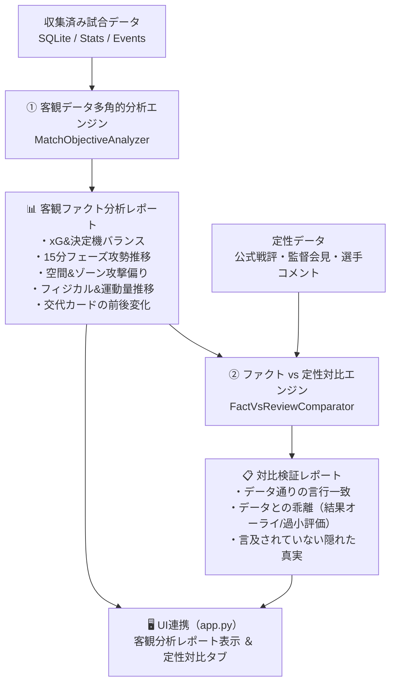

ご指示ありがとうございます！
「9つの問い」という高度な推論へ進む前に、**「収集した試合データから直接的に試合の特徴を多角的に分析・抽出し、客観的レポートとして提示した上で、レビュー記事・監督・選手コメントと対比する」** アプローチは、RAGの信頼性と分析の説得力を高める上で極めて本質的です。

実装に着手する前に、**設計案** と **効率的なステップ分け** を簡潔に提示いたします。

---

## 📐 設計案：客観データ多角的分析 ＆ 定性言説対比システム

### 1. 抽出する多角的客観特徴（5つの軸）
1. **戦力収支・決定機バランス**: 実得点 vs xG、ビッグチャンス数、枠内シュート効率
2. **15分フェーズ攻勢推移（モメンタム）**: どちらの時間帯にシュート・xGが偏ったか（前半立ち上がり／後半勝負所など）
3. **空間・攻撃ゾーンの偏り**: 左・中央・右、バイタル侵入、ペナルティエリア内侵入の偏重
4. **フィジカル・運動量**: 総走行距離、スプリント回数、前後半の走行量減衰
5. **交代カードの即時影響**: 交代投入前後のシュート数・被シュート数の変化

### 2. レビュー記事・コメントとの対比軸
* **【言行一致（整合）】**: 監督・選手が語った「狙い」「手応え」が客観スタッツにも表れていたか
* **【認識の乖離（ギャップ）】**: 「押し込まれた」と語るが被xGは低かった（安全な位置で持たせていただけ）等、感覚と数値のズレ
* **【見落とされたファクト】**: 会見や記事では触れられていないが、データ上決定打となっていた要因（特定交代後の急減など）

---

## 🗂️ 実装ステップのご提案

* **ステップ1: 客観多角分析モジュール (`agent/objective_analyzer.py`) の実装**
  * SQLiteのスタッツ・イベントから上記5軸の特徴量を自動抽出し、構造化レポート（辞書および見やすいMarkdown）を生成するクラスを実装。
* **ステップ2: ファクト vs レビュー対比エンジン (`agent/review_comparator.py`) の実装**
  * 抽出した客観ファクトと、公式戦評・監督・選手インタビューを突き合わせ、対比サマリー（AI推論またはルールベース突合）を生成。
* **ステップ3: テストコードの作成 (`tests/test_objective_analyzer.py`)**
  * モックDBデータを用いて、多角分析レポートおよび定性対比が正しく抽出・整形されることを単体テストで検証。
* **ステップ4: UI連携 (`app.py`)**
  * ダッシュボード上に「📊 客観データ分析レポート」と「⚖️ ファクト vs コメント対比」の専用ビュー/タブを追加し、見やすく可視化。

---

この設計案とステップ分けで進めてよろしいでしょうか？
ご確認いただけましたら、ステップ1から順次実装とテストを進めてまいります。