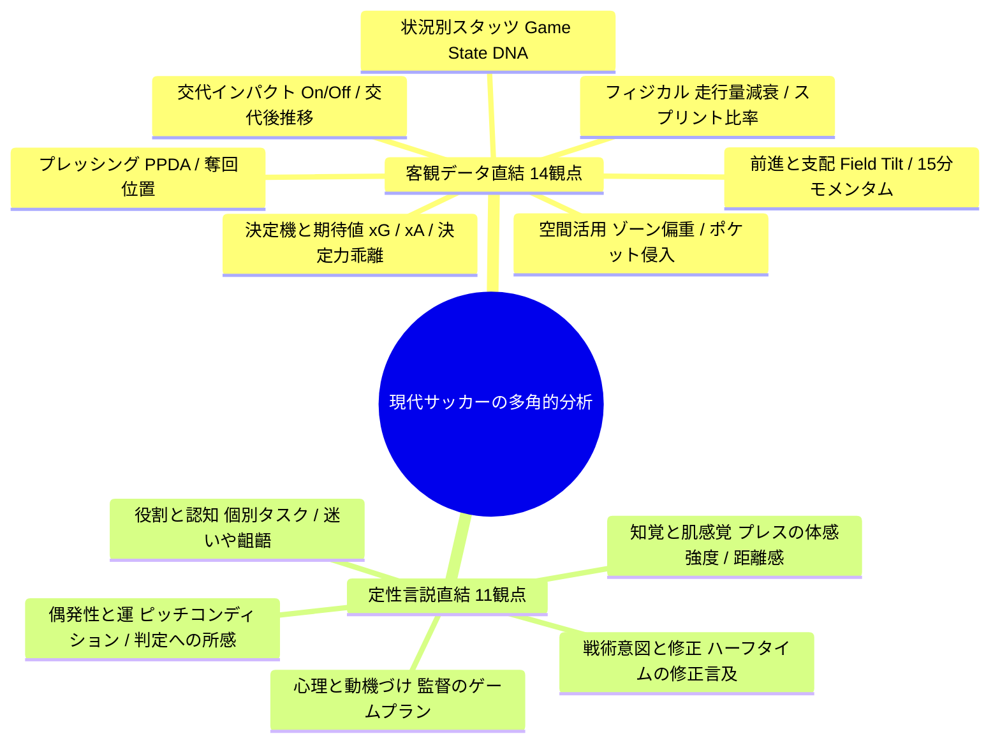

現代フットボールの著名な戦術理論、戦略家（グアルディオラ、ラングニック、デ・ゼルビ、ビエルサ、ナーゲルスマン等）、先端アナリティクス論文（MIT Sloan、StatsBomb、Opta）、および戦術分析メディア（Tifo Football、The Athletic、各種YouTubeアナリスト等）の知見を結集し、**25の多角的多角的分析観点** を体系化しました。

これらを、**「① 今回収集した客観データから直接算出・定量化できる観点」** と **「② レビュー記事・監督会見・選手コメント等の定性情報と強く結びつく観点」** に分類して提示します。

---

# ⚽ サッカー多角的分析の25の観点

---

## Part 1: 今回収集した客観データと直接関連付けられる観点（14観点）

収集済みのSQLiteデータ（J公式、Sofascore、Football LAB、SPAIAのスタッツ・イベント座標・前後半/15分フェーズ別数値）から直接算出・可視化できる観点です。

| # | 分析観点 | 理論的背景・提唱元 | データ分析としての本質 | 主な利用データ項目 |
|---|---|---|---|---|
| 1 | **実力と運の切り分け（xG乖離）** | アナリティクス論文（Garry Gelade他） | ゴール数とxG（ゴール期待値）の差分から、偶発的な上振れ/下振れか、本質的なチャンス創出力かを判定 | 得点数, xG, xg_goal_diff, シュート数 |
| 2 | **敵陣支配度（Field Tilt）** | Opta / The Athletic | 単なるポゼッション率（自陣パス回し）を排し、アタッキングサード（相手陣内30m）でのパス・タッチ占有率で真の攻勢度を評価 | 敵陣パス成功率, ファイナルサードパス数, AGI（攻撃の勢い） |
| 3 | **プレッシング強度（擬似PPDA）** | Colin Trainor（StatsBomb） | 相手のパス試行数に対するこちらの守備アクション（タックル・ファウル・パスカット）の頻度から、ハイプレスの実質圧力を定量化 | 被パス数, タックル数, インターセプト, ファウル数 |
| 4 | **15分フェーズ攻勢推移（モメンタム波）** | Football LAB / Tifo Football | 試合を6つの時間帯（0-15, 16-30, 31-45, 46-60, 61-75, 76-90+）に分割し、どちらが主導権を握っていたかの波を可視化 | 15分刻みポゼッション, 時間帯別シュート/被シュート, xG推移 |
| 5 | **スコア状況別DNA（Game State）** | MIT Sloan論文 / Howard Hamilton | 同点（DRAW）・リード時（LEADING）・ビハインド時（TRAILING）で、チームのラインの高さや攻撃意欲がどう激変するかを診断 | `game_state`別スタッツ（ポゼッション, xG, 平均ライン） |
| 6 | **空間の偏りとボトルネック（5レーン分析）** | グアルディオラ（Martí Perarnau『教本』） | ピッチの横幅（左大外/左HS/中央/右HS/右大外）のどこから侵入しているかをシュート・ラストパスの発生座標`(x,y)`から抽出 | イベント座標`(coord_x, coord_y)`, zone_name |
| 7 | **ポケット（ハーフスペース深部）侵入度** | ユリアン・ナーゲルスマン | ペナルティエリア脇（ニアゾーン/ポケット）の最重要エリアに何回侵入できたかをイベント位置から抽出 | PA脇座標でのパス・クロス・シュートイベント数 |
| 8 | **フィジカル減衰曲線（インテンシティ）** | マルセロ・ビエルサ / 運動生理学 | 前半と後半での走行距離（km）およびスプリント回数（時速24km以上）の低下率を測定し、プレスの持続力を評価 | 前後半別走行距離, スプリント数 |
| 9 | **実質フォーメーションと重心（平均立ち位置）** | Sofascore / StatsPerform | 登録上の布陣（例: 4-4-2）ではなく、ピッチ上の全選手の平均座標 `(avg_x, avg_y)` から「実質的な陣形」とチーム全体の重心の高さを算出 | 各選手の `avg_x`, `avg_y`, タッチ数 |
| 10 | **ビルドアップ脱出効率 vs ロスト危険度** | ロベルト・デ・ゼルビ | 自陣深い位置（自陣33%）でのボールロスト頻度と、そこから相手のプレッシャーを掻い潜って前進できた割合 | 自陣被奪回イベント, ミドルサード到達率 |
| 11 | **トランジション速度（ラングニックの3秒/8秒則）** | ラルフ・ラングニック（レッドブル流） | ボール奪取からシュートに至るまでの経過秒数・パス本数（カウンターの鋭さ） | イベント発生時間, `situation: COUNTER` のxG |
| 12 | **交代カードの即時インパクト（On/Off）** | 現代サッカーの5人交代制研究 | ベンチメンバーが投入された前後（例: 60分以降）で、チームのシュート頻度・被xG・走行量がどう跳ね上がったか | 交代イベント（minute）, 出場時間帯別チームスタッツ |
| 13 | **縦・横ユニットの距離感（ケミストリー）** | イタリア戦術論（マッシミリアーノ・アッレグリ） | CB間、ボランチ2枚、縦の2トップ等の平均座標間のユーグリッド距離を測定し、コンパクトネスと連動性を評価 | ペア選手の `avg_distance`, 同時出場スタッツ |
| 14 | **セットプレー依存度 vs オープンプレー効率** | ニコラス・ジョバー（アーセナル専任コーチ） | 総得点・総xGのうち、セットプレー（CK, FK, スローイン）由来とオープンプレー由来の比率を切り分け | `situation: SET_PIECE / OPEN_PLAY`, セットプレーシュート比率 |

---

## Part 2: 定性的な情報（戦評・会見・コメント）と強く結びつく観点（11観点）

監督会見、選手インタビュー、クラブ公式マッチレポートなどのテキストから読み解き、客観データと突合・検証すべき観点です。

| # | 分析観点 | 理論的背景・提唱元 | 定性情報としての本質 | 対比・検証のポイント（データ vs 言説） |
|---|---|---|---|---|
| 15 | **試合前のゲームプランと意図された非対称性** | 書籍『モダンサッカーの教科書』 | 監督が試合前に相手の弱点をどう見定め、あえてどのサイドを攻めさせ、どこで奪う罠を仕掛けていたか | 会見の「狙い通り」発言 vs 実際の奪取エリア・攻撃ゾーン |
| 16 | **ハーフタイムの戦術修正（アジャストメント）** | 名将たちのハーフタイム論 | 後半開始時に、立ち位置（配置）、マークの受け渡し、プレスの開始位置をどう指示してピッチに戻したか | 監督のハーフタイム修正コメント vs 後半開始15分（46-60分）のスタッツ好転度 |
| 17 | **ピッチ上の肌感覚・プレス強度の体感** | 選手インタビュー（ボランチ・CBの証言） | スタッツには表れにくい「相手の出足の速さ」「パスコースが消されていた感覚」「間合いの詰められ方」 | 選手の「相手のプレスが速くて蹴らされた」 vs 敵陣パス成功率・パス方向 |
| 18 | **守備のスイッチとトリガーの合意度** | レナート・バルディ（元イタリア代表分析） | チーム全体で「相手の誰がボールを持った瞬間」「バックパスが出た瞬間」に連動できていたか、それとも単騎プレスだったか | 選手の「プレスが連動しなかった」 vs 走行距離・インターセプト数 |
| 19 | **感情・メンタルモメンタム（失点直後の動揺）** | メンタルトレーニング論 / YouTube分析 | 先制・被先制直後の5分間に見られる、チーム全体の浮き足立ちや意気消沈 | 監督の「先制直後に集中が切れた」 vs 直後5分間の被シュート・ファウル頻度 |
| 20 | **ピン留めとスペースメイクの自己犠牲（黒子の働き）** | グアルディオラ / Tifo Football | ボールに触れていない選手が、相手CBを2枚引き連れて走ることで、味方にどれだけのフリーなスペースを創出したか | 選手の「自分が引きつけて裏を空けた」 vs 相棒のバイタルエリア侵入回数 |
| 21 | **判断の迷いと戦術的不協和（タスク過多）** | クラブ公式戦評・番記者レポート | 新システム導入時やポジション変更時に生じる、選手間のプレッシングやマーク受け渡しの迷い・ギャップ | 戦評の「守備のズレを突かれた」 vs 被ビッグチャンス・被xG |
| 22 | **ベンチワークのメッセージ（交代カードの意図）** | カルロ・アンチェロッティ | 交代選手を投入する際、監督が「追加点を奪え」と伝えたのか「守り切れ」と伝えたのか、その采配意図 | 監督の「流れを変えたかった」 vs 交代選手のロール（プレースタイル）と交代後の展開 |
| 23 | **相手の対策・研究への気付き（戦術の賞味期限）** | 戦術進化論 | 「開幕当初は通用していたが、相手に縦パスを消されるようになった」という選手たちの実感 | 相手監督の「相手の左サイドを警戒していた」 vs 自チームのパス成功率推移 |
| 24 | **ピッチコンディション・天候への適応** | Jリーグ現場知見 | 雨天のスリッピーなピッチ、強風、芝の重さによるプレー選択（ロングボール志向、ミス警戒）の変化 | 監督・選手のピッチ言及 vs ロングボール比率、パス成功率 |
| 25 | **判定・VAR・不運に対する主観的受け止め** | メディア戦評・監督コメント | オフサイド判定やPK判定、偶発的なディフレクションに対する「判定への不満」や「運がなかった」という言い訳 | 監督の「不運な判定」 vs 実質xGバランス（判定抜きでも劣勢だったかの検証） |

---

## 🎯 今回の分析システムにおける活用アプローチ

この25の観点を踏まえ、次の2段階でシステムに組み込むことを提案いたします。

1. **第1段階：客観データ多角分析レポート（Part 1の観点群を自動抽出）**
   * 試合を選択すると、Part 1の14観点の中から特に試合の決定打となった特徴（**xG乖離、15分フェーズの波、攻撃ゾーンの偏り、Game State別の豹変、交代前後の変化、フィジカル減衰**）を自動抽出し、**「客観データが語る試合の真実レポート」** として整理・出力します。
2. **第2段階：定性言説との対比検証（Part 2の観点群で突合）**
   * その客観レポートと、公式戦評・監督会見・選手コメントを並べ、**「監督・選手の認識（言説）と客観データ（ファクト）の一致・乖離」** を自動診断します。

この観点構成とアプローチで進めてよろしいでしょうか？
ご意見や特に重点を置きたい観点がございましたら、お知らせください！